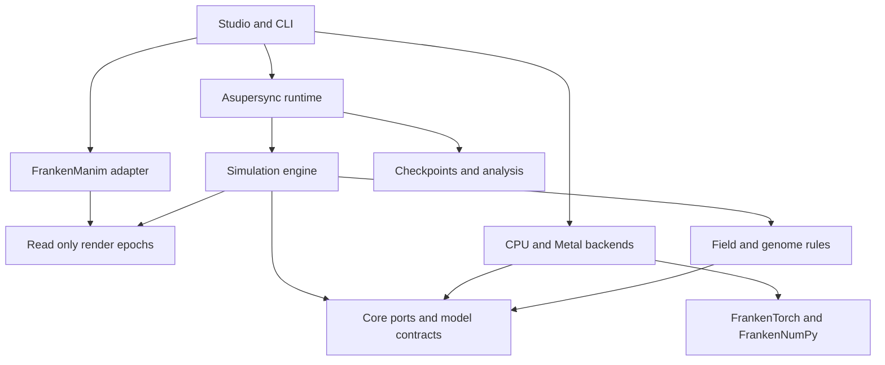

# Comprehensive Plan for the Design of FrankenLife

**FrankenLife** is a real-time artificial-life laboratory in memory-safe Rust: hundreds of thousands of continuously positioned organisms, each with its own heritable neural controller and chemistry, exchanging energy and information through a shared field. Its live visual language is a dark microscopic world of luminous particles, moving boundaries, colonies, filaments, vortices, and changing ecological relationships. Its animation and presentation system is built on FrankenManim; its execution substrate is Asupersync, FrankenTorch, and FrankenNumPy.

| Document field | Value |
|---|---|
| Proposed repository | `frankenlife` |
| Rust crate prefix | `flife-` |
| Proposed binaries | `flife`, `flife-studio`, later `flifed` |
| Document version | 0.2 — revised after independent mathematical, systems, and integration audit |
| Date | November 7, 2026 |
| Status | Design specification and implementation plan |
| Primary inspiration | The four supplied screenshots of Fraser Price's Neural-Kimchi-4B and its explanation |
| Planning reference | FrankenMining's comprehensive design plan [S1] |
| Required stack | Rust; Asupersync; FrankenTorch; FrankenNumPy; FrankenManim |
| Intended initial platforms | Native Apple Silicon and Linux CPU; other acceleration and browser profiles follow qualified implementations |

**Status convention.** Unless marked **Observed**, descriptions of FrankenLife are proposed designs, not existing software. **Derived** quantities are calculations from stated assumptions. **Target** quantities are acceptance criteria, not benchmark results. **Hypothesis** identifies an empirical question. Source-code observations concern inspected revisions, not a guarantee that every advertised upstream feature works. This document specifies the project; it does not claim that FrankenLife has already been implemented or that the screenshot's behavior has been reproduced.

## Executive design

Build the project around one useful vertical slice: **a genuinely evolving field-mediated ecology that can be watched, paused, inspected, perturbed, resumed, and recorded in real time**. The live world, its scientific history, and its animation must be three views of the same underlying state.

The first authoritative model, **FieldEcologyV1**, makes every organism an independent neural genome with continuous position, velocity, internal energy, mutable chemical response, and heritable sensing scale. Organisms absorb local energy-bearing field material, react to its composition, emit new material at an energy cost, and split into mutated descendants. There are no direct pairwise attraction tables, collision forces, or global reward functions in this baseline.

The main numerical decision is to represent field energy explicitly. Each grid cell holds a nonnegative resource amount `e` and a 32-component signed chemical moment `m`, with `||m||₂ ≤ e`. This adds one scalar energy plane to the 32-component visual reference. It preserves an expressive signed chemical signature while preventing cancellation of opposing signals from destroying or manufacturing spendable energy.

The main performance decision is to **batch execution without sharing neural weights**. A default `104 → 64 → 32 → 36` multilayer perceptron has 9,988 parameters. Four hundred thousand such controllers have about four billion parameters. Organisms with the same topology share a kernel implementation and packed layout; each retains its own weights, mutations, ancestry, and decisions.

The main presentation decision is to extend and integrate FrankenManim with **bulk particle and field primitives**. The world is rendered as a small number of batched objects, not hundreds of thousands of independently managed vector objects. FrankenManim remains responsible for scene composition, cameras, timelines, annotations, transitions, and export.

The main scientific decision is to keep four claims separate: the simulation obeys its rules; the implementation reproduces those rules; the images meet the desired visual character; and populations exhibit measurable evolutionary phenomena. A beautiful image establishes only the third.

## Contents

1. Reference interpretation and project goals
2. Product experience and visual requirements
3. Required stack and dependency boundaries
4. Mathematical world model
5. Energy, chemistry, and field exchange
6. Sensing and neural controllers
7. Genomes, mutation, reproduction, and death
8. Authoritative timestep
9. Data layout and memory ownership
10. Neural execution and accelerator design
11. Field kernels and deterministic reduction
12. Asupersync runtime and control protocol
13. FrankenManim animation and rendering
14. Studio, inspection, and interventions
15. Experiments and evidence of emergence
16. Reproducibility, checkpoints, and storage
17. Modular extension contracts
18. Workspace and API boundaries
19. Performance model and operating profiles
20. Platforms and distribution
21. Verification and acceptance gates
22. Implementation milestones
23. Implementation backlog and dependency graph
24. Failure modes and decision rules
25. Advanced research directions
26. Architectural decisions and immediate implementation order
27. Source register
28. Appendices: configuration, artifact schemas, fixtures, and handoff

# 1. Reference interpretation and project goals

## 1.1 What the supplied images establish

**Observed from the supplied screenshots, not independently benchmarked:**

| Reference element | FrankenLife interpretation |
|---|---|
| Roughly 400,000 visible particles | A target operating scale, with smaller qualified profiles for ordinary machines |
| Each particle has a distinct, untrained, randomly mutated neural network | Independent heritable neural parameters; no gradient training in the baseline ecology |
| Approximately 10,000 parameters on average, with architectures around 1,000–30,000 | A compact architecture catalog that permits meaningful size variation and later generalization |
| Continuous positions over a roughly 1,000 × 1,000 × 32 field tensor | Continuous organism coordinates and a sampled multidimensional spatial medium |
| Particles interact through the field rather than directly | Field-only interaction is a defining model invariant |
| Field reads include values and gradients at evolved ranges | Heritable sensing scale and a fixed, documented sensor encoding |
| Chemistry can feed, poison, push, or pull different particles differently | A bounded genotype-dependent metabolic and motility response |
| Energy is spent on behavior; zero energy means death | Explicit budgets and finite resource allocation |
| Background input comes from shifting Gaussian sources | A seeded, continuously varying external energy environment |
| Neural outputs control splitting, child energy, emission, emission direction, and expenditure | A matching controller output contract |
| Children inherit mutated chemistry, architecture, and weights | Endogenous ecological selection over both body rules and controllers |
| Multicolored filaments, hollow boundaries, dense clusters, and interacting structures | Visual and ecological targets to test, not shapes to paint into the simulation |

The visible overlays include a population near 400,000, a requested step rate of 128, displayed achieved step rates around 65–82, and a requested display rate of 30 frames/s. The screenshots do not disclose hardware, weight precision, neural evaluation cadence, numerical update rules, or the timing convention behind the overlay. FrankenLife must report these quantities separately.

The uploaded references are `IMG_2165.jpeg` and `IMG_2166.jpeg` for the visual appearance and population claims, and `IMG_2167.png` and `IMG_2168.png` for the mechanism descriptions. They are design evidence, not a complete executable specification.

## 1.2 What remains unknown about the reference

The images do not specify the diffusion operator, field decay, exact interpretation of signed channels, simultaneous uptake rules, movement equation, sensing kernels, mutation distributions, topology mutation algorithm, population-cap policy, numerical precision, color mapping, or checkpoint semantics.

FrankenLife must therefore implement an original, explicit rule set inspired by the described primitives. It must not claim numerical parity with Neural-Kimchi without an independently obtained executable reference and a defined comparison protocol. A future compatibility model can coexist with FieldEcologyV1 if the original equations become available.

## 1.3 Project goals

1. Produce compelling real-time animated imagery in the visual family of the supplied references.
2. Make that imagery arise from a functioning ecology with heritable variation and finite energy.
3. Scale from a small reference world to a measured 400,000-organism native profile.
4. Use the requested Franken stack as the actual numerical, runtime, and animation substrate.
5. Make simulation rules, controllers, environments, analysis, and visualizations modular.
6. Preserve inspectability: identify an organism, its neural decisions, ancestry, energy transactions, and local field.
7. Support reproducible experiments, perturbations, branching from checkpoints, and shareable discoveries.
8. Keep the first implementation focused enough to reach a convincing interactive world before adding broad infrastructure.

## 1.4 Initial scope

The initial world is two-dimensional, periodically wrapped, and populated by point-like active organisms. The field is local; diffusion and motion operate at a fixed simulation timestep. The viewer supports a two-dimensional microscope and optional depth-like styling of that same two-dimensional state.

Three-dimensional ecology, physical membranes, explicit molecular species, arbitrary evolving computation graphs, distributed single-world execution, and gradient-based training are later model families. They are not prerequisites for a beautiful, useful first release.

# 2. Product experience and visual requirements

## 2.1 Three operating modes

| Mode | Main purpose | Required behavior |
|---|---|---|
| Studio | Watch, inspect, intervene, and discover | Responsive camera and controls; honest clocks; inspector; presets; recordings |
| Laboratory | Reproduce and compare experiments | Headless runs, seed ensembles, controlled branches, metrics, checkpoints |
| Cinema | Produce explanatory or artistic output | FrankenManim camera tracks, captions, diagrams, precise export timing, recorded provenance |

All modes use the same engine. Cinema must not invent simulation events, and Studio must not implement an alternative set of physics inside its frame callback.

## 2.2 Primary user journey

Launch a validated preset and immediately see the world. Pan and zoom from an entire ecosystem to individual organisms without changing the simulation. Click an organism to inspect its energy, age, ancestry, chemistry, neural architecture, sensing radius, current observations, and decoded actions.

Pause, draw an intervention region, remove part of a colony, and resume. Save the exact pre-intervention checkpoint and compare the altered world with a control branch. Follow descendants of a selected organism. Record the resulting sequence with the same camera moves and annotations in FrankenManim.

The product should make both immediate play and disciplined inquiry natural.

## 2.3 Visual identity

The initial presentation is a dark microscopic canvas with fine, luminous particles. Teal, violet, magenta, pale cyan, amber, and lime can distinguish lineages or chemical signatures. Small-scale detail remains crisp; dense regions retain texture and internal boundaries.

The renderer needs:

- Stable particle colors derived from a declared mapping, not fresh randomness each frame.
- Fine point rendering that remains legible under deep zoom.
- Density-aware rendering when many particles occupy less than one screen pixel.
- Controlled bloom that does not erase thin boundaries.
- Optional short trails and exposure controls.
- Smooth camera motion and scene transitions through FrankenManim.
- Raw diagnostic views with no bloom, trails, or aesthetic color mixing.
- Consistent treatment of the toroidal seam.

Screenshots contain visually suggestive cell-like boundaries. FieldEcologyV1 contains no explicit membrane object. If hollow boundaries emerge, they are arrangements of particles and field exchanges. A membrane overlay may describe detected structure; it may not feed forces back into the baseline.

## 2.4 Early visual success criteria

**Target:** the first interactive milestone must already show continuous motion, distinct colors, local field structure, births, and deaths. Later milestones add large populations and more compelling emergent forms.

**Target:** a gallery release includes at least six actual simulation recordings, covering a dense world, a deep zoom, an interacting boundary, a perturbed colony, a lineage view, and a raw field view. Every recording includes its run identifier, seed or checkpoint, model version, and display mapping.

Appearance is judged against the supplied references. Scientific claims are judged separately. If the early ecology remains visually bland, investigate parameter regimes and rules; do not disguise a frozen or decorative particle animation as an evolving system.

# 3. Required stack and dependency boundaries

## 3.1 Stack responsibilities

| Component | FrankenLife role | Integration requirement |
|---|---|---|
| Asupersync | Runtime ownership, cancellation, bounded work, control channels, checkpoint/export workers, deterministic concurrency tests | One runtime authority; no detached application tasks |
| FrankenTorch | Typed tensor storage, CPU reference inference, independent-network population execution, Metal gateway | Add population kernels and command/resource contracts where absent |
| FrankenNumPy | Array layout, genuinely typed host storage, deterministic RNG, reference numerics, analysis interchange | Avoid accidental widening of the live field through high-level wrappers |
| FrankenManim | Live scene composition, cameras, bulk world primitives, overlays, timeline, recording and export | A mandatory integration in Studio and Cinema |
| FrankenSQLite | Run catalog, configurations, lineage summaries, intervention journal, metrics indexes | Metadata storage; no per-particle per-tick SQL in the hot loop |
| FrankenPandas | Offline and sampled experiment analysis | Operate on bounded summaries or exported columns |
| FrankenNetworkX | Optional lineage and ecological interaction graph analysis | Derived analysis, never a hidden simulation dependency |
| FrankenSim | Optional numerical reference operators and later physical model extensions | Reuse narrow qualified modules rather than importing its entire workspace |
| FrankenThreeD | Optional later volumetric or spatial presentation | Does not replace FrankenManim's animation contract |
| Rust ScriptBots | Prior design patterns for artificial-life state ownership and inspection | Selective reuse; its direct-interaction model and renderer dependencies are different |

The first four are foundational. The others are selected because they solve a concrete problem, and are feature-gated when they are not necessary to run a world.

## 3.2 Observed upstream capabilities and implementation gaps

The current FrankenTorch source includes real typed storage, a preallocated CPU batched matrix-multiplication API, and a generic Metal compute gateway. The gateway can compile bounded MSL kernels, allocate reusable shared buffers, and dispatch them; its generic dispatch currently submits one kernel and waits for completion. Its separate fused-operator path demonstrates batching for a fixed set of operations. These are useful building blocks, not an existing 400,000-controller ecology engine. [S2–S5]

FrankenNumPy exposes typed `ArrayStorage`, layout handling through `NdLayout`, and deterministic random generators. Its inspected `UFuncArray` stores floating values in `Vec<f64>`, including conversions from an F32 storage input. Live state must use real F32 storage, not merely an F32 dtype tag. [S6–S9]

FrankenManim has scene, point-cloud, rendering, and presentation machinery that the implementation must integrate at the primitive level. Its existing features and the additional bulk-world work are distinguished in Section 13. No throughput number in its design documentation establishes performance for this specific particle workload. [S10]

The stack audit is pinned to source revisions in the source register. Before integration, the exact dependency closure must compile and pass the small capability probes in Section 21. Newer revisions can be adopted after those probes succeed.

## 3.3 Memory safety policy

Every FrankenLife-owned Rust crate must use `#![forbid(unsafe_code)]`. No raw-pointer optimizations, unchecked indexing, manually implemented `Send`/`Sync`, application-level FFI, or unsafe shortcuts belong in those crates.

The inspected numerical and platform dependencies do contain audited-boundary work using unsafe Rust, including CPU SIMD/GEMM integration and Metal FFI. The project must not describe this dependency graph as containing zero unsafe code. Instead:

1. Pin the exact reviewed backend revisions and enabled features.
2. Keep platform bindings and architecture intrinsics in their existing narrow upstream boundary crates.
3. Exercise only safe, validated public interfaces.
4. Validate shape, length, offset, access mode, and shader bounds before dispatch.
5. Require ownership and completion rules that prevent simultaneous incompatible buffer access.
6. Repair any unsound safe interface upstream before relying on it.

Memory safety does not by itself imply numerical correctness, race-free GPU access, or energy conservation. All three need their own contracts.

## 3.4 Runtime and dependency policy

Asupersync owns application scheduling, supervision, deadlines, and task lifetime. Existing Franken numerical kernels can have their own internal parallelism; the source audit found Rayon usage in relevant CPU paths. The default production route must add or use serial/caller-controlled slice kernels so Asupersync can admit and partition work without nested independent worker pools.

A temporary reference adapter may use a demonstrably bounded upstream worker configuration, but it must report that executor boundary explicitly. It must not be described as Asupersync-scheduled data parallelism.

Python wrappers, NumPy fallback, PyTorch/libtorch, training frameworks, and an additional asynchronous runtime are not required production dependencies. Video encoding can use FrankenManim's existing external encoder boundary. Dependency additions need a concrete capability and an isolation boundary, not a hypothetical future use.

# 4. Mathematical world model

## 4.1 World and state

The baseline domain is a two-dimensional torus:

$$
\Omega=[0,L_x)\times[0,L_y).
$$

The field uses a regular `G_x × G_y` grid. The primary large-world target is `1024 × 1024`. Cell widths are `h_x=L_x/G_x` and `h_y=L_y/G_y`. Organisms retain continuous coordinates; grid cells are not organism locations.

At committed simulation tick `n`, the state is:

$$
W_n=(F_n,P_n,\Gamma_n,R_n,C_n,J_n),
$$

where `F` is the field, `P` is the live particle population, `Γ` is the genome store, `R` is the deterministic random-addressing state, `C` is the environment/controller state, and `J` identifies committed command and event positions.

Each organism has stable identity, generation, lineage identity, position, velocity, internal energy, genome handle, controller cadence phase, and lifecycle state. Its authoritative history also includes birth tick, reproduction-cooldown deadline tick, the previous committed energy-change sensor value, and the last raw 36-output controller vector together with its evaluation tick and validity flag. These are state, not disposable caches. A physical storage slot is never its identity.

Use checked integer ticks for age and lifecycle deadlines; derive displayed/sensed age from `(tick − birth_tick) Δt`. Do not repeatedly add `Δt` to an F32 age: at `Δt=1/128`, an F32 counter starting at zero can stop advancing after 131,072 simulation-seconds. Reject tick/ID/deadline overflow before publication. Convert rational time to floating units only under the declared numerical profile.

## 4.2 Field representation

For each cell `c`:

$$
e_c\ge0,\qquad m_c\in\mathbb{R}^{32},\qquad \|m_c\|_2\le e_c.
$$

Here `e_c` is a quantity of spendable ecological energy in the cell, and `m_c` is an energy-weighted chemical signature. Composition is:

$$
z_c=
\begin{cases}
m_c/e_c,&e_c>0,\\
0,&e_c=0.
\end{cases}
$$

The 32 signed components are abstract chemical traits, not claims about real molecular species. Opposite signatures can mix and cancel their moment while leaving positive energy. This is an intentional coarse representation; a later multi-carrier model can preserve chemical mixtures that a first moment cannot distinguish.

**Design:** composition near zero is not automatically good food. The baseline chemistry includes a positive discrimination threshold so neutral mixtures do not become a universally exploitable energy source.

## 4.3 Units and physical interpretation

The model's energy unit is an ecological accounting unit. Motion is overdamped active motion in an implicit medium. The baseline is not a physically complete molecular dynamics system and does not claim conservation of Newtonian momentum or a kinetic-plus-potential Hamiltonian.

Energy density is `e_c/(h_x h_y)`. Changing grid resolution must not accidentally increase available energy merely by increasing the number of cells. Source power, uptake units, and continuum coefficients retain their declared meanings.

The baseline's bilinear exchange footprint is tied to grid spacing. That spacing is therefore a microscopic model parameter, not a freely interchangeable accuracy knob. A resolution study of the complete ecology requires a fixed-world-radius exchange-kernel variant. Transport-only refinement can be tested independently without making a full ecological mesh-independence claim.

Use explicit units in names and schemas: world-length per simulation-second, ecological-energy per simulation-second, and diffusion in length-squared per simulation-second. `power_per_source` is total ecological-energy per simulation-second; a source-density rate additionally divides by cell area. Those quantities are not interchangeable. Display seconds and simulation seconds are separate.

## 4.4 Global energy ledger

Define:

$$
\mathcal E_n=\sum_i E_i+\sum_c e_c.
$$

For every committed tick:

$$
\mathcal E_{n+1}-\mathcal E_n
=I_n-O_n-D_n+\varepsilon_n.
$$

`I` is declared external injection, including initial population endowment or a user energy brush; `O` is declared removal from the modeled world; `D` is dissipated energy from inefficiency, maintenance, action costs, decay, and unrecycled death; `ε` is numerical residual.

Emission, absorption, and child energy transfer are internal transfers. Their net contribution must be zero after their explicitly charged losses. No correction may silently add energy to make the equation balance.

**Target:** exact small integer/rational fixtures balance exactly. Floating production runs use a declared residual budget, with both per-tick and cumulative residuals reported against actual transferred energy. Section 21 defines the acceptance approach.

## 4.5 Sources and transport

External sources are seeded, time-varying Gaussian patches:

$$
S(x,t)=\sum_j A_j(t)\exp\left(-\frac{\|x-\mu_j(t)\|_\Omega^2}{2\sigma_j^2}\right).
$$

This expression describes the spatial shape, not an additional independently tunable power-density amplitude. The implementation uses a periodized or explicitly normalized discrete kernel. For total source power `P_j`, nonnegative raw cell weights `k_jc`, and timestep `Δt`, the authoritative injection is `q_jc = P_j Δt k_jc / Σ_d k_jd`; a zero/invalid normalization is an error. Each source has a chemical direction `a_j` with `||a_j||₂≤1`. Its injected cell amount `q` adds `(q,q a_j)` to `(e,m)`. The density-injection rate is `q/(h_x h_y Δt)`.

Source paths and changes use simulation time and recorded random streams. Source power must not depend on display rate. A fixed per-source power budget is distributed over its normalized spatial weights so clipping or changes in grid resolution do not change total injection.

The baseline uses the same positivity-preserving transport operator for `e` and every component of `m`. For square-grid explicit diffusion:

$$
u'_c=(1-4r)u_c+r\sum_{d\in N_4(c)}u_d,\qquad
r=D\Delta t/h^2\le1/4.
$$

For rectangular grids require `r_x+r_y≤1/2`. Apply decay through an exponential factor `exp(-λΔt)`, charging the removed energy to dissipation. Identical nonnegative mixing coefficients preserve `||m||≤e`.

Subcycle when a configured coefficient exceeds the stability bound. Record the subcycle rule; do not silently clamp diffusion. Higher-order, implicit, anisotropic, or advective operators are separate qualified implementations with their own positivity and conservation tests.

# 5. Energy, chemistry, and field exchange

## 5.1 Local reads and local consumption

Sensing may reach an evolved distance. Consumption remains local in FieldEcologyV1. A long-range sensor must not accidentally become long-range feeding.

At organism position `x_i`, a compact interpolation stencil gives nonnegative weights `w_ic` that sum to one. Bilinear interpolation is the first implementation. The cell-centered `grid-cic-v1` convention uses continuous indices `(x/h_x − 1/2, y/h_y − 1/2)`, floor-selected cells, and fractional-coordinate weights with periodic wrapping. Combine repeated wrapped cell indices before allocation/reduction on very small grids. The organism requests a total uptake amount `d_i≥0`, determined by its genotype, local observations, and the fixed timestep.

Its demand on a cell is `q_ic=d_i w_ic`.

## 5.2 Simultaneous uptake without overspending

All organisms sample one immutable field snapshot. Aggregate cell demand:

$$
A_c=\sum_i q_{ic},\qquad
\alpha_c=
\begin{cases}
\min(1,e_c/A_c),&A_c>0,\\
0,&A_c=0.
\end{cases}
$$

Grant:

$$
u_{ic}=\alpha_cq_{ic}.
$$

The cell debits the exact sum of granted energy and the corresponding proportion of its moment:

$$
e'_c=e_c-\sum_i u_{ic},\qquad
m'_c=m_c\left(1-\frac{\sum_i u_{ic}}{e_c}\right),
$$

with explicit zero handling.

This is a two-pass demand-and-grant protocol. A single pass in which each organism subtracts from a cell and clamps it afterward would make survival depend on thread order and could create energy.

Finite precision requires a defined final reconciliation. The implementation must ensure total granted energy never exceeds availability, using a stable residual distribution or a conservative representable cell budget. It must not repair an overspend by reducing field energy to zero while leaving all particle gains untouched.

## 5.3 Mutable chemistry

A chemistry component combines heritable affinity, motion response, and sensing scale with explicitly fixed metabolic coefficients in the baseline. Section 7.1 distinguishes mutable genes from per-run constants. A configurable coefficient is not automatically a freely evolvable gene.

One explicit baseline family is:

$$
\eta_i(z)=\eta_{\max,i}\tanh(k_i\,a_i\cdot z-b_i),
$$

where `||a_i||₂≤1`, `0≤ηmax,i≤1`, `k_i` is bounded, and `b_i>0` in the reference ecology. A positive value permits useful uptake; a negative value causes harm. Alternative bounded chemistry functions can be registered as different model components.

For a granted packet `u`:

$$
g=\max(\eta,0)u.
$$

For the entire organism, let `U_i=Σ_c u_ic`, `G_i=Σ_c max(η_i(z_c),0)u_ic`, and:

$$
T_i^{\rm requested}
=\kappa_i\sum_c\max(-\eta_i(z_c),0)u_{ic},
\qquad
T_i=\min(T_i^{\rm requested},E_i+G_i),
$$

where the baseline toxicity sensitivity is the fixed positive per-run value `κ_i=κ>0`. The organism gains `G_i-T_i`, and the ledger dissipates `U_i-G_i+T_i`. This uses the actual clipped toxicity debit. If individual packet attribution is needed, allocate the actual toxicity debit proportionally to its requested contributions, with deterministic residual handling.

The baseline tradeoffs are concrete: affinity is a unit direction with a positive fixed discrimination threshold; motility coefficients have a fixed norm budget and actual movement has an energy cost; greater sensing scale increases maintenance. Uptake capacity, maximum efficiency, affinity gain, half-saturation density, toxicity sensitivity, and discrimination threshold are fixed for a given baseline run. Allowing toxicity to evolve to zero without a resistance cost would remove poisoning while preserving all positive gains. A later variable-metabolism family must specify resistance and capacity costs or a constrained trait budget before making those scalars heritable. These costs are ecological model parameters, not an external fitness function.

## 5.4 Field-mediated motion

Motion follows local chemical response, not pairwise forces. A baseline response is:

$$
f_i=\operatorname{bound}\left[
g_u(u_i/\Delta t)\left(\chi_{e,i}\nabla\tilde e+
\sum_{k=1}^{32}\chi_{ik}\nabla\tilde z_k\right)
\right].
$$

For the baseline, `g_u = U_i/(Δt U_max,i)` when `U_max,i>0`, with zero response at zero capacity; the grant contract bounds this ratio to `[0,1]`, apart from declared roundoff reconciliation. `U_i` is the actual total granted uptake, not the request. Tildes denote the normalized local sensor quantities defined in Section 6.1. Each response coefficient has units of world-length squared per simulation-second squared, so its product with a normalized-field gradient is an acceleration. The 33 coefficients share a fixed Euclidean norm budget; `bound` is a radial clamp to `maximum_acceleration`. The response can be attractive or repulsive.

The baseline integrates nonnegative linear drag analytically while holding the chemical acceleration over the tick:

$$
v^*=e^{-\gamma\Delta t}v_n+
\frac{-\operatorname{expm1}(-\gamma\Delta t)}{\gamma}f_n,
$$

with force coefficient `Δt` when `γ=0`. Apply the speed and energy limits to obtain `v_{n+1}`, then use the declared first-order position step `x_{n+1}=wrap(x_n+Δt v_{n+1})`. It is not an exact integration of the position under changing force. Use `expm1` or a qualified stable equivalent for the drag coefficient; literal subtraction of two nearly equal floats can erase a small but valid force response. The force convention is an acceleration in world units.

Movement expenditure must be affordable. For the baseline's cost proportional to final speed squared, scale the entire proposed velocity when necessary, as defined in Appendix A. Scaling only the active force is insufficient: an opposing force can reduce an already unaffordable residual velocity. Do not apply motion first and then permit negative energy. The baseline validator requires `maximum_speed × Δt ≤ 0.5 min(h_x,h_y)`; a motion-substepped alternative must declare its intermediate sensing/exchange semantics instead of silently changing this integrator.

Density-based repulsion, direct collisions, adhesion, and pairwise predation are not silently added to solve unattractive output. They define later model variants.

## 5.5 Paid emission

The neural controller chooses an emission gate, a proposed expenditure `w≥0`, and a direction `a∈R³²`. Normalize the direction; if its norm is below a declared threshold, emit no directional packet under a specified no-op policy.

For efficiency `ρ∈[0,1]`:

$$
E_i\leftarrow E_i-w,\qquad
(e_c,m_c)\leftarrow(e_c,m_c)+w_{ic}(\rho w,\rho w a).
$$

The ledger records `(1-ρ)w` as dissipation. Energy and moment use the same deposition weights. A particle cannot emit an arbitrary signal amplitude for negligible cost.

The first model deposits at the organism's post-motion position. Those deposits are visible to other organisms on the next tick. No organism can recover its own new deposit within the same tick.

Emission can feed descendants, competitors, or organisms with compatible chemistry. Because uptake efficiency is bounded by one and action costs are positive, a closed self-feeding loop cannot amplify spendable energy.

## 5.6 Maintenance and complexity costs

Maintenance includes a basal per-time cost, sensing cost, controller-complexity cost, and optional trait costs. Charge ecological costs from canonical model work, such as parameters evaluated at the configured controller cadence. Never charge according to wall-clock runtime, a cache miss, worker scheduling, or GPU model.

Physical execution time must not become hidden biological fitness. A faster backend should reproduce the same modeled costs.

The complexity cost and its coefficient are experimental parameters. Include an ablation without complexity cost to determine whether observed network simplification is an artifact of that choice.

# 6. Sensing and neural controllers

## 6.1 Baseline sensor vector

At one evolved sensing scale, sample normalized energy and 32 normalized composition components, and their two spatial derivatives:

| Sensor group | Scalars |
|---|---:|
| Energy and 32 composition values | 33 |
| Their x derivatives | 33 |
| Their y derivatives | 33 |
| Internal energy, age, vx, vy, recent energy change | 5 |
| Total | 104 |

The baseline sensor pyramid uses **densities**. Set `R_0=e/(h_x h_y)` and `M_0=m/(h_x h_y)`. Each coarser level is the same normalized 2×2 arithmetic average of `R` and every component of `M`; its cell spacing doubles and its cell centers remain anchored to the same torus origin. Averaging integrated energy and then dividing by the coarse cell area would introduce an erroneous factor of four per level. The authoritative field remains in cell-integrated units.

Sensing scale is a continuous bounded gene. Define level scales `s_l=2^l max(h_x,h_y)`. Between two supported levels, blend with `t=log₂(s/s_l)`. At each level bilinearly interpolate raw `R,M` at the organism's position and take analytic derivatives of that same bilinear interpolant using that level's physical spacings. At an interpolation knot (a stored cell center), use the floor-selected right-hand interpolation interval; geometric cell edges are not the knots of this cell-centered interpolant. Blend those raw values and derivatives first; only then compute regularized composition:

$$
Z=\frac{M}{R+R_{\rm floor}},\qquad
\partial Z=\frac{\partial M-Z\,\partial R}{R+R_{\rm floor}}.
$$

`R_floor` is a positive density, not an unscaled cell-energy constant. This observation regularization does not alter field energy or the packetwise chemistry in Section 5.3. Do not average composition ratios, derive gradients of a different interpolant, or blend already normalized level observations.

The default energy observation is `q=R/(R+R_scale)` with derivative `∂q=R_scale ∂R/(R+R_scale)²`; composition observations are `Z`. Neural gradient inputs are `tanh(L_gradient ∂q)` and `tanh(L_gradient ∂Z_k)`, using a fixed model length `L_gradient`, not the organism's evolved scale. The motion law uses the unsaturated physical derivatives of `q,Z`, then its explicit acceleration bound. Intrinsic inputs are `E/(E+E_scale)`, `age/(age+age_scale)`, `tanh(v_x/v_scale)`, `tanh(v_y/v_scale)`, and `tanh(energy_change_rate/change_scale)`. Ordering is values `[q,Z_0..Z_31]`, x derivatives in that order, y derivatives in that order, then the five intrinsic inputs in the table's order.

Validate positive scales, adequate levels, grid divisibility by `2^l` through the maximum admitted level, and finite coordinate/derivative arithmetic. A uniform density/composition must produce identical observations and zero gradients at every sensing scale. The pyramid is a versioned sensor approximation, not exact Gaussian convolution at arbitrary radius; compare it against a slow direct implementation of these same rules.

## 6.2 Default controller

The proposed default architecture is:

$$
104\rightarrow64\rightarrow32\rightarrow36.
$$

With a bias at every layer:

$$
104(64)+64+64(32)+32+32(36)+36=9,988.
$$

Use `tanh` after the two hidden affine layers and a **linear final affine layer** producing 36 raw outputs. Apply sigmoid, normalization, and budget decoding only in the output contract. Applying `tanh` to the final layer before sigmoid would restrict gates to approximately `[0.269,0.731]` and unintentionally narrow child shares and rates. The reference evaluator specifies activation arithmetic; accelerated approximations require their own tested numerical contract. Weight bounds and validity checks keep every admitted affine calculation finite.

There is no autograd tape, optimizer state, training minibatch, or global loss in the baseline. Weights start randomly, then change through inherited mutation.

## 6.3 Output contract

| Output | Count | Decoding |
|---|---:|---|
| Reproduction gate or hazard | 1 | Bounded gate; converted to a timestep-consistent attempt process |
| Child energy share | 1 | Bounded fraction with viability constraints |
| Emission gate | 1 | Bounded activation |
| Emission direction | 32 | Normalized vector with explicit zero-vector behavior |
| Emission expenditure rate | 1 | Bounded fractional rate decoded into a timestep-consistent fraction of currently available energy |
| Total | 36 | All decoded before state mutation |

There is no direct motor output in this baseline. Motion comes from mutable chemistry. A neural motor head, recurrent memory, or learned sensor projection is a separately identified controller family.

## 6.4 Architecture variation

The first evolutionary architecture catalog uses fixed sensor/output schemas and varying hidden layers:

| Example architecture | Parameters |
|---|---:|
| `104 → 8 → 36` | 1,164 |
| `104 → 32 → 36` | 4,548 |
| `104 → 64 → 32 → 36` | 9,988 |
| `104 → 96 → 64 → 36` | 18,628 |
| `104 → 128 → 96 → 36` | 29,316 |

These parameter counts include biases and are derived, not measurements. The catalog covers roughly the range described in the screenshots while keeping inference kernels predictable.

Architecture mutations move between compatible templates using explicit inheritance maps. For equal-depth widening, retain the existing subnetwork and initialize new neurons with zero outgoing influence; this preserves the prior function before perturbation. Shrinking, changing activation, or moving between one and two hidden layers is generally not function-preserving. In particular, inserting an identity-weight `tanh` layer does not preserve a `tanh` network. Appendix A specifies a separate deterministic depth-change map and requires each directed catalog transition to have its own fixture.

Arbitrary graphs need a bounded graph representation, cycle policy, reference evaluator, execution planner, and accelerator lowering. Do not advertise unrestricted architecture evolution merely because a few dense templates exist.

## 6.5 Independent genomes and batching

The identity of a neural network is its own parameter state and topology. A shared topology does not imply shared weights.

For one layer, a correct batched computation can be expressed as:

$$
Y_b=X_bW_b+b_b.
$$

The batch dimension indexes organisms; `W_b` changes with `b`. Replacing this with one common `W` would fundamentally change the project.

Exact immutable content deduplication is permitted as a storage optimization. A child mutation creates its own logical genome. Approximate low-rank shared bases, shared-policy networks, or distilled controllers are separate scientific modes.

## 6.6 Controller cadence

The scientific model records field timestep, movement timestep, and controller evaluation schedule. The full-evaluation profile evaluates every live controller every tick. A multi-rate profile may evaluate controllers at a nominal 32 Hz while advancing the field at 128 Hz, with explicitly held **raw** outputs and stable per-organism phases.

A newborn has an invalid held-output flag and receives a forced evaluation on its first active tick, regardless of its normal phase. Charge that actual model evaluation, store its raw output vector and tick, then follow its stable phase schedule. Never inherit stale output memory from a recycled slot or recompute a held output from the current field after resume. Every tick decodes held raw outputs against the current energy budget; it does not replay an old expenditure or birth decision.

For the advance `W_n → W_(n+1)`, the evaluation/event tick is `n+1`; a regular evaluation is due when `(n+1) mod K` equals the stored phase. Intrinsic age and eligibility use the committed input tick `n`; advancing the observation field does not age an organism early. A child committed at tick `b` is first evaluated during the advance to tick `b+1`. A forced first evaluation does not shift its later regular phase. Source sampling uses the separate midpoint-time rule in Appendix A.

Changing cadence changes the feedback delay and can change selection. The engine must never reduce it automatically under load while retaining the same model identity.

# 7. Genomes, mutation, reproduction, and death

## 7.1 Genome contents

| Genome component | Heritable content |
|---|---|
| Controller | Architecture identifier, weights, biases, activation family |
| Chemistry | Unit affinity direction; fixed coefficients are referenced through the model descriptor |
| Sensing | Scale, optional later sensor layout, normalization-family identifier |
| Motion response | 33 chemical/energy-gradient sensitivities within a fixed Euclidean norm budget |
| Lifecycle | Neural split/share decisions; threshold, cooldown, and viability constants are fixed in the baseline |
| Mutation | Mutation parameters if meta-evolution is enabled |
| Provenance | Parent genome identity, birth ordinal, mutation record, schema version |

In the starter family, weight/bias values, catalog topology, affinity direction, the 33-component motility response, and sensing scale mutate. The metabolic scalars listed in Section 5.3, drag, speed/acceleration ceilings, lifecycle constants, and all cost coefficients remain fixed per run. Separate mutation families may expand that set only with explicit bounds and tradeoffs. The initial release does not let evolution mutate the engine's global rules, resource accounting, integer capacities, numerical precision, or memory-access policy.

## 7.2 Random initialization

Create independent random weights with layer-scale-aware variance and bounded initial chemistry. Record the initializer algorithm and seed domains. Initial energy is a declared external input, not a hidden gift outside the ledger.

A random start may go extinct. Include distinct preset categories:

- Random ecological starts for research.
- Viability-calibrated starts with declared parameter tuning.
- Saved evolved populations for visual demonstrations.

A visually selected seed bank is valuable, but must not be presented as the unconditional result of arbitrary random initialization.

## 7.3 Mutation operators

Support weight perturbation, sparse weight replacement, bias mutation, chemistry perturbation, sensing-scale mutation, and topology change. Each has a bounded distribution and an independently addressed random stream.

Useful defaults combine frequent small perturbations with rarer larger changes. Mutate positive parameters in an appropriate transformed space; renormalize constrained vectors through a documented projection.

For canonical F16 genomes, mutation occurs in a wider temporary value and rounds once under a fixed rule. Very small changes can disappear after rounding. A strict distinct-genome profile rejects effective no-op mutations or chooses a representable neighboring value; an exact-clone ablation may deliberately allow them.

Record how often mutation proposals are rejected by validity bounds. Excessive clipping can dominate the mutation distribution and requires parameter adjustment.

Strict mutation uses at most eight deterministically addressed candidate proposals per attempted birth. Address mutation draws by `(parent_id, event_tick, candidate_index, parameter_or_trait_lane, draw_index)`. Each retry has distinct lanes; an operational retry of the same tick repeats its proposals, while a later-tick birth attempt receives fresh proposals even if no previous birth succeeded. A successful-birth ordinal alone is insufficient. If all proposals are invalid or effectively identical to the parent after canonical rounding, reject the birth atomically, preserve parental energy/cooldown, and report the reason. Do not retry without a bound. Validation rejects a strict-mutation configuration with no enabled operator capable of changing an admitted genome. Parent-relative nonidentity is distinct from a proof of global uniqueness; a strict globally unique benchmark additionally checks canonical content hashes at birth with equality verification on collisions.

## 7.4 Reproduction transaction

The split output is decoded into a reproducible attempt. If using a hazard `λ_i`, use:

$$
p_i=-\operatorname{expm1}(-\lambda_i\Delta t).
$$

The random draw is addressed by stable parent identity, tick, and reproduction lane. This gives one Bernoulli attempt per eligible tick, with at most one successful split. It is the probability of at least one event in a constant-rate Poisson interval, not an exact continuous-time event simulator; the unconstrained attempt rate is `(1−exp(−λΔt))/Δt`, and cooldown/energy gating add discretization effects. Use `expm1` or a qualified stable equivalent and verify timestep refinement.

An eligible birth checks its minimum-parent-energy threshold against the actual post-emission budget, then requires sufficient energy for parent survival, child viability, and birth cost. For available parent energy `E`, birth cost `c_b`, and child share `β`:

$$
E_{\rm child}=\beta(E-c_b),\qquad
E_{\rm parent}'=(1-\beta)(E-c_b).
$$

Both must satisfy their viability constraints. The transaction reserves a particle slot and genome allocation, constructs the mutated child, validates it, and commits the energy transfer and identity together. A rejected allocation does not partially charge the transfer.

Child position has a small recorded offset with periodic wrapping, drawn uniformly by area inside the configured disk. The child starts with zero velocity, zero recent-energy-change history, an invalid held-controller-output flag, and its own stable cadence phase. Birth and successful parent split set their cooldown deadlines to the committed event tick plus `ceil(cooldown_seconds/Δt)`. Eligibility is checked against the current committed input tick. Failed attempts do not reset cooldown. No direct contact force is implied. Newborns first participate on the next tick and are evaluated then as specified in Section 6.6.

## 7.5 Population and parameter capacity

Admission must consider live organism count, total parameters, canonical genome bytes, per-topology scratch, maximum bucket count, and checkpoint reserve. A 10,000-parameter average is not a safe upper bound when networks can grow to approximately 30,000. The run records fixed logical live-population and full-materialization genome quotas, distinct from physical allocation and observer-retention budgets. Exact content deduplication does not reduce a genome's logical charge.

In research mode, exceeding a fixed logical quota pauses before committing the affected tick and reports the exact proposed births and required resources. In exhibition mode, a declared stable-ID-ordered birth-rejection policy may enforce those same fixed quotas. The policy is part of the experiment identity. Transient physical allocation failure, arena fragmentation, or delayed reclamation instead pauses/retries the unchanged candidate or fails the run; those events cannot become extra birth-selection rules.

Reserve rendering, inspection, and checkpoint budgets separately. If an observer retains memory, skip/drop its work, cancel/release its snapshot, or pause the simulation at a safe boundary until resources become available. Turning observation on cannot change which birth is accepted. Retrying a paused candidate preserves its proposals, command order, RNG addresses, and identities. Changing a scientific quota requires an explicit new branch/configuration identity.

Capacity pressure must be visible. Rejecting large-controller offspring because the fixed logical genome quota is exceeded is an externally imposed selection pressure, not an emergent ecological result.

The baseline has no hidden culling to keep the display attractive and no automatic reseeding after extinction.

## 7.6 Death and recycling

Death is committed once per organism. Causes include energy exhaustion, admitted environmental hazards, explicit user removal, and a separately classified numerical fault.

For natural death with residual energy, a configured fraction can return to the local field using the organism's declared corpse signature; the remainder dissipates. An erase brush explicitly chooses removal, dissipation, or recycling and records that choice.

A numerical fault is not allowed to masquerade as ordinary selection. Research mode stops or quarantines the run under a named fault policy, preserving the offending state. An exhibition containment mode can remove the organism, but the run is marked accordingly.

## 7.7 Lineage and ecological identity

Stable particle identity, genome identity, and lineage identity are separate. An organism can die while its genome remains in checkpoints or descendants. Color can follow founder lineage or chemical similarity, but the mapping must not change simulation behavior.

“Species,” “organism,” “colony,” and “cooperation” are analysis labels with explicit criteria. The engine does not infer a biological species from a shared color.

# 8. Authoritative timestep

## 8.1 Ordered phases

Every tick has one committed input state and one candidate output state.

| Phase | Action | Visibility rule |
|---|---|---|
| 1 | Admit queued commands and environment changes | Commands apply at their recorded tick boundary |
| 2 | Transport existing field and apply scheduled external sources | Produce one immutable observation field |
| 3 | Build sensing pyramid and spatial indexes | Derived read-only data for this tick |
| 4 | Sample organisms and evaluate due neural controllers | All read the same observation epoch |
| 5 | Form uptake requests and resolve cell grants | No cell grants more energy than available |
| 6 | Settle uptake gain, toxicity, maintenance, and controller/sensor costs | Actual paid losses are recorded; exhausted organisms cannot act |
| 7 | Compute affordable motion, emission, and reproduction proposals | Deterministic budget priority; no mutation of the committed world |
| 8 | Resolve capacities, construct births, and collect deaths | Transactional, stable identity-based ordering |
| 9 | Reduce paid deposits and recycling into the next field | New deposits are first sensed next tick |
| 10 | Validate invariants and publish the next epoch | Publish state, event cursor, and accounting together |

Within phase 7 the baseline priority is motion, then emission, then reproduction. This ordering affects ecology and is versioned. The controller's decoded emission fraction applies to the budget remaining at the emission stage; Appendix A specifies its rate-to-fraction law.

## 8.2 Exhaustion and affordability

An organism alive at the beginning of a tick can absorb energy before its maintenance obligation is settled. Gain is added, aggregate toxicity is bounded by available energy, and maintenance is paid up to the remaining amount. Failure to satisfy required maintenance causes death in this tick.

Recheck exhaustion after **every** ordered budget stage, including motion, emission, splitting, and final tiny-reservoir clearing. Once energy reaches zero, mark death immediately and prohibit all later actions; already paid motion/deposits retain their stated effects. Collect the death at its resulting position. Every published live organism has strictly positive energy after the declared tiny-energy policy. A zero-energy organism may not survive publication and absorb new energy on the next tick.

At commit, store the surviving organism's recent-energy-change rate `(E_next−E_previous)/Δt`, including all its gains, losses, and parent-to-child transfers. Newborns start with zero history. This one-tick history is the next tick's intrinsic input and must be checkpointed exactly.

Do not record unpaid maintenance as dissipated energy. Requested cost and actual paid cost are distinct telemetry values. The same distinction applies to unaffordable movement or emission.

## 8.3 Cancellation and publication

Cancellation before publication discards the candidate tick. The last committed world remains authoritative. A GPU failure after partial in-place work cannot be repaired by blindly replaying the same energy-transfer kernels against that partial output.

Use immutable current-state buffers, separate next-state buffers, and bounded transactional side arenas for births. A successful fence and invariant check precede publication. The large immutable genome bank is not copied every tick.

If a crash occurs after a tick was shown but before it was durably checkpointed, recovery resumes from the latest durable checkpoint and replays its complete durable command closure under the run's determinism class. Section 12.3 defines write-ahead acceptance and retries. A command beyond the advertised durable watermark, or an unreproducible numerical trajectory, cannot be promised recoverable from a sparse journal. The UI reports published tick, durable checkpoint tick, and command durability separately.

## 8.4 Explicit operator splitting

The initial schedule is first-order operator splitting. It has a documented timestep error; fixed-step reproducibility is not proof of continuum accuracy.

Add timestep-refinement studies before introducing more complex integrators. A later Strang-split transport/exchange schedule is a new numerical scheme with its own identity and tests. Do not swap schemes while retaining the same model/version label.

# 9. Data layout and memory ownership

## 9.1 Live organism storage

Use structure-of-arrays storage for hot state: positions, velocities, energies, tick-derived lifecycle history, held controller outputs and their validity/evaluation ticks, flags, genome handles, topology handles, and stable identities. Keep rarely accessed ancestry metadata and descriptive names in separate structures.

The hot loop processes contiguous ranges or indexed buckets. It does not allocate an object, future, actor, mutex, or virtual function call per organism.

Dense live slots may be compacted, but the mapping from stable identity to slot must be updated transactionally. RNG, lineage, commands, inspection, and event references use stable identity. Reusing a slot must not reuse the prior organism's identity or randomness.

## 9.2 Genome arenas

Store weights in immutable, packed slabs by topology and numerical representation. An organism record refers to an arena allocation with a generation tag. A birth allocates a new genome; a death releases the live reference after all relevant readers complete.

The simulation maintains independent indexes for spatial order and neural topology order. Moving a particle across the world must not trigger a copy of its entire genome. Spatially sorting compact particle descriptors is cheap compared with repacking several gigabytes of weights.

Use checked 64-bit totals for parameters, bytes, offsets, and artifact lengths. At four billion parameters, byte offsets already exceed 32 bits. With architecture growth, parameter counts can also exceed that range.

Shard device arenas according to actual maximum buffer length and binding limits. A valid global handle resolves to a specific buffer, checked local offset, and validated extent. Never assume one 8–24 GB allocation or one 32-bit shader offset is portable.

## 9.3 Field layout

The authoritative host representation is truly typed F32 storage with layout supplied or checked by FrankenNumPy. The 33 planes are energy plus 32 moments.

The device representation can use tiled channel blocks, such as groups of four or eight components, when measurement supports it. Field stencils prefer coherent spatial access; organism sensing prefers coherent channel reads at a few positions. Choose the compromise through separate stencil and gather benchmarks.

A semantic layout descriptor identifies shape, strides, alignment, ownership, and units. Rendering, checkpointing, and analysis must not reinterpret an incompatible buffer by assuming layout from its length.

## 9.4 Scratch and bounded queues

Allocate reusable scratch for:

- Sensing outputs and due-controller index lists.
- Neural activation tiles and decoded actions.
- Cell demands and admissible grant scales.
- Contribution indices and segmented reductions.
- Birth reservations and death compaction.
- Field pyramid levels.
- Render instances, selection results, and sampled metrics.

Scratch capacity is part of preflight admission. Steady-state ticks should not allocate at population scale. Exceptional growth occurs at explicit epoch boundaries with capacity accounting.

## 9.5 Resource epochs

Every buffer is in a declared state: available, computing, committed, rendering, checkpointing, or retiring. A resource may have multiple immutable readers, but only one admitted writer, and no incompatible access while work is in flight.

The proposed API uses typed leases and epoch identifiers. These are FrankenLife interface requirements, not names of existing FrankenTorch APIs. A device owner retains every bound resource until command completion is verified.

Triple-buffer compact render projections when needed. Do not triple-buffer the full neural bank merely to support smooth display.

The default large-world field view is a bounded derived display texture/projection, not a long-lived lease on either authoritative ping-pong field. A full-field diagnostic lease requires an explicitly admitted spare buffer or a paused world. Limit outstanding leases per consumer as well as queued frames. When every display slot is busy, skip publishing a new render projection and keep the last displayable one; do not overwrite a leased buffer or allocate an unbounded new epoch. Cancellation, surface loss, and consumer exit release leases only after any device reads finish. Recording that requires every sampled state uses its separate bounded export/backpressure policy.

# 10. Neural execution and accelerator design

## 10.1 Reference evaluator

Implement a small, independent scalar evaluator with explicitly ordered accumulations and declared activation arithmetic. It is the known-answer oracle for neural outputs and action decoding.

The production CPU route uses FrankenTorch's typed storage and preallocated slice kernels. The initial batched-matrix operation can evaluate separate weights with shapes `[B,1,I] × [B,I,O]`. Before parallel production use, qualify a caller-controlled execution path; current internal Rayon behavior must not cause uncontrolled nesting. [S3]

No high-level object graph is rebuilt per organism or per tick. Autograd is disabled.

## 10.2 Population inference kernels

Add a first-class population-inference path in FrankenTorch or a narrow FrankenLife adapter built on its gateway:

1. Partition due controllers by topology, dtype, and activation family.
2. Gather small sensor vectors into the bucket's layout.
3. Execute independent matrix-vector products with fused biases and activations.
4. Keep intermediate activations in registers or bounded local scratch where practical.
5. Write a compact decoded-action buffer.
6. Scatter actions back by stable slot mapping for the current epoch.

Benchmark one threadgroup per organism, small groups of organisms, and weight layouts organized across execution lanes. Unique weights make conventional shared-matrix GEMM performance an unreliable predictor.

A rare topology must have a correct fallback. It must not receive a different controller, be skipped, or be culled because it fits the GPU poorly.

## 10.3 Precision contracts

| Numerical profile | Canonical genotype | Evaluation | Implication |
|---|---|---|---|
| Reference F32 | F32 | Specified CPU accumulation and activation | Primary semantic baseline |
| Compact F16 | F16 with declared rounding | F32 accumulation where supported | A distinct quantized evolutionary model |
| F32 master with F16 cache | F32 | F16 stored inference cache, F32 accumulation | Both copies count toward memory; phenotype approximation must be tested |
| Quantized I8 | I8 plus explicit scales | Qualified integer/float kernels | Later model; mutation and saturation need separate validation |

F16 is not an invisible storage optimization when it changes heritable values. Preserve its mutation lattice and rounding rule in checkpoint identity.

Do not advertise an 8 GB weight footprint while keeping an unreported 16 GB F32 master copy.

## 10.4 Metal integration

Use the existing FrankenTorch generic Metal gateway as the initial Apple Silicon compute boundary. Extend upstream with:

- Safe typed F16/raw-data upload and update paths needed by immutable genome pages.
- A generic command batch containing several ordered kernels.
- Read/write binding declarations and compatible alias checks.
- Completion receipts that retain resources until work finishes.
- Device capability queries and bounded allocation failures.
- Optional asynchronous submission after synchronous batch correctness is established.
- A compatible presentation resource bridge for FrankenManim.

Current shared unified-memory buffers still involve API-specific allocation and copy behavior. “Unified memory” alone does not establish a zero-copy integration.

Initially use one device owner for both simulation submissions and resource publication. Current shared-reference APIs must not be exposed in a way that allows a host read to race a device write. Qualify the safe boundary rather than assuming the type system already models GPU hazards. [S4–S5]

## 10.5 Device residency

Keep genome pages, field state, live organism state, and inference scratch resident between ticks. CPU interaction consists mainly of small commands, selected inspection requests, compact counters, and scheduled checkpoint transfers.

Avoid full population or field readback at display cadence. Selected-organism inspection may read a bounded set of values at a lower rate. Broad analysis operates on scheduled summaries or offline checkpoints.

## 10.6 Birth and mutation throughput

Births require copying or reconstructing a genome and applying mutations. Measure this separately from forward inference.

Support exact immutable parent pages plus bounded delta records in archival storage. For hot inference, materialize or specialize the representation when a delta chain becomes too expensive. Do not promise constant-time inference through arbitrarily long ancestry chains.

At 1,000 births/s and 10,000 F16 parameters per child, full new-genome materialization alone is about 20 MB/s, or 72 GB/hour if every genome is persistently stored in full. Sparse mutation records and retention are therefore important even when live memory fits easily.

## 10.7 Backend equivalence

CPU and GPU implementations must agree on stage semantics, action decoding, capacity decisions, RNG addressing, and energy accounting. Short-horizon numerical comparison uses declared error budgets.

Long ecological trajectories can diverge after tiny floating-point changes. Passing a small tensor tolerance does not prove identical lineages after hours. Use exact replay only in a qualified determinism class and statistical comparisons across approximate backends.

# 11. Field kernels and deterministic reduction

## 11.1 Required kernels

The core accelerator pipeline includes transport, source injection, sensor-pyramid construction, particle sensing, neural inference, uptake demand, grant calculation, chemistry settlement, movement, birth/death processing, deposit reduction, validation, and render projection.

These are coarse kernels over arrays. The runtime should submit a bounded command graph, not tens of millions of tiny operations.

## 11.2 Spatial organization

Bin compact organism references by the grid cell or tile covering their local stencil. Use counting/prefix-sum or stable radix techniques with checked capacities.

The baseline has no all-pairs neighbor loop. Field-only interactions give approximate work:

$$
O(G_xG_yF)+O(NF K_s)+O\left(\sum_i P_i\right),
$$

where `K_s` is bounded sensor/stencil work and `P_i` is neural parameter count. Sorting and compaction contribute their measured costs. This is not a claim that every kernel is strictly linear under all implementations.

## 11.3 Deterministic reduction route

Generate contribution descriptors keyed by cell, stable organism identity, and contribution lane. Use a stable ordering and a fixed reduction tree for the qualified deterministic route.

Do not materialize 32 separate huge key/value records per contribution if a compact packet descriptor and vector payload can be reduced together. Bound scratch for dense hotspots and adversarial clustering.

For uptake, FieldEcologyV1 evaluates the nonlinear chemistry separately on **each actual granted cell packet**, exactly as in Section 5.3. Do not substitute either the requested mixture or the average composition of granted packets: nonlinear efficiency and positive/negative splitting do not commute with mixing. Contention changes which packets are received. A mixture-first chemistry is a different model family, not an equivalent optimization.

## 11.4 Throughput route

A throughput profile may use faster reductions only after validating platform support, numerical error, and resource accounting. Floating atomics are not assumed to exist uniformly or be deterministic.

Prefer cell-owned gather or segmented reduction when it provides predictable access and conservation. If an atomic path is introduced, it has a distinct numerical profile and a conservative budget reconciliation.

Both routes must preserve nonnegative energy and bounded signals. A faster backend may not gain performance by losing deposits or allowing concurrent overdraw.

## 11.5 Diffusion and cone preservation

The common transport operator must have nonnegative coefficients. For a closed periodic world, it must also conserve the total energy sum before explicit decay. Row-normalized averaging alone is not sufficient to guarantee global conservation on arbitrary nonuniform or boundary-dependent operators; the appropriate column-sum/flux condition must also hold.

For the regular periodic stencil, these properties are straightforward. Obstacles, walls, variable coefficients, and adaptive grids require explicit flux accounting.

Monitor cone residual `max(0,||m_c||₂-e_c)`. Small numerical residuals may be resolved through a declared non-energy-creating contraction of `m`, logged separately. Large violations fail the tick. Such a correction changes composition and must remain bounded; it is not a substitute for a correct transport operator.

## 11.6 Grid and time refinement

Compare transport observables across grid resolutions and ecological observables across halved timesteps. Adjust cell-integrated source energy and density-based sensor normalization correctly.

For whole-ecology spatial refinement, add `FixedFootprintExchangeV1`: integrate a nonnegative compact kernel of fixed radius in world units over the contributing cells and normalize its weights. Use those same weights for energy and moment transfers. Refine the sensor and motion schemes consistently. The baseline's four-cell bilinear exchange instead treats grid spacing as a microscopic model parameter. Do not claim mesh independence for it.

# 12. Asupersync runtime and control protocol

## 12.1 Ownership structure

A world-session region owns simulation orchestration, accepted commands, compute jobs, checkpoint work, analysis, and presentation subscriptions. Closing the session cancels new work, drains outstanding work, completes or aborts transactions, and releases resources in a known order.

Use coarse CPU jobs and accelerator submissions. Four hundred thousand organisms do not become four hundred thousand async tasks.

Asupersync's `Cx`, budgets, owned task regions, bounded message admission, and Lab facilities are suitable substrate concepts. Exact API signatures are compiled at the chosen dependency lockset rather than copied untested into the public FrankenLife interface. [S11–S12]

## 12.2 Four clocks

| Clock | Meaning | May change automatically? |
|---|---|---|
| Scientific tick | Fixed model advancement | No |
| Neural cadence | Controller evaluation schedule in simulation time | No |
| Presentation clock | Display refresh and camera responsiveness | Yes, without changing the world |
| Export clock | Sample times of recorded output | Only according to the declared export mode |

A slow simulation can still render the latest committed world smoothly while the camera moves. The HUD must show achieved scientific steps/s and simulation-time/wall-time ratio.

If the engine falls behind, bound catch-up work and report backlog. Do not skip scientific ticks, silently enlarge `Δt`, or drop accepted interventions.

## 12.3 Command protocol

Every simulation-changing command has:

- Session identity and client command identity.
- Requested effective tick or “next admissible tick.”
- Expected model/configuration revision where relevant.
- Validated payload and resource estimate.
- Accepted order and actual application tick.
- Terminal result: applied, rejected, cancelled before application, or failed.

Commands include pause, step, resume, source changes, energy/material brushes, population removal, seeded introduction, checkpoint, branch, and model-parameter changes.

The control loop remains active at an existing committed boundary while paused. Pause, resume, single-step, inspection, checkpoint-current, and close do not require a future scientific tick to occur. A step authorizes exactly one candidate advancement and reports whether it committed. A pause during an in-flight tick takes effect at the next safe boundary, with that boundary reported. Future-tick interventions cannot head-of-line block control; reserve bounded control capacity, and let session cancellation remain usable even when ordinary queues are full. Reject late scientific commands unless the submitted request explicitly permits retargeting; record the actual chosen tick.

In recoverable mode, validate and assign a canonical order and effective tick, then durably append the command record before acknowledging durable acceptance or allowing that tick to apply it. The record includes `(session/branch identity, client command ID)`, canonical payload and hash, expected revision, and effective tick. A bounded writer performs I/O; the owner waits for its receipt without blocking the native UI thread. Do not advance through an assigned command boundary until its required persistence receipt arrives. The same identity and same payload return the existing accepted/applied outcome; reuse of an identity with different content is rejected. A timeout or I/O error after submission is an uncertain outcome, not proof that nothing persisted: hold the affected boundary and reconcile by the same command ID and journal watermark before retrying or declaring rejection.

Seal the exact ordered scientific-command set before computing a candidate tick. A new command cannot enter a sealed boundary: reject its explicit late target or, only with permission already encoded in the request, assign the next unsealed boundary. Cancellation of a command already sealed into a candidate must either win at the owner and abort that candidate safely before a durable cancellation record is committed, or lose to publication and report too late. After the winning cancellation is durable, rebuild from the prior committed state without that command. Never publish a precomputed candidate containing a successfully cancelled intervention. An uncertain cancellation append blocks reconciliation just like an uncertain acceptance append.

Publication atomically advances world state and its application-event cursor/status set. An aborted candidate leaves its commands pending for the identical retry unless a separately successful durable cancellation changes that schedule. Terminal outcomes are recorded and are reconstructible from the checkpoint plus ordered durable records in a qualified replay class. An applied response follows publication; an explicitly durable applied response also waits for its terminal record's persistence receipt. A later best-effort mode may acknowledge volatile work only if it labels that status and exposes the lost-on-crash interval.

Admission order and application order can differ: command A can be accepted for tick 1000 before command B for tick 101. Keep contiguous durable/ingested journal watermarks, a pending map ordered by `(effective_tick, admission_order)`, and explicit terminal command identities. An application-event cursor indexes the application/outcome stream; it is not the largest accepted sequence number. Applying B must not mark A applied or remove A from the pending schedule. Checkpoints preserve these distinct positions and the idempotency records needed for retries.

Checkpoint closure includes all accepted future-tick commands, or the exact durable journal segments needed to reconstruct them, not merely the last applied cursor. Replay preserves command IDs and ordering so a client retry after a lost response cannot repeat an energy brush. Pause timing is an operational control history; scientific replay follows effective ticks rather than wall-clock pauses.

Camera moves, color maps, and annotation edits normally belong to a separate presentation timeline. They cannot influence the world unless explicitly submitted as an intervention.

## 12.4 Backpressure

Reliable commands and checkpoint requests use bounded queues with explicit rejection or waiting behavior. Presentation snapshots use latest-value publication and can discard obsolete frames. Metrics have a declared sampling and loss policy.

These policies are not interchangeable. A dropped display frame is harmless to the simulation; a dropped accepted energy injection changes the experiment.

Do not perform blocking database writes, video encoding, or full analytics queries while holding the simulation owner. Waiting asynchronously for a required durability receipt can hold a tick at its boundary while control, camera, and shutdown remain responsive.

## 12.5 CPU workers and blocking work

Asupersync admits bounded compute work using a configured nonzero blocking/compute capacity. Long CPU kernels check cancellation between tiles, not within every multiply.

Borrowed-fiber concurrency is not automatically parallel execution. Numerical adapters must state which executor actually runs their jobs, with a global worker budget that prevents oversubscription.

Include FrankenManim's caller-configured CPU renderer threads in the same admission budget. Its internal scoped worker threads are not Asupersync tasks; bounding them is part of the adapter contract, just as with the numerical libraries.

## 12.6 GPU cancellation

Cancellation is cooperative and cannot preempt an arbitrary GPU kernel. Stop new submissions and await the outstanding completion receipt before releasing buffers. If cancellation wins before the publication commit point, discard the candidate epoch. If publication already won, retain the committed epoch and report that exact outcome. The engine/session owner is the sole public commit authority; a backend's internal publication hook cannot independently expose a state.

Bound work per dispatch so shutdown remains responsive on functioning hardware. A hung driver requires a separately stated failure policy; a timeout on a future does not prove the device stopped touching memory.

Where strict containment matters, put the compute device owner in a supervised process and communicate through bounded protocols. This is a later operational mode, not an excuse to detach tasks.

## 12.7 Lab tests

Use Asupersync Lab to exercise pause/resume races, simultaneous commands, full queues, cancellation during checkpoint admission, writer failure, device-fence delay, close during export, and shutdown with a partially prepared birth epoch.

The tests verify protocol outcomes and publication invariants. They do not establish bitwise cross-vendor floating-point equivalence or exhaustive verification of every possible real execution schedule.

## 12.8 One dependency universe

The final lockset must resolve a compatible Asupersync type universe across FrankenLife and its Franken dependencies. Independently fetched repository heads are research references, not a known-compatible build.

Keep upstream adaptation inside narrow crates. The plan's initial compatibility milestone must detect version, feature, allocator, thread-runtime, and platform conflicts before building broad product features.

This is a concrete integration issue: the inspected FrankenManim manifest pins different Asupersync, FrankenTorch, and FrankenNumPy revisions from the separately inspected current heads. Reconcile those actual pins before attempting shared gateway/resource types; the research table is not a ready-to-use Cargo lockset. [S19]

Also inventory root-only Cargo overrides and build configuration. The inspected Manim manifest explicitly mirrors a reviewed `block` override to `Dicklesworthstone/rust-block` revision `b39ae859d1ee8e8cb5eef6a516471f1578d26b96`. Cargo reads `[patch]` settings at the consuming workspace root; a Git dependency's own patch does not automatically become FrankenLife's patch. Carry or independently requalify this override, verify its actual resolved source in the Metal build, and record it in the compatibility evidence. Matching the top-level suite pins alone is insufficient. [S19–S20]

# 13. FrankenManim animation and rendering

## 13.1 Mandatory animation integration

FrankenManim is the scene and animation system for FrankenLife. It controls the world camera, transitions, labels, plots, equation overlays, inspector illustrations, and export timeline. The live ecology appears inside that scene as a bulk primitive.

The simulation advances independently and publishes immutable render epochs. FrankenManim samples those epochs; a scene updater must not mutate the scientific world or advance it by an amount derived from render-frame duration.

Use the native Rust interface. Python and the optional Python compatibility portal are unnecessary for the product.

### Existing implementation and required additions

**Observed at FrankenManim revision `3312ad47141aacc9ac7aedf5ba9493fd28d679e0`:** `DotCloud` already carries points, radii, colors, glow, and antialiasing. Its conversion creates a CPU `RecordBuffer`, and the retained camera route expands cloud records into prepared point draws. It is a useful first viewer and semantic reference, but moving every point still entails CPU preparation.

The actual `NativePreviewRenderer` uses the FrankenTorch Metal gateway and native presenter, and can present its retained RGBA8 device buffer without CPU frame-pixel readback. That existing output path does not establish direct sharing of simulation input buffers.

The inspected native presenter's `poll_events()` exposes only visible/occluded/closed surface state. It does not return the pointer, scroll, keyboard, or modifier events required by Studio. Manim's typed event consumer does not supply that missing native acquisition. A safe native input bridge is therefore required upstream in the permitted platform boundary, with an M0 capability probe and explicit interactive-host work in FL-018/020/022. [S21]

The inspected Metal camera path explicitly rejects `Shader::Texture` as an unsupported textured surface. Therefore the large-world implementation includes new bulk `ParticleCloud` and `FieldTexture` primitives, or equivalent admitted render-IR extensions, with safe resident-buffer consumption. The existing `DotCloud` path remains the early/reference route. [S10a–S10d]

## 13.2 Bulk world primitive

Introduce a proposed `LifeWorldMobject` adapter composed of:

| Proposed primitive | Payload | Function |
|---|---|---|
| `ParticleCloudView` | Epoch lease, positions, compact colors, sizes, identities | All live organisms in a few batched draw/compute submissions |
| `FieldSurfaceView` | Bounded derived texture lease; explicitly admitted full-field diagnostic lease only | Energy, composition, and gradient visualization |
| `SelectionOverlay` | Bounded selected identities and annotations | Highlights, trajectories, local field samples |
| `MetricOverlay` | Small immutable summary | Counts, clocks, energy balance, graphs |
| `CameraTrack` | Timeline keyframes and follow rules | Pan, zoom, framing, transitions |

These are proposed FrankenLife-facing interfaces. Their lowering should reuse actual FrankenManim point-cloud and render-IR structures where possible. Missing residency, stable-ID, field-texture, or compositing support becomes explicit upstream work.

One world primitive may contain 400,000 particles. Do not create 400,000 independent scene objects, animation handles, or draw calls.

## 13.3 Render pipeline

The initial quality path is:

1. Read a completed compact render epoch.
2. Transform positions with the current FrankenManim camera.
3. Cull only invisible rendering work.
4. Render fine points or compact splats into a linear-light accumulation target.
5. At distant zoom, accumulate meaningful density and color statistics at screen resolution.
6. Composite optional field channels.
7. Apply controlled bloom and optional temporal trails.
8. Tone-map, convert color space, and composite text and selection overlays.
9. Present or encode the frame.

Rendering culling and level of detail must not suspend the corresponding organisms. Off-camera life continues.

Use explicit premultiplied-alpha or additive-emission semantics, with a bounded color/exposure policy. Avoid uncontrolled additive saturation that turns all dense colonies white.

## 13.4 Aesthetic and diagnostic mappings

| Mapping | Meaning | Appropriate use |
|---|---|---|
| Founder lineage | Stable categorical color | Follow inheritance and mixing |
| Chemical affinity | Fixed projection of a high-dimensional trait | Compare metabolic specialization |
| Energy | Monotone lightness or scalar palette | Locate feeding and starvation |
| Age or generation | Explicit temporal scale | Observe turnover |
| Motion | Direction/speed encoding | Inspect flow and collective motion |
| Neural architecture | Discrete topology palette | Observe architecture selection |
| Local field | Chosen components or a fixed projection | Inspect information and resource patterns |

A fixed high-dimensional projection has a recorded matrix and scaling. If PCA or another data-dependent projection is used, its fit is recorded and reused; a continuously refitted palette can make an unchanged organism appear to change identity.

Purely artistic color modes are allowed. The UI identifies them as visual mappings, and scientific metrics never read colors back as data.

## 13.5 Temporal behavior

Interpolate only between two known committed simulation states, normally with one-state display latency. Match organisms by stable identity. A reused storage slot is not a continuous trajectory.

Interpolate motion across periodic seams using the minimum wrapped displacement only when the retained tick gap and speed bound guarantee travel of less than half each domain extent. Latest-value publication can skip many ticks; per-tick movement bounds alone do not make a long gap unambiguous. For an ambiguous gap, snap to the latest state and reset affected trails, or use separately recorded winding/displacement information. Never draw an invented reverse trajectory. A birth appears at its committed birth time; a death can fade visually but remains dead scientifically.

Trails use simulation-time decay by default. Pausing the world freezes the scientific trail. A wall-time cinematic trail is a separately recorded presentation option.

Camera smoothing can run at display cadence even while the world is paused.

## 13.6 CPU and GPU composition

The CPU route provides reference frames and, when paired with a qualified presentation/input host, a functional small-world viewer. The existing CPU fallback is a frame stream, not an already implemented Linux native window. Linux initially guarantees headless/reference execution and frame export; native Linux Studio requires a separately qualified host. The native Metal route is the first interactive host and targets large worlds after qualification. [S22]

For shared Metal rendering and simulation, use an explicit resource bridge: same qualified device context, compatible buffer layout, completion fence, read lease, and release notification. If the current libraries cannot share a resource safely, implement a bounded copy adapter first and measure it. Do not claim zero-copy based only on both libraries mentioning Metal.

Keep native window creation, event polling, presentation, and native-surface close on the process main thread, as required by the current presenter. Asupersync owns background work and run lifetime through a bounded bridge to that event loop. A main-thread presentation callback must not block on a long simulation kernel, checkpoint, or encoder.

The native input bridge delivers pointer/button/scroll/key/modifier events plus focus/capture loss, resize, and drawable scale. Define logical-window, drawable-pixel, viewport, and world-coordinate conversion exactly, including high-DPI and toroidal views. UI hit testing and camera changes stay with the presentation owner; completed brushes become canonical world-space commands through `CommandPort`. Selection uses the displayed epoch's stable ID, then validates that identity against the authoritative world; never reinterpret a stale screen hit as the current occupant of its old slot.

The current synchronous presentation path is an integration starting point, not evidence of input latency. Bound outstanding simulation submissions so a present operation cannot sit behind an unbounded compute queue; qualify separate queues/fences or asynchronous presentation support if needed. Include queue contention and event delivery in G6, not just render-kernel time. FrankenLife-owned crates retain their unsafe prohibition; AppKit/other platform FFI stays in the reviewed upstream host boundary.

Use FrankenManim's camera/3D capture route for point-cloud exports. Its ordinary vector-only capture path rejects non-vector programs with `CameraRequired`; adding a cloud to a vector capture call is not a supported integration. [S10c–S10e]

FrankenManim's certified CPU output and accelerated standard output have different qualification boundaries. FrankenLife must not promise that arbitrary GPU-rendered live worlds inherit certified pixel identity. [S10]

## 13.7 Rendering performance contract

Measure particle count, visible count, viewport resolution, point radius distribution, field-layer count, overdraw, bloom passes, color mode, and copy/readback volume. A benchmark of 400,000 one-pixel points is not equivalent to one with broad overlapping translucent splats.

**Target:** 1080p presentation at 30 fps for the qualified large-world profile; 60 fps is a stretch goal. Input and camera response should remain under 100 ms at the 95th percentile on the qualifying machine.

Measure frame-time percentiles and simulation slowdown together. A render benchmark that freezes inference does not qualify the live product.

## 13.8 Timeline and export

Maintain a presentation timeline with camera keyframes, selected subjects, color mapping, overlays, captions, and optional audio cues. Associate it with a run/checkpoint and exact simulation-time range.

Export modes are distinct:

- **Live capture:** records what was presented, including declared dropped/repeated frames and simulation speed.
- **Simulation-time export:** samples a run at precise simulation times and may run slower than real time.
- **Checkpoint replay export:** restores a qualified state and reconstructs the requested interval under its replay contract.

Use FrankenManim's frame and encoding paths, recording renderer, encoder, resolution, frame rate, tone mapping, and source hashes. A 4K/60 export target does not imply 4K/60 live simulation.

Native still frames and frame sequences are suitable for strict visual regression. Encoded video is compared according to its codec settings, not assumed byte-identical across encoders.

# 14. Studio, inspection, and interventions

## 14.1 Main layout

The default interface is dominated by the world canvas. A compact top bar shows pause/step/run, simulation speed, and recording. A collapsible side panel contains the selected organism, environment controls, and experiment tools.

Persistent telemetry shows:

- Live population and total logical neural parameters.
- Allocated genome bytes and memory headroom.
- Configured and achieved scientific steps/s.
- Configured neural cadence and achieved full-population-equivalent evaluations/s.
- Display fps and simulation-time/wall-time ratio.
- Births, deaths, capacity rejections, and numerical faults.
- Energy injection, useful uptake, dissipation, and ledger residual.
- Current tick, model identity, seed, and durable checkpoint tick.

Expose implementation detail in diagnostics, not as clutter in the ordinary exploration flow.

## 14.2 Organism inspector

On selection, request a bounded snapshot for the exact organism and source tick. Show:

| Panel | Content |
|---|---|
| Identity | Stable identity, founder, parent, generation, birth tick |
| State | Energy, age, position, velocity, recent gain/loss |
| Chemistry | Affinity, efficiency, toxicity, uptake, sensing scale, motility traits |
| Brain | Architecture, parameter count, sampled activations, decoded outputs |
| Inputs | Sensor values, gradients, normalization, source scale |
| Transactions | Recent uptake, emission, movement, maintenance, reproduction |
| Descendants | Counts and selected ancestry paths |

Full weight dumps are on demand. Inspection must not copy all genomes or pause the world every frame. It must also be observationally pure: turning the inspector on cannot change the simulation.

## 14.3 Intervention tools

Provide brushes for external energy, signed chemical material with paid/declared energy, particle removal, seeded organism introduction, and source editing. Allow selection regions, temporary measurement regions, and camera-follow targets.

Every intervention preview shows its units, affected region, and whether it adds/removes energy. Application is one tick-boundary command with an exact recorded payload.

A material brush cannot write an arbitrary `m` that violates `||m||≤e`. It must inject an admissible packet or explicitly transform composition through a registered operation.

## 14.4 Branch and compare

At any durable checkpoint, create a control branch and an intervention branch. Share immutable genome pages where safe. Preserve the parent checkpoint identity and all subsequent commands.

Display synchronized simulation-time views and paired metrics. Matching seeds reduce some experimental variance, but divergence changes later random-event usage; the analysis must not assume perfect common-random-number coupling after different birth histories.

## 14.5 Saved discoveries

A discovery contains a run/checkpoint reference, selected region or lineage, a thumbnail, its presentation settings, and a description. A colony cannot always be transplanted by copying particles alone; its local field and environmental dependencies may be essential.

Support two explicit exports: a complete reproducible world checkpoint and a local transplant package with declared cropped field, boundary conditions, and energy endowment.

## 14.6 Headless and machine interfaces

The CLI exposes validation, capability inspection, run, step, inspect, checkpoint, resume, branch, sweep, analyze, render, and export operations.

Machine output is versioned JSON or NDJSON with stable identifiers and explicit errors. A later daemon/API uses the same command protocol through the user's relevant Rust service libraries. It must not create a second simulation owner.

Do not start with a network service if a local application and headless CLI satisfy the initial workflow.

# 15. Experiments and evidence of emergence

## 15.1 What the project can demonstrate

The engine can directly demonstrate heritable variation, differential survival/reproduction, field exchange, and time-varying spatial organization. Stronger claims about adaptation, cooperation, collective individuality, or open-ended evolution require designed experiments.

The core should be enjoyable before those stronger claims are resolved.

## 15.2 Baseline observables

Record time series for population, births/deaths, lifespan distribution, energy flows, architecture distribution, mutation acceptance, lineage diversity, spatial autocorrelation, cluster statistics, motility, resource concentration, and capacity pressure.

Report sampled versus complete metrics and their sampling rules. Computation-heavy spatial statistics run at a bounded rate and cannot silently stall the ecology.

Do not calculate diversity by inspecting 400,000 whole genomes every frame. Use incremental genotype hashes, sampled distances, bounded sketches, and exact analysis of selected subsets.

## 15.3 Evolutionary experiments

| Question | Experiment | Evidence sought |
|---|---|---|
| Does inheritance matter? | Compare inherited genomes with shuffled or freshly randomized offspring under matched budgets | Sustained differences in survival/reproduction and structure |
| Do neural decisions matter? | Freeze, zero, shuffle, or replace controllers while preserving other rules | Changes beyond those produced by chemistry alone |
| Does field emission matter? | Disable or decorrelate paid emissions | Loss or alteration of interactions and spatial organization |
| Does architecture evolution matter? | Fixed topology versus mutable topology | Reproducible changes in architecture distribution and ecology |
| Does the environment select traits? | Shift source chemistry or location and compare control branches | Heritable trait changes associated with improved subsequent performance |
| Are boundaries functionally important? | Remove part of a boundary or perturb its field | Measurable changes in resource flow, persistence, or recovery |
| Is a collective more than a transient clump? | Transplant, partition, and regrow candidate structures | Repeated organization and functional dependence across conditions |
| Does apparent novelty persist? | Long runs with archived descriptors and repeated seed ensembles | New behaviors that survive beyond brief transients |

No single metric proves “life.” Define each claim through a limited operational test.

## 15.4 Hypothesis register

| ID | Hypothesis | Cheap test | Failure implication |
|---|---|---|---|
| H1 | The field-only model can produce persistent heterogeneous colonies | Small-world seed/parameter sweep with raw-state recordings | Revisit chemical closure, transport, and action costs before scaling |
| H2 | Independent neural controllers add behavior beyond chemistry | Controller ablations | Simplify or redesign the sensor/action contract if the neural component is inert |
| H3 | Paid emission supports niche construction | Compare emission-enabled and emission-disabled worlds | Investigate coupling, decay, and metabolic incompatibility |
| H4 | Strong visual structures correspond to functional organization | Boundary perturbation and resource-flow tests | Present them as visual patterns, not functional membranes |
| H5 | Architecture variation affects ecology usefully | Fixed/mutable catalog comparison | Avoid expensive unrestricted topology work without benefit |
| H6 | Target-scale execution is bandwidth-feasible on selected hardware | Resident unique-weight microbenchmarks plus end-to-end run | Adjust the qualified operating profile, not the reported semantics |

## 15.5 Search and seed selection

Support systematic parameter sweeps and novelty-oriented exploration as outer experiment tools. They can identify interesting worlds, but the selection process must be recorded.

The baseline run has no aesthetic fitness function controlling organisms. An outer search that selects visually interesting settings is distinct from within-world natural selection.

Use separate discovery seeds and held-out evaluation seeds. Preserve failed and extinct runs when evaluating claims. A gallery can curate successes while the experiment report states the selection procedure.

## 15.6 Related artificial-life systems

Neural cellular automata demonstrate useful perception and differentiable local-rule ideas, but the well-known growing-NCA formulation uses a shared learned rule. FrankenLife's baseline instead gives each organism its own heritable controller. Flow-Lenia motivates careful conservation and localized rule variation; Particle Lenia supplies useful precedent for interactive organism exploration. These are conceptual references, not drop-in substitutes or evidence that the proposed model will reproduce their behaviors. [S13–S15]

## 15.7 Long-run ecology

Once short-run mechanics are credible, test hours-long and days-long worlds. Track extinction, saturation, lineage monopolization, energy accumulation, composition collapse, mutation drift, and evolving computational cost.

An evolutionary run that spends most of its time at a hardware cap cannot support an unqualified ecological-selection conclusion. Include cap-pressure traces and repeat representative experiments with greater headroom.

# 16. Reproducibility, checkpoints, and storage

## 16.1 Determinism classes

| Class | Promise |
|---|---|
| Canonical reference | Exact replay under a fully specified reference arithmetic, ordering, RNG, and build contract |
| Qualified backend | Exact replay only for the tested backend/device/toolchain/math profile |
| Cross-backend numerical | Short-horizon outputs agree within declared tolerances; long-run ecology compared statistically |
| Exploratory throughput | Full provenance and valid accounting; exact replay claimed only where measured |

Do not treat identical seeds as sufficient for cross-device identical worlds.

Reference arithmetic may initially be qualified to one pinned CPU environment. Wider bitwise guarantees require explicit tests or a portable arithmetic implementation. Platform math-library behavior is not implicitly identical.

## 16.2 Random-addressing contract

Use a versioned RNG algorithm with semantic addressing:

`(world_seed, subsystem, stable_entity_id, tick_or_birth_ordinal, draw_lane)`.

Use an injective admitted-range encoding into keys/counters or a documented collision-resistant derivation. Never seed by worker index, task order, physical slot, current wall time, or display frame.

FrankenNumPy's deterministic RNG components provide a starting point, including explicit-seed generators and Philox. Match the exact upstream counter-advance and output conventions when implementing device parity. [S8–S9]

Record RNG state/algorithm version and initialization conventions. Merely writing “Philox” in a manifest is insufficient for interoperability.

## 16.3 Checkpoint contents

A resumable checkpoint includes:

- Model identifier and full effective configuration.
- Tick, rational timestep, controller schedule, and environment state.
- Field energy and moments.
- Live particle state, stable IDs, birth/cooldown ticks, previous committed energy-change values, and free-list/generation state where semantically relevant.
- Held raw controller outputs, validity and evaluation ticks, stable phases, and any other state needed between controller evaluations.
- Canonical genomes, architecture schemas, mutations needed for exact reconstruction.
- RNG addressing version and any stateful streams.
- Application-event cursor, contiguous durable/ingested journal watermarks, terminal command identities, all pending future commands or their complete retained journal closure, and parent branch identity.
- Numerical backend, dtype, math mode, source/feature/toolchain fingerprints.
- Energy-ledger cumulative totals and capacity policy.
- Chunk lengths, checksums, and a manifest committing the complete set.

A screenshot or particle-position dump is not a resumable world.

## 16.4 Publication protocol

Capture a committed epoch and its exact journal closure. Write versioned chunks to temporary destinations, verify checksums, flush files under the chosen durability policy, and publish the manifest atomically. Persist required directory/rename metadata where the platform requires it, then index the manifest. Only a complete durable manifest makes a checkpoint visible as resumable. The platform durability profile must distinguish process-crash recovery from stronger power-loss guarantees; an atomic rename alone does not prove either all chunk data or directory entries are durable.

Failures preserve the previous checkpoint. Cancellation does not leave a partially published replacement.

Hash immutable genome pages once at creation or archival commit. Do not hash four billion unchanged parameters every tick.

## 16.5 Checkpoint memory

An asynchronous checkpoint can retain old pages while the world creates new ones. Account for those references in peak memory.

Offer:

- A low-memory pause-and-stream checkpoint.
- A bounded incremental checkpoint with a fixed retained-page budget.
- A background checkpoint only when preflight headroom covers worst-case retained state.

When the budget is exhausted, stop admitting another checkpoint, cancel and release the active checkpoint's retained pages, or pause/rate-limit simulation while the writer drains. Do not pause only an active writer while allowing the simulation to retain and allocate more epochs. The policy must bound the actual live closure, not just the writer's queue length.

## 16.6 Storage responsibilities

Use FrankenSQLite for run metadata, command journals, checkpoint indexes, lineage summaries, and sampled metrics. Large numeric arrays and immutable genome chunks live in a versioned chunk store referenced by the database.

An organism-by-tick SQL table is not the default storage format. It would multiply volume and introduce unacceptable synchronization pressure.

The chunk manifest is the authority for checkpoint completeness. A database transaction indexing a nonexistent or partially written chunk must never make it resumable.

## 16.7 Retention and repair

Keep an explicit retention policy for recent checkpoints, pinned discoveries, command logs, and ancestry material. Preserve the transitive parent/delta closure required by retained genomes.

Journal garbage collection must also preserve the segments, pending-command records, and idempotency identities needed by every retained checkpoint/branch. A retained application-event cursor is not permission to delete future accepted commands or the records needed to reconstruct a terminal outcome.

Garbage collection traces from committed manifests and pinned discoveries. It cannot delete a page referenced by an active render, export, branch, or checkpoint lease.

Optional RaptorQ recovery can protect archival bundles through the suite's existing components after the core format is stable. Checksums, atomic publication, and tested recovery come first; error correction does not excuse an incoherent snapshot.

## 16.8 Event volume

Record accepted interventions and enough state to replay under the declared determinism class. Detailed ecological events can be batched and sampled for analytics, with completeness metadata.

If exact replay depends on nondeterministic device results, a sparse event log alone is insufficient. Such runs need adequate recorded states or a weaker replay claim. This distinction must appear in export metadata.

# 17. Modular extension contracts

## 17.1 Extension families

| Extension | Allowed responsibility | Boundary |
|---|---|---|
| Environment | Sources, boundary conditions, admitted external hazards | All external energy changes enter the ledger |
| Field operator | Transport, decay, chemical transformation | Declares conservation/positivity and resource requirements |
| Chemistry | Uptake efficiency, toxicity, motion response | Bounded outputs and explicit energy transfers |
| Controller family | Sensor schema, topology, evaluation, action decoding | Independent genomes and reference evaluator |
| Mutation policy | Heritable transformations | Validity bounds, deterministic randomness, no hidden state |
| Lifecycle model | Birth/death rules | Transactional identity and energy accounting |
| Renderer | Field/particle projections and visual mappings | Read-only scientific state |
| Metric | Observations and summaries | Bounded, observationally pure computation |
| Exporter | Versioned files and bundles | Durability, provenance, resource limits |

## 17.2 Contract manifest

Every extension declares identity/version, configuration schema, input/output schemas, invariants, determinism class, required capabilities, memory/work bounds, reference tests, and supported backends.

Changing chemistry or transport changes the scientific model identity. Changing only a color map changes presentation identity. An optimization may retain model identity only if it meets the model's numerical contract.

## 17.3 Static composition first

Begin with Rust traits and enums selected at startup, with monomorphized or compiled batch execution. Avoid trait-object calls inside per-neuron or per-field-component loops.

Dispatch once per model, bucket, or phase. A new extension should not require editing the entire engine, but it must have a concrete backend implementation.

## 17.4 Device lowering

A CPU callback cannot automatically execute on Metal or a future GPU backend. Accelerator-capable extensions provide an admitted kernel template or a validated intermediate representation with explicit shape and access rules.

The first release supports a finite registry of trusted kernels. Arbitrary shader injection is not a plugin API. A later restricted DSL or sandboxed extension runtime can be added with work bounds, deterministic effects, and backend conformance.

## 17.5 Model compatibility

Checkpoint loading requires exact schema/model compatibility or an explicit migration that produces a new branch and provenance record.

Do not deserialize a genome into a superficially similar but semantically different controller. A sensor reordering, new normalization, changed emission decoding, or different mutation rounding is a meaningful version change.

## 17.6 Keeping the core small

Extensions depend on core contracts; the core does not import every optional analysis or rendering library. The headless engine must build without Studio, video encoding, graph analysis, or three-dimensional visualization.

Add a crate when it owns a real abstraction or platform boundary. Do not create dozens of empty crates before the first living world.

# 18. Workspace and API boundaries

## 18.1 Proposed workspace

The mature initial workspace has the following responsibilities. Create only the crates needed by each milestone.

| Crate | Responsibility | Dependencies directed toward |
|---|---|---|
| `flife-core` | IDs, units, schemas, errors, epochs, model descriptors, kernel-port contracts | Standard library and narrow suite primitives |
| `flife-field` | Field semantics, exchange/transport reference operators, layout contracts | Core, FrankenNumPy |
| `flife-genome` | Chemistry/controller genomes, mutations, topology catalog, ancestry encoding | Core, deterministic RNG |
| `flife-neural` | Sensor/action ABI, scalar oracle, FrankenTorch population adapter | Core, genome, FrankenTorch |
| `flife-engine` | Tick state machine, budgets, lifecycle transactions, backend-neutral orchestration | Core, field, genome, neural |
| `flife-backend-cpu` | Qualified CPU phase execution and controlled parallel kernels | Core ports, field/neural kernels |
| `flife-backend-metal` | Device owner, kernel templates, resource leases, Metal execution | Core ports, FrankenTorch Metal |
| `flife-runtime` | Asupersync session ownership, commands, supervision, queue policies | Engine, core |
| `flife-render` | Compact render projections and visual mapping semantics | Core, read-only state contracts |
| `flife-manim` | Bulk world adapter, camera/timeline, overlays, export integration | Render, FrankenManim |
| `flife-store` | Chunk format, checkpoint transactions, run/lineage catalog | Core, FrankenSQLite |
| `flife-analysis` | Metrics, controlled comparisons, graph/column analysis | Core, optional FrankenPandas/NetworkX |
| `flife-experiments` | Seed ensembles, sweeps, branching, experiment reports | Runtime, store, analysis |
| `flife-cli` | Local and machine interfaces | Composition of required services |
| `flife-studio` | Interactive application shell | Runtime, Manim adapter, selected analysis |

The application composition root selects a backend and passes it through core ports. The engine must not depend on a concrete backend that in turn depends on the engine. Reference operators can be called directly in tests; production execution uses the backend's qualified implementation.

Keep a small number of substantial modules rather than inventing a crate for every equation. Set per-crate size expectations when implementation starts; split by responsibility when review becomes difficult, not to hit arbitrary line counts.

## 18.2 Dependency topology



The composition root injects backend implementations through the core contracts. The graph shows code dependencies and publication relationships; it does not imply that the renderer owns the engine.

## 18.3 Core interface contracts

The following are proposed public responsibilities, not assertions that these exact symbols already exist upstream:

| Interface | Required operations and guarantees |
|---|---|
| `WorldBackend` | Preflight, initialize, advance and validate a private candidate, return its completion/lease receipt, snapshot, shutdown; only the engine/session owner publishes |
| `ModelDescriptor` | Canonical schema, units, component identities, supported numerical profiles |
| `ControllerFamily` | Validate topology/genome, encode sensors, evaluate reference batch, decode actions |
| `FieldOperator` | Declare stencil/flux rules, reference step, invariants, backend implementation identity |
| `CommandPort` | Bounded admission, exact application tick, terminal outcome |
| `RenderEpoch` | Immutable source tick, stable identity map, leased compact buffers |
| `CheckpointWriter` | Capture committed state, write chunks, verify, atomically publish manifest |
| `MetricObserver` | Bounded read-only observation with completeness/sampling metadata |

An API that can fail must express the failure. Missing accelerator capability, budget exhaustion, schema mismatch, incompatible checkpoint, queue closure, numerical invalidity, and cancellation are distinct error classes.

## 18.4 Subsystem contracts

Each substantial crate maintains a concise `CONTRACT.md` covering purpose, inputs, outputs, invariants, refusal cases, determinism, validity domain, independent tests, and known gaps.

Use these contracts to make implementation reviewable. They should describe actual behavior and meaningful limits, not become a paperwork substitute for implementing the world.

## 18.5 Build and source policy

Pin the Rust toolchain, Cargo lockfile, enabled features, and suite revisions. Maintain a `franken-stack.lock`-style compatibility record with the capability probes that qualified the combination.

No placeholder backend may report success while doing no work. A feature that compiles but cannot render or simulate must report an explicit unavailable capability.

The repository should contain the plan, code, small independent fixtures, presets, benchmark definitions, and compact gallery manifests. Large recordings and run histories belong in artifact storage, not repeated Git commits.

# 19. Performance model and operating profiles

## 19.1 The dominant scale

**Derived:** with `N=400,000` and average `P=10,000`:

$$
NP=4,000,000,000.
$$

| Weight format | Raw weight bytes | Binary size | Excludes |
|---|---:|---:|---|
| F32 | 16,000,000,000 | 14.90 GiB | All other state |
| F16/BF16 | 8,000,000,000 | 7.45 GiB | All other state |
| I8 | 4,000,000,000 | 3.73 GiB | Scales, zero points, other state |

The exact default network gives 3,995,200,000 parameters and 7,990,400,000 F16 bytes. Its 132 biases mean its weighted multiply-accumulate count is slightly below its parameter count: 9,856 MACs per organism, or 3.9424 billion MACs per population sweep.

An average of 30,000 parameters would require 24 GB of F16 weights or 48 GB of F32 weights. Population count alone is therefore an inadequate capacity metric.

## 19.2 Weight-stream lower bound

The following uses the round 10,000-parameter assumption and one visit to every distinct weight per neural sweep. It assumes the complete bank cannot remain in cache.

| Full population neural sweeps/s | Approximate MAC/s | Approximate FLOP/s at 2 per MAC | F16 weight stream | F32 weight stream |
|---:|---:|---:|---:|---:|
| 15 | 60 billion | 120 billion | 120 GB/s | 240 GB/s |
| 30 | 120 billion | 240 billion | 240 GB/s | 480 GB/s |
| 60 | 240 billion | 480 billion | 480 GB/s | 960 GB/s |
| 80 | 320 billion | 640 billion | 640 GB/s | 1.28 TB/s |
| 128 | 512 billion | 1.024 trillion | 1.024 TB/s | 2.048 TB/s |

These are arithmetic estimates, not hardware benchmarks. Sensors, fields, birth/death work, layouts, reductions, render traffic, and overhead are additional.

The workload has low weight reuse compared with shared-weight neural inference. Headline GPU FLOP/s alone cannot justify a real-time claim. Measure sustained useful bandwidth with the actual independent-weight layout.

## 19.3 Other memory

At `1024²` cells and actual F32 storage:

| Allocation | Derived size |
|---|---:|
| 32 signed moment planes | 128 MiB |
| One scalar energy plane | 4 MiB |
| One complete field state | 132 MiB |
| Current and next complete field | 264 MiB |
| Two separately materialized full gradient fields | Additional 264 MiB |
| Four-cell contribution references, 8 bytes each, 400k organisms | Approximately 12.2 MiB |
| Render record at illustrative 32 bytes/organism | Approximately 12.2 MiB |
| Two 64- and 32-wide F32 hidden activations for all 400k | Approximately 146.5 MiB |
| Persistent 36-output F32 controller vectors for all 400k | Approximately 54.9 MiB, plus validity/evaluation/lifecycle history |

Prefer microbatched activations and bounded derivative caches where they reduce traffic. A full geometric pyramid adds approximately one-third of a base field for an ideal two-dimensional halving pyramid, before alignment and additional buffers.

Allocate deposits, demands, reduction scratch, IDs, particle state, texture targets, mutation staging, and library overhead explicitly. Include arena fragmentation, topology padding, deferred reclamation, and checkpoint retention.

## 19.4 Peak-memory preflight

Before launch, calculate:

$$
M_{\rm peak}
=M_{\rm genomes}+M_{\rm state}+M_{\rm field}
+M_{\rm scratch}+M_{\rm render}+M_{\rm births}
+M_{\rm checkpoint}+M_{\rm backend}+M_{\rm reserve}.
$$

Use device memory limits and actual allocation results. On unified-memory systems, CPU and GPU allocations compete with the operating system and other applications.

The admission result reports both logical parameters and allocated bytes. A raw 7.45 GiB weight figure must never be presented as the complete system requirement.

## 19.5 Operating profiles

These are proposed qualification profiles. Counts and rates are targets or model settings; no row is a measured capability.

| Profile | Initial/benchmark population | Field | Canonical weights | Neural schedule | Purpose |
|---|---:|---|---|---|---|
| Reference | 4,096 | 128² × 33 | F32 | Every scientific tick | Independent correctness and small live world |
| Interactive | 25,000 | 256² × 33 | F32 or separately identified F16 | Every tick | First polished live viewer |
| Desktop ecology | 100,000 | 512² × 33 | F16 | Explicit every-fourth-tick profile available | Rich everyday exploration |
| Target full | 400,000 | 1024² × 33 | F16, average near 10k | Every tick | Faithful independent-controller scaling |
| Target multi-rate | 400,000 | 1024² × 33 | F16, average near 10k | Every fourth tick | Separately named bandwidth-conscious ecology |
| Research large | Capacity-admitted | Configurable | F32/F16 by model | Declared | Headless experiments and long runs |

The base timestep can be `1/128` simulation-second. For the full target, first qualify at least 30 achieved scientific steps/s and 30 display fps on a named machine; seek the screenshot's roughly 65–82 achieved steps/s next. Achieving the full requested 128 steps/s is a stretch target, not a universal requirement for calling the viewer interactive.

At 30 achieved steps/s with `Δt=1/128`, the world advances at about 0.234 simulation-seconds per wall-second. Report that ratio. A high display rate cannot conceal a slowly advancing ecology.

For a multi-rate profile, scientific steps/s divided by the controller interval is only a **nominal** full-population-equivalent evaluation rate. Actual work changes with phase imbalance, births, forced first evaluations, and population/topology changes. Report measured individual evaluations and parameter evaluations over the timing window, with the exact normalization used for equivalent sweeps.

These rows are workload definitions, not complete ecological presets. Each qualifying profile must supply its own world dimensions, initial field/population energy, source geometry/composition and total power, costs, lifecycle settings, and fixed logical capacity limits. Changing grid size or population while copying the small-world energy budget is not a valid scale-up procedure.

For example, at unit sensing scale the starter's minimum mandatory cost per default organism is `0.005 + 0.001 + 9988 × 128 × 2e−9 = 0.008556928` energy units per simulation-second, before movement, emission, birth, and field losses. At 400,000 organisms this is **3,422.7712 energy/s**. The starter's eight sources supply only `8 × 80 = 640 energy/s`; even perfect uptake and zero other losses could sustain at most about 74,793 such organisms indefinitely. Initial energy can postpone decline but cannot remove this long-run deficit. Larger sensing scales and uptake inefficiency make the requirement stricter.

Select large-world source density/power and ecological parameters through declared small-to-large experiments, preserving units and reporting energy throughput per organism and per world area. The performance gate uses an evolving population in its declared count/parameter band. Separately labeled frozen-population or controlled-churn stress fixtures are useful kernel/resource tests; they cannot substitute for the live ecological qualification or evidence of sustained coexistence.

## 19.6 Benchmark suite

Measure:

1. Scalar and batched controller correctness.
2. Resident independent-weight inference by topology/dtype/population.
3. Dense and clustered field sampling.
4. Demand/grant resolution under uniform and adversarial hotspots.
5. Transport and pyramid construction.
6. Birth/mutation materialization and death reclamation.
7. Particle/field rendering with actual overdraw.
8. Live simulation plus rendering plus inspector.
9. Checkpoint/export interference.
10. Long-run memory and throughput stability.

Report warmup, duration, repeats, device, memory, OS, compiler, features, math mode, seed, distributions, achieved rates, percentiles, and peak allocation. Include real genomes and evolving worlds; a synthetic contiguous GEMM alone is insufficient.

## 19.7 Optimization order

Optimize only measured bottlenecks, in this likely order: avoid allocation/copies; keep data resident; control dispatch count; pack independent weights; fuse small layers; bound field/reduction scratch; reduce contention; schedule CPU work coherently; tune rendering overdraw; then investigate compression or additional devices.

Do not spend the first milestone building speculative distributed infrastructure while a single world still copies its full neural bank per frame.

# 20. Platforms and distribution

## 20.1 Native first

Apple Silicon is the first accelerated target because an actual FrankenTorch Metal gateway is available. Linux CPU is the first headless and reference target. The initial build matrix also verifies ARM CPU numerics where the selected dependencies support them.

Hardware qualification records an actual model and memory configuration. “Apple Silicon” or “many-core Linux” is not a benchmark specification.

## 20.2 Other accelerators

CUDA, Vulkan, or WebGPU support requires a real upstream backend, kernels, resource-lifetime integration, and conformance. A device enum or CPU-emulated “GPU” backend does not satisfy that requirement.

FrankenJAX can be useful for later research transforms, but its inspected documentation describes CPU-emulated multi-device execution rather than an immediately available production accelerator for this workload. It is not on the initial critical path. [S16]

## 20.3 Browser

A browser edition is a later, smaller profile or a viewer for recorded/native runs. The four-billion-parameter target exceeds conventional 32-bit WebAssembly addressability even for F16 weights, before other state. Memory64, device buffers, feature support, and browser limits require separate qualification.

Do not promise full native scale in a browser simply because individual suite libraries have WASM builds.

A useful first browser artifact is a FrankenManim timeline player with selected recorded states and camera controls. It does not claim to run the full evolving ecology locally.

## 20.4 Multiple machines

First distribute independent worlds and seed ensembles under Asupersync supervision. This scales research without changing within-world semantics.

A single distributed world needs spatial partitioning or another explicit partition scheme, field halos, particle/genome migration, globally consistent uptake at boundaries, tick barriers, and recovery after partial failure. Long-range sensors and large genomes complicate migration.

Do not add asynchronous stale-boundary exchange to the baseline and call it the same model. Distributed single-world execution is a separate milestone after single-device performance is understood.

## 20.5 Packaging

Ship a native application and CLI with a capability report, validated presets, small reference fixtures, license notices, and clear optional encoder support. The application should launch offline.

The capability command reports genuine limitations. A missing GPU produces a functional smaller CPU route when selected, or an explicit refusal for a GPU-required run; it must not silently substitute a different neural model.

# 21. Verification and acceptance gates

## 21.1 Independent numerical fixtures

Create small hand-computable fixtures for diffusion, source normalization, two-organism contention, opposite-sign mixing, toxicity clipping, emission, birth energy transfer, and periodic interpolation.

Keep the oracle implementation separate from production kernels. Tests that call the same helper to compute both expected and actual results cannot validate a mistaken equation.

## 21.2 Invariant register

| ID | Invariant |
|---|---|
| INV-01 | Every committed field energy is finite/nonnegative; every committed live organism has finite strictly positive energy after the tiny-reservoir policy |
| INV-02 | Every committed chemical moment satisfies the declared cone tolerance |
| INV-03 | Global energy change equals declared injection minus removal/dissipation within the numerical budget |
| INV-04 | Cell grants never exceed the available cell resource |
| INV-05 | No organism spends the same energy twice |
| INV-06 | A birth commits identity, genome, slot, and energy transfer together |
| INV-07 | A dead identity cannot be resurrected by slot reuse |
| INV-08 | Baseline organism interaction is exclusively field-mediated |
| INV-09 | Presentation and inspection do not change scientific state |
| INV-10 | Published epochs are complete and immutable to observers |
| INV-11 | RNG does not depend on worker order or display cadence |
| INV-12 | Capacity policy is explicit and recorded |
| INV-13 | Neural batching preserves independent per-organism weights |
| INV-14 | Every resumable checkpoint contains a complete, validated reconstruction closure |
| INV-15 | Every allocated buffer and dispatch fits checked limits |

## 21.3 Quantitative acceptance gates

| Gate | Required evidence |
|---|---|
| G0 Stack | Required native crates compile together at one qualified lockset with required root patches resolved; tensor/RNG/Manim/runtime probes pass; native input acquisition is demonstrated or tracked as an explicit blocking host task before G2/G6 |
| G1 Arithmetic | Hand fixtures pass; scalar model obeys INV-01–08; transport stability and energy units verified |
| G2 First world | Real births, mutations, deaths, paid emission, field response, pause/step, and Manim rendering in one runnable application |
| G3 Replay | Off-phase/newborn checkpoint resume and crash/retry command recovery match the qualified reference trajectory; observation remains state-neutral under retained-lease pressure |
| G4 Accelerated parity | CPU/Metal stage comparisons pass declared tolerances and accounting tests, including contention and variable topology |
| G5 Visual | Human review against the supplied screenshots; useful deep zoom, crisp dense detail, no misleading synthetic structure |
| G6 Interactive | Qualified profile meets 30 fps display and p95 input/camera latency ≤100 ms during live inference |
| G7 Scale | Evolving population in a declared band around 400k independent genomes near 10k parameters; ≥30 achieved full-evaluation ticks/s and ≥30 fps on a named machine over a stated sustained interval |
| G8 Endurance | At least 8 wall-clock hours at the qualifying workload, with committed ticks/simulated duration, actual lifecycle turnover, bounded memory, valid accounting, checkpoint/restart evidence, and no hidden reseeding |
| G9 Research | Seed ensembles and ablations support the specific ecological claims made in the release |
| G10 Export | Recorded interval renders through FrankenManim with correct clock, camera, event, and provenance alignment |

G7 must use the full-evaluation profile. A multi-rate result is useful and reportable, but is a separately qualified profile.

For the initial G7 benchmark, use at least ten wall-clock minutes after warmup; require at least 380,000 live organisms throughout the timed interval and a declared mean neural size within 9,000–11,000 parameters, with actual count/topology ranges reported. Report mean achieved rates and frame/step-time percentiles, not only a favorable burst. The exact admitted population ceiling is set by preflight and cannot silently cull or reject births to maintain the band. A run that leaves the band remains reportable but does not qualify that interval as the full target.

G8 distinguishes sustained operation from fault-injection subruns and pause/restart downtime. At 30 ticks/s, eight active wall hours contain 864,000 committed ticks and only 1.875 simulated hours with `Δt=1/128`; report both clocks. Require at least one completed checkpoint/restart recovery exercise and repeated allocation/reclamation. If the ecological seed has little turnover, add a separately identified controlled-churn fixture rather than claiming that elapsed viewer time tested lifecycle memory. Track post-warmup memory trend as well as peak memory. A slowed or nearly paused window cannot satisfy the sustained-work requirement.

## 21.4 Numerical tolerances

For small fixtures, use exact values where arithmetic permits. For floating comparisons, publish absolute and relative tolerances for each quantity and a meaningful scale.

**Initial target:** for a short closed F64 oracle run, cumulative energy residual below `10⁻¹⁰` of initial energy plus cumulative absolute transfers. For F32 production fixtures, begin with `10⁻⁵` on the same normalized cumulative measure and tighten based on observed roundoff and world size. These thresholds are proposed gates, not evidence that the implementation attains them.

Also report residual relative to initial/current energy alone and long-run drift slope. A denominator dominated by large recycled flows can hide an unacceptable cumulative energy source.

Tolerance changes require a documented reason, not merely widening until a regression passes.

## 21.5 Metamorphic and adversarial tests

- Permuting storage slots preserves the reference trajectory by stable identity.
- Changing render fps, resolution, color mapping, or inspector state does not change the world.
- One versus several CPU workers agrees in the qualified deterministic route.
- Grid-aligned periodic translations that preserve the sensor pyramid's anchors give correspondingly translated reference states under the same translated environment. Arbitrary fractional shifts, and shifts incompatible with decimated pyramid levels, require resampling-error tests rather than exact equality.
- Zero source input cannot increase total spendable energy without a recorded external intervention.
- Opposite emissions cancel moments while conserving their energy.
- A million competing requests to one cell cannot overdraw it.
- All births at once either fit or obey the recorded capacity policy.
- A very large or malformed genome cannot overflow an offset or dispatch length.
- Cancellation at each tick phase leaves either the prior epoch or the next complete epoch visible.
- Device failure, full disk, truncated chunks, and an interrupted checkpoint preserve the last durable world.
- Equal uniform density at different pyramid levels produces identical sensor values and zero gradients.
- Packetwise nonlinear chemistry is distinguished from mixture-first chemistry by a counterexample with opposite signatures.
- Zero energy after any action cannot survive publication; newborn held outputs never inherit a reused slot's data.
- Off-phase resume preserves held outputs, cooldowns, energy history, and pending future commands exactly.
- Duplicate/retried commands apply once; crashes before/after durable acceptance preserve the advertised durability contract.
- Retained render/inspector/checkpoint leases can change wall time but cannot change a birth decision.
- Fast-forwarded integer clocks cross F32 time-resolution boundaries without losing age or cooldown progress.
- Exhausted mutation retries terminate with a deterministic rejected birth and no energy charge.

Use rotational comparisons carefully: a square grid has limited exact rotational symmetry. Arbitrary-angle equality is not a valid bitwise test of the discrete model.

## 21.6 Scientific validation

Run chemistry-only, fixed-controller, shuffled-inheritance, no-emission, fixed-topology, no-complexity-cost, and altered-source controls. Preserve raw-state views alongside aesthetic output.

Evaluate multiple seeds, effects and uncertainty, survival bias, cap pressure, and parameter-search selection. The goal is evidence proportionate to each claim, not a universal score for artificial life.

## 21.7 Validation boundaries

This plan does not report a built executable, measured throughput, reproduced screenshot, or proven emergence. Those become deliverables at the gates above. The initial source audit informs integration choices; it is not a substitute for compiling the dependency closure and running its contracts.

# 22. Implementation milestones

## 22.1 Delivery sequence

| Milestone | Concrete deliverable | Required gates | Exit decision |
|---|---|---|---|
| M0 Compatible foundation | One native program runs an Asupersync session, typed array operation, independent-network batch, and FrankenManim frame | G0 | Fix the lockset/interfaces before expanding |
| M1 First living world | 4,096-organism field ecology with independent genomes, energy ledger, reproduction/mutation/death, and live Manim view | G1, G2 | Continue only with functioning mechanisms and inspectable state |
| M2 Usable laboratory | Polished 25k profile, inspector, interventions, checkpoint/resume, branches, basic recording | G3, G5, G6 at this profile | Resolve UX and semantics before large-scale optimization |
| M3 Qualified acceleration | CPU/Metal parity; persistent buffers; fused population inference; bounded variable topology and births | G4 | Establish real bandwidth/latency frontier |
| M4 Screenshot-scale world | 400k independent networks near 10k average, 1024² field, interactive rendering and honest clocks | G7, G8 | Publish full-profile measurements or a precise capacity limit |
| M5 Reusable scientific/visual release | Seed gallery, ablations, experiment reports, reliable Cinema export, extension examples | G9, G10 | State only the ecological conclusions supported by experiments |
| M6 Additional model families | Selected extensions such as recurrent controllers, multi-carrier chemistry, or physical boundaries | Per-extension contracts | Add only after a demonstrated scientific or product need |

The milestones are evidence gates rather than calendar promises. Work can proceed in parallel where interfaces are stable.

## 22.2 First useful slice

The first implementation must have a complete cycle: source energy enters a field; organisms sense it; independent neural controllers decide; chemistry causes gain/loss and motion; paid emission changes the field; reproduction produces a mutated child; death releases resources; the result appears live through FrankenManim.

This slice is more valuable than a broad collection of disconnected crates. A small authentic ecology is the first product.

## 22.3 Parallel work lanes

| Lane | Early ownership | Shared contract |
|---|---|---|
| Model and numerics | Energy, transport, chemistry, lifecycle fixtures | Model descriptor, stage inputs/outputs |
| Neural and compute | Genomes, scalar oracle, population kernels, device leases | Sensor/action ABI, topology catalog, core backend port |
| Animation and Studio | Bulk Manim integration, camera, palette, selection | Immutable render epoch |
| Runtime and experiments | Asupersync owner, commands, checkpoints, replay | Epoch publication and journal/checkpoint schema |

Each lane needs a runnable integration example. Integrate at M1 and repeatedly afterward; do not allow the viewer and engine to develop incompatible state models.

## 22.4 Upstream work as deliverables

Some performance-critical work belongs in the libraries:

- FrankenTorch: controlled-executor CPU slice kernels, population GEMV/fused MLP support, generic command batches, typed uploads, and resource-lifetime contracts.
- FrankenNumPy: borrowed typed-array kernels and useful layout/RNG interfaces where the current surface causes widening or copying.
- FrankenManim: efficient bulk particle/field lowering and persistent resource handoff where current APIs require excessive rebuilding.

The plan does not hide those tasks behind “integrate library.” Each has a specific acceptance test in the backlog.

## 22.5 Release scope control

M1 cannot be delayed by a daemon, plugin marketplace, arbitrary graphs, a three-dimensional world, a distributed grid, or automated narration.

M4 cannot be declared complete through a shared-policy neural shortcut, reduced undeclared cadence, a prerecorded animation, or a renderer benchmark with inference disabled.

# 23. Implementation backlog and dependency graph

## 23.1 How to use the backlog

These are **proposed work-item identifiers**, suitable for conversion into Beads after the repository exists. They are not claims that issues or tasks have already been created.

Each item has a concrete artifact, prerequisites, and acceptance evidence. Split an item only when its work genuinely becomes independent. Preserve identifiers when revising the plan.

### Foundation and model

| ID | Work item | Depends on | Completion evidence |
|---|---|---|---|
| FL-001 | Qualify one pinned Franken dependency closure | — | Native tensor/array/RNG/runtime/Manim probes; required root patches resolve; input-host gap captured by a real event probe |
| FL-002 | Define IDs, units, model descriptor, epochs, and errors | FL-001 | Canonical serialization, integer clocks, initial/source algorithm registry, and checked-bound fixtures |
| FL-003 | Implement typed field buffers and layout validation | FL-002 | Actual F32 byte counts and shape/stride/bounds tests |
| FL-004 | Implement source injection and stable transport | FL-003 | Exact source totals, periodic stencil, CFL and decay fixtures |
| FL-005 | Implement demand/grant uptake and ledger | FL-003 | Contention, rounding, and no-overdraw tests |
| FL-006 | Implement bounded chemistry and affordable motion | FL-004, FL-005 | Per-packet chemistry, toxicity, velocity, and energy fixtures |
| FL-007 | Define sensor/action ABI and implement CPU sensing/pyramid | FL-002, FL-003 | Density-preserving levels, derivative/order fixtures, hidden-vs-output activation and stable decoding |
| FL-008 | Implement independent scalar controller evaluator | FL-007 | Hand-set networks and independent known answers |

### Heredity and first world

| ID | Work item | Depends on | Completion evidence |
|---|---|---|---|
| FL-009 | Implement immutable genomes and topology catalog | FL-002, FL-007 | Parameter counts, fixed logical quota accounting, checked allocation refusal, width/depth transition fixtures |
| FL-010 | Implement semantic RNG addressing and mutation | FL-009 | Seed/order invariance, fixed-vs-heritable traits, finite retries, canonical rounding fixtures |
| FL-011 | Implement paid emission and reproduction transaction | FL-005, FL-009, FL-010 | Exact split/deposit accounting, early logical quota enforcement, rollback |
| FL-012 | Implement death, recycling, compaction, stable identity | FL-011 | Exhaustion at every stage; no duplicate death, stale controller state, or slot-identity confusion |
| FL-013 | Implement ordered candidate tick and epoch publication | FL-004, FL-006, FL-008, FL-011, FL-012 | G1 plus complete small headless ecology |
| FL-014 | Add Asupersync session owner and command admission | FL-013 | Responsive paused control loop, idempotent command IDs, exact ticks, cancellation boundaries |
| FL-015 | Create a real small-world preset and smoke run | FL-014 | Births, deaths, emissions, and heritable variation observed in raw state |
| FL-016 | Implement reference checkpoint state encoding | FL-013 | Off-phase outputs/history, pending commands, complete state round-trip, corruption refusal |

### Animation and Studio

| ID | Work item | Depends on | Completion evidence |
|---|---|---|---|
| FL-017 | Implement immutable compact render epochs | FL-013 | Stable IDs, bounded projections/leases, observation-neutral pressure tests |
| FL-018 | Implement native FrankenManim bulk-world adapter and safe input host | FL-001, FL-017 | Real live world; bounded scene objects; actual native pointer/key/resize/focus events |
| FL-019 | Add points, density rendering, palettes, and raw views | FL-018 | Visual comparison with references and defined color semantics |
| FL-020 | Add camera, seam-correct interpolation, zoom, selection | FL-018, FL-019 | DPI-correct native input/selection; no seam streaks, ambiguous skipped-epoch motion, or slot interpolation |
| FL-021 | Add bounded organism/brain/chemistry inspector | FL-007, FL-017, FL-020 | Correct source tick; no full-genome-bank readback |
| FL-022 | Add intervention brushes and recorded commands | FL-014, FL-020 | Native input to canonical world-space payload; applied tick and energy reconciliation |
| FL-023 | Add timeline recording and basic video/frame export | FL-018, FL-022 | G10 for a short recorded interval |
| FL-024 | Complete usable small-world Studio | FL-015, FL-019, FL-020, FL-021, FL-022 | G2, G5, and small-profile G6 |

### CPU and accelerator execution

| ID | Work item | Depends on | Completion evidence |
|---|---|---|---|
| FL-025 | Qualify controlled-executor FrankenTorch CPU inference | FL-001, FL-008, FL-009 | Unique-weight batch parity; no nested worker oversubscription |
| FL-026 | Implement topology buckets and packed genome arenas | FL-009, FL-025 | Independent weights, no per-tick genome repack, large-index tests |
| FL-027 | Implement bounded cell bins and contribution reductions | FL-005, FL-013 | Hotspot correctness, scratch limits, deterministic ordering |
| FL-028 | Implement Metal owner, typed buffers, and safe leases | FL-001, FL-002 | Resource alias/lifetime tests and failure handling |
| FL-029 | Add generic batched compute submission upstream | FL-028 | Multiple ordered kernels; retained resources; completion receipts |
| FL-030 | Implement fused independent-controller Metal kernels | FL-008, FL-026, FL-029 | Per-topology/dtype parity and resident-bandwidth benchmark |
| FL-031 | Implement Metal field, sensing, demand, and grant phases | FL-004, FL-005, FL-007, FL-027, FL-029 | Sensor pyramid and phase parity including oversubscribed cells |
| FL-032 | Implement Metal chemistry, motion, emission, lifecycle, mutation, and validation | FL-006, FL-010, FL-011, FL-012, FL-030, FL-031 | Whole-tick parity, affordability, no partial commit after failure |
| FL-033 | Implement resident Manim particle/field primitives and resource bridge | FL-018, FL-028, FL-029 | Safe leases, native field textures, bounded CPU preparation, measured copy/readback volume |
| FL-034 | Qualify 25k and 100k live accelerated profiles | FL-024, FL-030, FL-031, FL-032, FL-033, FL-043 | G4 and G6 with full runtime telemetry and memory admission |

### Persistence, replay, and experiments

| ID | Work item | Depends on | Completion evidence |
|---|---|---|---|
| FL-035 | Implement chunk store and atomic checkpoint manifest | FL-016 | Crash/cancel/corruption recovery retains last valid checkpoint |
| FL-036 | Implement FrankenSQLite run catalog and command journal | FL-014, FL-035 | Write-ahead/idempotent admission, cancellation records, distinct durable watermarks, crash/retry tests |
| FL-037 | Implement checkpoint/resume and exact reference replay | FL-010, FL-035, FL-036 | G3 including off-phase controller state, cooldowns, future commands, and RNG |
| FL-038 | Implement low-memory and bounded background checkpoint modes | FL-028, FL-035, FL-037 | Peak-memory admission and active-page retention tests |
| FL-039 | Implement branching and paired experiment runs | FL-037 | Shared immutable closure and independent command histories |
| FL-040 | Implement incremental metrics and lineage summaries | FL-012, FL-036 | Declared sampling, bounded compute, correct stable IDs |
| FL-041 | Implement seed ensembles, sweeps, and ablations | FL-039, FL-040 | Repeatable comparisons and complete run catalog |
| FL-042 | Implement discovery/transplant bundles | FL-020, FL-035, FL-039 | Full-world and local-package semantics distinguished |

### Target scale and release

| ID | Work item | Depends on | Completion evidence |
|---|---|---|---|
| FL-043 | Qualify complete backend/observer peak-memory admission | FL-026, FL-028, FL-038 | Early logical quotas preserved; physical/checkpoint/birth/observer peaks bounded |
| FL-044 | Benchmark full independent-weight capacity frontier | FL-030, FL-034, FL-043 | Rates by population, topology, precision, and hardware |
| FL-045 | Qualify full-evaluation 400k profile | FL-032, FL-033, FL-034, FL-041, FL-044 | Complete energy/environment preset; G7 count/work interval and distinct measured clocks |
| FL-046 | Qualify separately named multi-rate profile | FL-032, FL-034, FL-043 | Held-action semantics, phase-stable schedule, correct cost accounting |
| FL-047 | Run endurance and fault campaign | FL-037, FL-038, FL-045 | G8 wall/simulation clocks, committed work, turnover, bounded memory, restart and fault evidence |
| FL-048 | Refine ecological parameters through declared experiments | FL-041 | H1–H5 results, failed runs retained, held-out seeds |
| FL-049 | Build provenance-backed visual gallery | FL-023, FL-042, FL-045, FL-048 | G5 and G9; real simulation recordings and raw views |
| FL-050 | Qualify Cinema export at 1080p and optional 4K | FL-023, FL-037, FL-049 | G10; correct simulation-time sampling and stable camera timeline |
| FL-051 | Package offline native app, CLI, and capability report | FL-024, FL-037, FL-047, FL-050 | Fresh-install launch and explicit capability refusals |
| FL-052 | Publish qualified extension examples and developer contracts | FL-013, FL-034, FL-041 | One new chemistry, metric, and visual mapping without core rewrites |

### Later extensions

| ID | Work item | Depends on | Completion evidence |
|---|---|---|---|
| FL-053 | Add fixed-world-footprint exchange and refinement study | FL-006, FL-027, FL-031 | Consistent physical footprint and convergence evidence |
| FL-054 | Add recurrent or richer controller families | FL-009, FL-030, FL-041 | New schema, stateful replay, bounded execution |
| FL-055 | Add multi-carrier chemistry | FL-005, FL-041, FL-052 | Species-resolved conservation and benefit over first-moment closure |
| FL-056 | Add recorded-world browser presentation | FL-023, FL-050, FL-051 | Browser capability and artifact-size qualification |
| FL-057 | Distribute independent experiment ensembles | FL-041, FL-047 | Reproducible job identity, cancellation, durable results |
| FL-058 | Evaluate single-world multi-device partitioning | FL-045, FL-047, FL-057 | Halo/grant/migration correctness and demonstrated scaling benefit |

## 23.2 Critical paths

The first living-world path is:

**FL-001 → core/field/controller contracts → authoritative tick → Asupersync owner → Manim bulk adapter → small-world Studio.**

The scale path is:

**Qualified CPU semantics → topology arenas and reductions → Metal resource ownership and batches → population/field kernels → live integration → memory admission → 400k qualification.**

Checkpoint and experiment work proceeds alongside the rendering/acceleration lanes after the authoritative state schema is stable. Full replay is required before long-run scientific release, but a small authentic live world should arrive earlier.

## 23.3 Completion evidence

A work item closes when its actual implementation and its listed evidence exist. A stub, an unchecked screenshot, a synthetic benchmark unrelated to its workload, or a plan paragraph does not close it.

Record evidence near the implementation or milestone report. Do not append an ever-growing development diary to this design document.

# 24. Failure modes and decision rules

| Risk | Observable symptom | Response |
|---|---|---|
| Most random worlds immediately die | Few births; no surviving lineages | Check ledger/units first, then sweep source density, costs, affinity distributions, and mutation strength |
| Neutral mixture dominates | Energy remains but composition collapses toward zero | Compare chemistry thresholds and multi-carrier variant; report closure effects |
| Uniform immortal carpet | Low turnover; no spatial diversity | Inspect resource saturation, maintenance, emission decay, and selection pressure |
| Neural controller is irrelevant | Ablations look equivalent | Revisit sensor/action coupling before adding larger networks |
| Energy exploit | Positive unexplained ledger drift or self-feeding amplification | Stop scientific qualification; isolate exact transfer bug |
| Artificial architecture selection | Larger brains reproduce less only near memory limits | Increase headroom or treat the run as capacity-constrained |
| Genome bank dominates memory | Allocation failures or checkpoint spikes | Use checked arenas, explicit precision, bounded retention, and smaller admitted profiles |
| Bandwidth floor exceeds hardware | Inference alone consumes the step budget | Report the measured frontier; use a separately named multi-rate profile |
| Dense hotspots serialize deposits | High reduction tail latency | Cell-owned/segmented reductions and bounded hotspot handling |
| Scene objects dominate rendering | CPU time grows with scene-object bookkeeping | Bulk primitive and retained buffers |
| Glow hides actual dynamics | Attractive output but weak raw-state structure | Keep raw views and evaluate ecological claims from state |
| Pauses alter results | Render/inspection changes hashes | Remove frame-time effects and impure observation |
| GPU cancellation corrupts state | Partial transfers after timeout | Whole-epoch publication and retained resource leases |
| Persistence stalls the world | SQL/encoding latency appears in tick time | Batched metadata, chunk store, bounded workers, declared backpressure |
| Cross-backend replay diverges | Small differences amplify into different lineages | Use the correct determinism class and statistical comparisons |
| Dependency updates break types | Multiple runtime versions or ABI/layout mismatch | Requalify one pinned lockset and narrow adapters |

## 24.1 Stop and revise criteria

Stop claiming ecological results if accounting fails, capacity pressure is hidden, or numerical faults are counted as ordinary death.

Stop scaling if independent-weight inference has not been measured in isolation or if the live pipeline repeatedly copies its full state across a device boundary.

Revise the baseline chemistry if controlled small-world experiments cannot produce sustained reproduction or meaningful field-mediated interaction over a reasonable documented parameter sweep. Increasing population is not a remedy for a broken rule set.

Do not stop the whole project merely because the full 128-step/s target is unattainable on a particular machine. Publish the supported profile and preserve honest clock reporting.

## 24.2 Open decisions with resolution rules

| Decision | Owner responsibility | Resolution rule |
|---|---|---|
| Exact compatible suite revisions | Integration lane | Small native capability suite and dependency audit |
| Best particle/weight device layout | Compute lane | End-to-end bandwidth and live frame interference |
| CPU worker integration | Runtime and numerical lanes | No oversubscription; controlled cancellation; measured scaling |
| Bulk Manim lowering strategy | Animation lane | Reuse actual IR; meet bounded-copy and rendering gates |
| F16 canonical-genome suitability | Model and compute lanes | Mutation fidelity, short-run parity, long-run ecological comparison |
| First compelling parameter regimes | Experiment lane | Declared search and held-out seeds, not visual guesswork alone |
| Need for multi-carrier chemistry | Model lane | Demonstrated information loss or ecological limitation in first-moment closure |
| Need for multi-device worlds | Compute lane | A measured single-device limit and a credible communication budget |

# 25. Advanced research directions

## 25.1 Richer chemical ecology

Add multiple nonnegative resource species, reaction networks, substrate recycling, and explicit toxic material. Each reaction has a stoichiometric/energy contract. This preserves distinctions that the baseline energy-weighted first moment loses.

Allow environmental gradients, obstacles, boundaries, seasons, or resource cycles as independently versioned environments.

## 25.2 Recurrent and developmental controllers

Add a small internal state, gated recurrent units, modular neural graphs, or developmental genome-to-network mappings. State transitions must be checkpointed and energy-costed.

Developmental encodings can reduce stored genome size, but they are not an exact substitute for the original independent dense-weight model. Evaluate them as another controller family.

## 25.3 Collective organization

Investigate stable colonies, division of labor, cross-feeding, field-mediated exclusion, recovery after damage, and replicating multi-particle structures.

Analyze these through interventions, lineage, and resource flows. A moving ring is not automatically a multicellular organism; a useful collective definition requires persistence and functional evidence.

## 25.4 Physical extensions

FrankenSim modules may support fluid advection, diffusion in heterogeneous media, deformable boundaries, adhesion, or physically motivated active matter. Add them only as explicit model extensions with compatible conservation laws and numerical limits.

A three-dimensional renderer for a two-dimensional ecology is much cheaper than a three-dimensional field ecology. At `1024³ × 32` F32 components, the moments alone occupy 128 GiB before double buffering. Three-dimensional simulation needs a separately designed sparse/adaptive or smaller-grid model.

## 25.5 Automated discovery

Use experiment agents or search algorithms to propose parameter sweeps, identify unusual state trajectories, and assemble candidate galleries. All interventions and selection criteria remain recorded.

Foundation-model aesthetic scoring or gradient-based controller training can be experimental tools, but they are explicitly outside the untrained evolutionary baseline. Their results must retain that provenance.

## 25.6 Sound and explanation

Optional sonification can map population turnover, energy flux, or spatial activity to audio. A FrankenManim explanatory film can show selected organisms, the field tensor, neural inputs/outputs, and an energy-flow diagram synchronized to an actual run.

Audio is a presentation layer unless a separately declared experiment allows organisms to sense a modeled acoustic field.

# 26. Architectural decisions and immediate implementation order

## 26.1 Decision record

| ID | Decision | Reason |
|---|---|---|
| ADR-01 | Field-mediated continuous organisms in a 2D torus | Matches the described primitives and supports efficient local exchange |
| ADR-02 | Separate scalar energy and 32 signed moments | Prevents signed cancellation from becoming energy creation/loss |
| ADR-03 | Independent heritable neural genomes | Central to the requested system |
| ADR-04 | Fixed sensor/action ABI plus evolvable architecture catalog | Expressive evolution with tractable batching |
| ADR-05 | No gradient training in the baseline | Preserves ecological mutation/selection semantics |
| ADR-06 | Asupersync owns subsystem lifetime and coarse work | Structured cancellation and explicit authority without per-particle task overhead |
| ADR-07 | Typed buffers and qualified FrankenTorch backends | High performance without accidental storage widening or invented backend capability |
| ADR-08 | Mandatory bulk FrankenManim integration | Real-time animation with a manageable scene representation |
| ADR-09 | Whole-epoch publication | Prevents half-applied transfers and lifecycle events |
| ADR-10 | Separate numerical/replay classes | Honest limits of floating-point and accelerator reproducibility |
| ADR-11 | Native first; independent-world distribution before shared-world distribution | Reaches useful scale with lower semantic complexity |
| ADR-12 | Explicit hardware-capacity effects | Prevents resource limits from masquerading as evolutionary selection |
| ADR-13 | Raw scientific views alongside aesthetic views | Makes visual and functional claims separately testable |
| ADR-14 | Small authentic ecology before infrastructure expansion | Maximizes useful progress toward the user's actual objective |

## 26.2 Immediate implementation sequence

1. Create the repository and a minimal workspace with the plan, selected dependency pins, and capability probes.
2. Implement the energy/field/uptake fixtures and independent neural evaluator.
3. Implement the full small-world tick, including actual mutation, births, and deaths.
4. Wire the world owner through Asupersync and publish immutable render epochs.
5. Display the live world through the native FrankenManim bulk adapter.
6. Add pause, step, camera, selection, inspector, and a real default preset.
7. Add complete checkpoint/resume and intervention replay.
8. Profile independent-weight inference, transport, reductions, and the live rendering path.
9. Implement the measured CPU/Metal improvements and qualify larger profiles.
10. Build the seed gallery and scientific ablations from actual runs.

The defining first accomplishment is an evolving world one can watch and inspect. The defining scale accomplishment is that the same semantics remain intact at 400,000 independent neural organisms.

# 27. Source register

## 27.1 Research scope

The primary evidence is the supplied screenshots and the user's repositories. Repository inspection checked code and manifests where capability details mattered. The observed revisions below are research pins; they are not a compiled, qualified release lockset.

The equations, model choices, architecture, targets, and task graph in this document are original proposed FrankenLife designs. The screenshots supply the interaction primitives and visual objective, but not these exact equations.

## 27.2 Pinned repositories

| Repository | Inspected revision | Scope |
|---|---|---|
| FrankenMining | `a645210f59bd845f947dd495e746bb9a72716223` | Comprehensive-plan conventions and repository structure |
| Asupersync | `8e1cb881587894d5980c4ad8e2ea6d49bda00e6f` | Public modules, runtime policy, documented ownership/cancellation APIs |
| FrankenTorch | `287e14d335dd79d4e0e704c0e9d4231e1d64fcc5` | Typed storage, CPU batch kernels, Metal compute/fused interfaces |
| FrankenNumPy | `20159e89c4ba2d6822b395eeff538f8c47ed8b6f` | Typed storage/layout, UFuncArray representation, RNG and features |
| FrankenManim | `3312ad47141aacc9ac7aedf5ba9493fd28d679e0` | DotCloud, retained camera preparation, native Metal presentation, texture gap |

The suite inventory, Rust ScriptBots, and FrankenJAX were additionally inspected as integration references. Specific source links and their evidence scope follow.

## 27.3 Source entries

- **S1 — Planning precedent.** [FrankenMining comprehensive plan at the inspected revision](https://github.com/Dicklesworthstone/franken_mining/blob/a645210f59bd845f947dd495e746bb9a72716223/COMPREHENSIVE_PLAN_FOR_THE_DESIGN_OF_FRANKENMINING.md). Supports the separation of facts/designs/targets, implementation contracts, and evidence-gated work. FrankenLife does not copy its mining-domain ontology or its full process apparatus.
- **S2 — FrankenTorch typed tensors.** [ft-core source](https://github.com/Dicklesworthstone/frankentorch/blob/287e14d335dd79d4e0e704c0e9d4231e1d64fcc5/crates/ft-core/src/lib.rs) and [workspace manifest](https://github.com/Dicklesworthstone/frankentorch/blob/287e14d335dd79d4e0e704c0e9d4231e1d64fcc5/Cargo.toml). Supports real typed storage and the available crate inventory.
- **S3 — CPU batch inference foundation.** [ft-kernel-cpu source](https://github.com/Dicklesworthstone/frankentorch/blob/287e14d335dd79d4e0e704c0e9d4231e1d64fcc5/crates/ft-kernel-cpu/src/lib.rs). The inspected `bmm_tensor_contiguous_f32_into` has caller-owned output and internal Rayon execution. Its existing unsafe boundaries require the dependency policy described in Section 3.
- **S4 — Existing Metal gateway.** [compute.rs](https://github.com/Dicklesworthstone/frankentorch/blob/287e14d335dd79d4e0e704c0e9d4231e1d64fcc5/crates/ft-kernel-metal/src/compute.rs). Supports reusable buffers, checked sizes/grid, math modes, and currently synchronous single-kernel generic dispatch. The safe public surface still needs disciplined resource access by its consumer.
- **S5 — Existing fixed-operation batching.** [fused.rs](https://github.com/Dicklesworthstone/frankentorch/blob/287e14d335dd79d4e0e704c0e9d4231e1d64fcc5/crates/ft-kernel-metal/src/fused.rs) and [Metal crate boundary](https://github.com/Dicklesworthstone/frankentorch/blob/287e14d335dd79d4e0e704c0e9d4231e1d64fcc5/crates/ft-kernel-metal/src/lib.rs). Useful precedent for a more general batch interface; not an existing heterogeneous ecology engine.
- **S6 — FrankenNumPy typed storage and layout.** [fnp-dtype](https://github.com/Dicklesworthstone/franken_numpy/blob/20159e89c4ba2d6822b395eeff538f8c47ed8b6f/crates/fnp-dtype/src/lib.rs) and [fnp-ndarray](https://github.com/Dicklesworthstone/franken_numpy/blob/20159e89c4ba2d6822b395eeff538f8c47ed8b6f/crates/fnp-ndarray/src/lib.rs). Supports the typed-buffer/layout route.
- **S7 — UFuncArray storage qualification.** [fnp-ufunc source](https://github.com/Dicklesworthstone/franken_numpy/blob/20159e89c4ba2d6822b395eeff538f8c47ed8b6f/crates/fnp-ufunc/src/lib.rs). The inspected `UFuncArray` contains `values: Vec<f64>`; `from_storage` converts non-F64 storage through `to_f64_vec`. This is why a dtype tag is insufficient for memory budgeting.
- **S8 — Minimal deterministic RNG.** [fnp-random-core](https://github.com/Dicklesworthstone/franken_numpy/blob/20159e89c4ba2d6822b395eeff538f8c47ed8b6f/crates/fnp-random-core/src/lib.rs).
- **S9 — Generator and feature contracts.** [fnp-random source](https://github.com/Dicklesworthstone/franken_numpy/blob/20159e89c4ba2d6822b395eeff538f8c47ed8b6f/crates/fnp-random/src/lib.rs), [its feature manifest](https://github.com/Dicklesworthstone/franken_numpy/blob/20159e89c4ba2d6822b395eeff538f8c47ed8b6f/crates/fnp-random/Cargo.toml), and [FrankenNumPy README](https://github.com/Dicklesworthstone/franken_numpy/blob/20159e89c4ba2d6822b395eeff538f8c47ed8b6f/README.md). Supports explicit-seed operation and exclusion of the Python fallback boundary from the native simulator.
- **S10 — Animation integration.** [FrankenManim repository](https://github.com/Dicklesworthstone/franken_manim). Its README explicitly distinguishes the intended finished specification from present qualification, and describes CPU/accelerated rendering boundaries. FrankenLife-specific bulk residency, field composition, and throughput require their own implementation and evidence.
- **S10a — Existing cloud semantics.** [pointcloud.rs at the inspected revision](https://github.com/Dicklesworthstone/franken_manim/blob/3312ad47141aacc9ac7aedf5ba9493fd28d679e0/crates/fmn-library/src/pointcloud.rs). Supports `DotCloud` and its CPU record representation.
- **S10b — Retained point preparation.** [retained.rs](https://github.com/Dicklesworthstone/franken_manim/blob/3312ad47141aacc9ac7aedf5ba9493fd28d679e0/crates/fmn-render/src/retained.rs). Supports the distinction between one semantic cloud and per-point prepared draws.
- **S10c — Actual Metal presenter and texture limitation.** [metal.rs](https://github.com/Dicklesworthstone/franken_manim/blob/3312ad47141aacc9ac7aedf5ba9493fd28d679e0/crates/fmn-render/src/metal.rs). Supports native presentation without frame-pixel readback, the main-thread requirement, and explicit rejection of textured surfaces in the inspected camera route.
- **S10d — Renderer features and safety boundary.** [fmn-render manifest](https://github.com/Dicklesworthstone/franken_manim/blob/3312ad47141aacc9ac7aedf5ba9493fd28d679e0/crates/fmn-render/Cargo.toml) and [library root](https://github.com/Dicklesworthstone/franken_manim/blob/3312ad47141aacc9ac7aedf5ba9493fd28d679e0/crates/fmn-render/src/lib.rs). Supports the Metal feature route and owned-renderer unsafe prohibition.
- **S10e — Camera capture requirement.** [vector_frame.rs](https://github.com/Dicklesworthstone/franken_manim/blob/3312ad47141aacc9ac7aedf5ba9493fd28d679e0/crates/fmn-render/src/vector_frame.rs).
- **S11 — Asupersync library surface.** [lib.rs](https://github.com/Dicklesworthstone/asupersync/blob/8e1cb881587894d5980c4ad8e2ea6d49bda00e6f/src/lib.rs). Supports the actual module surface and `deny` rather than whole-graph `forbid` policy.
- **S12 — Runtime ownership and limits.** [Asupersync README](https://github.com/Dicklesworthstone/asupersync/blob/8e1cb881587894d5980c4ad8e2ea6d49bda00e6f/README.md). Supports region-owned task lifetime, cooperative cancellation, bounded admission, Lab testing, and the documented limitations relevant to this plan.
- **S13 — Related neural cellular automata.** Mordvintsev, Randazzo, Niklasson, and Levin, [Growing Neural Cellular Automata](https://distill.pub/2020/growing-ca/), 2020. A conceptual comparison for local perception and shared learned rules, not a direct implementation source.
- **S14 — Conservation and localized rules.** Plantec and collaborators, [Flow-Lenia: Towards open-ended evolution in cellular automata through mass conservation and parameter localization](https://arxiv.org/abs/2212.07906), 2022/2023.
- **S15 — Interactive particle artificial life.** [Particle Lenia](https://znah.net/lenia/) by Mordvintsev, Niklasson, and Randazzo.
- **S16 — Optional transform research.** [FrankenJAX repository](https://github.com/Dicklesworthstone/frankenjax). The inspected documentation scopes its hardware acceleration and CPU-emulated multi-device path; it is not assumed to supply FrankenLife's production GPU kernels.
- **S17 — Relevant prior application design.** [Rust ScriptBots](https://github.com/Dicklesworthstone/rust_scriptbots). Useful reference for sole-owner simulation state, inspection, lineage, and experiment interfaces. Its existing renderer and direct-interaction ecology are not the requested FrankenLife implementation.
- **S18 — Suite discovery.** [Dicklesworthstone repository profile](https://github.com/Dicklesworthstone). Optional integration roles in this plan are proposed uses, not claims that every needed adapter already exists.
- **S19 — Concrete suite compatibility work.** [FrankenManim workspace manifest](https://github.com/Dicklesworthstone/franken_manim/blob/3312ad47141aacc9ac7aedf5ba9493fd28d679e0/Cargo.toml). Its inspected pins include FrankenTorch `523aaf827faf538aa541126ee222fcd7af348410`, Asupersync `c48399f20a9780ef420de64fe504ff922e5afe5e`, and FrankenNumPy `a15d5c32e9330b555b0a653058bcfcff22fcb4ec`. These differ from the separately inspected repository heads and require reconciliation.
- **S20 — Cargo override scope.** [Cargo Book: overriding dependencies](https://doc.rust-lang.org/cargo/reference/overriding-dependencies.html). Cargo reads `[patch]` at the consuming workspace root and ignores patch settings in dependencies. S19 contains the actual reviewed `rust-block` override at `b39ae859d1ee8e8cb5eef6a516471f1578d26b96` that must be carried or requalified for the selected Metal closure.
- **S21 — Native input capability boundary.** [FrankenTorch presentation.rs at Manim's actual Torch pin](https://github.com/Dicklesworthstone/frankentorch/blob/523aaf827faf538aa541126ee222fcd7af348410/crates/ft-kernel-metal/src/presentation.rs), also inspected at [the separately researched Torch head](https://github.com/Dicklesworthstone/frankentorch/blob/287e14d335dd79d4e0e704c0e9d4231e1d64fcc5/crates/ft-kernel-metal/src/presentation.rs). `poll_events` returns surface state, while the internal AppKit event pump does not expose typed input. [Manim interaction.rs](https://github.com/Dicklesworthstone/franken_manim/blob/3312ad47141aacc9ac7aedf5ba9493fd28d679e0/crates/fmn-studio/src/interaction.rs) consumes host events; native event acquisition remains separate required work.
- **S22 — CPU stream versus native host.** [Manim preview.rs](https://github.com/Dicklesworthstone/franken_manim/blob/3312ad47141aacc9ac7aedf5ba9493fd28d679e0/crates/fmn-studio/src/preview.rs). The fallback emits CPU frames and has no native event queue; it does not establish a Linux native Studio implementation.

# 28. Appendices

## Appendix A — Proposed initial configuration

This is a complete **proposed starter profile** for the schema described here, not a configuration accepted by an already existing FrankenLife binary. Numerical values are initial experimental choices. They are not a claim that this seed produces the screenshot's structures or survives indefinitely.

The loader must validate all ranges, canonicalize effective defaults, calculate actual memory, and refuse unknown keys. The profile intentionally uses the small reference world; the 400k benchmark needs a separately budgeted environment as described in Section 19.5. Named algorithm IDs below resolve to the explicit rules in this document and the golden-vector registry required by FL-002/010; an unimplemented or unrecognized family is an error, not permission to choose an arbitrary algorithm.

```toml
schema = "frankenlife.config.v1"
name = "reference-field-ecology"
model = "field-ecology-v1"
seed = 42

[world]
width = 128.0
height = 128.0
grid_width = 128
grid_height = 128
boundary = "periodic"
moment_channels = 32
field_dtype = "f32"
tick_numerator = 1
tick_denominator = 128
transport_scheme = "positive-five-point-v1"
diffusion = 0.15
decay_per_second = 0.01
stability_policy = "subcycle"
exchange_kernel = "grid-cic-v1"
tiny_energy_policy = "dissipate-and-record"
tiny_energy_threshold = 1.0e-12

[population]
initial_count = 4096
maximum_count = 16384
initial_energy = 2.0
initial_velocity = "zero"
initial_positions = "uniform"
capacity_policy = "pause-before-commit"
automatic_reseed = false

[field_initialization]
energy_per_cell = 0.0
composition = "zero"

[sources]
count = 8
power_per_source = 80.0
sigma_world_units = 10.0
spatial_normalization = "fixed-total-power"
kernel = "normalized-truncated-minimum-image-gaussian-v1"
kernel_cutoff_sigma = 4.0
chemical_directions = "seeded-unit-vectors"
chemical_direction_policy = "fixed-per-source"
path = "seeded-smooth-torus-v1"
path_speed = 1.0
path_direction_interval_seconds = 30.0

[chemistry]
family = "bounded-affinity-v1"
heritable_traits = ["affinity_direction", "motion_response", "sensing_scale"]
maximum_efficiency = 0.8
affinity_norm_limit = 1.0
affinity_gain = 4.0
discrimination_threshold = 0.15
uptake_capacity_per_second = 0.4
uptake_half_saturation_density = 0.1
toxicity_sensitivity = 0.2
chemistry_evaluation = "per-granted-cell-packet"
motion_response_norm_limit = 1.0
maximum_acceleration = 4.0
drag_per_second = 2.0
maximum_speed = 4.0

[sensors]
schema = "energy-moment-gradient-104-v1"
normalization = "fixed-local-scales-v1"
energy_density_scale = 1.0
gradient_length_scale_world_units = 1.0
composition_energy_floor_density = 1.0e-6
internal_energy_scale = 4.0
age_scale_seconds = 60.0
velocity_scale = 4.0
energy_change_scale_per_second = 1.0
initial_scale_world_units = 1.0
minimum_scale_world_units = 1.0
maximum_scale_world_units = 16.0
pyramid_filter = "positive-box-v1"
pyramid_scale_blend = "log-linear-v1"

[controller]
family = "independent-dense-mlp-v1"
input_width = 104
hidden_widths = [64, 32]
output_width = 36
hidden_activation = "tanh"
output_activation = "linear"
canonical_weight_dtype = "f32"
accumulation_dtype = "f32"
evaluation_interval_ticks = 1
phase_policy = "stable-identity"
autograd = false
initializer = "fan-in-scaled-symmetric-v1"
maximum_absolute_parameter = 4.0

[architecture_mutation]
enabled = true
catalog = "dense-104-36-catalog-v1"
maximum_parameters = 30000
probability_per_birth = 0.01
inheritance_map = "overlap-plus-zero-output-v1"
depth_change_map = "prefix-and-identity-bridge-v1"
target_selection = "uniform-other-catalog-member"

[mutation]
rng = "fnp-philox-semantic-v1"
weight_probability = 0.002
weight_standard_deviation = 0.02
replacement_probability = 0.0001
chemistry_standard_deviation = 0.01
sensing_log_scale_standard_deviation = 0.02
reject_effective_noop = true
maximum_candidate_proposals_per_birth = 8
exhausted_proposals_policy = "reject-birth-no-charge"
meta_evolution = false

[costs]
basal_energy_per_second = 0.005
sensor_energy_per_second_at_unit_scale = 0.001
sensor_unit_scale_world_units = 1.0
sensor_scale_cost_exponent = 1.0
neural_energy_per_parameter_evaluation = 2.0e-9
motion_energy_per_speed_squared_second = 0.002
birth_energy = 0.05

[emission]
gate_threshold = 0.5
maximum_fractional_rate_per_second = 0.25
transfer_efficiency = 0.9
direction_zero_threshold = 1.0e-8
zero_direction_policy = "no-emission-no-charge"
position = "post-motion"
visibility = "next-tick"

[reproduction]
maximum_attempt_rate_per_second = 1.0
minimum_parent_energy_before_attempt = 4.0
minimum_child_energy = 0.3
minimum_parent_energy_after_split = 0.3
minimum_child_fraction = 0.1
maximum_child_fraction = 0.9
cooldown_seconds = 1.0
child_position_offset_radius = 0.25
newborn_activation = "next-tick"

[death]
residual_energy_recycle_fraction = 0.5
corpse_direction = "genetic-affinity"
numerical_fault_policy = "stop-and-preserve"

[execution]
backend = "cpu-reference"
determinism = "qualified-reference"
math_mode = "specified"
cpu_workers = 1
command_queue_capacity = 256
control_queue_capacity = 16
command_durability = "write-ahead-before-apply"
render_queue_capacity = 3
maximum_logical_genome_bytes = 1073741824
maximum_allocated_genome_bytes = 1207959552
maximum_total_bytes = 2147483648
checkpoint_retained_bytes = 134217728
observer_pressure_policy = "drop-observer-or-pause-unchanged-world"

[presentation]
engine = "franken-manim"
width = 1920
height = 1080
frames_per_second = 30
color_mapping = "founder-lineage-v1"
background = "#020308"
point_radius_pixels = 0.8
bloom_enabled = true
bloom_strength = 0.15
trails_enabled = false
interpolation = "committed-states-one-epoch-late"
show_clock_telemetry = true

[recording]
enabled = false
clock = "simulation-time"
include_provenance = true

[persistence]
catalog = "frankensqlite"
checkpoint_mode = "pause-and-stream"
checkpoint_interval_simulation_seconds = 30.0
retain_recent_checkpoints = 4
preserve_pinned_discoveries = true
metrics_interval_ticks = 128
```

### A.1 Default decoding details

The baseline uptake request uses local energy density `r_i`:

$$
d_i=\Delta t\,U_{\max,i}\frac{r_i}{K_i+r_i},
$$

with `K_i>0`, `r_i≥0`, and the zero-density limit equal to zero. This is a request; the demand/grant resolver still limits actual resource transfer.

Use fixed local normalizers. No global population statistic or per-frame histogram normalization feeds into a controller. Such a normalization would introduce a nonlocal coupling absent from the field-only model.

Let `σ` be the declared sigmoid implementation. Reproduction attempt rate is `λmax σ(o_split)`. The child fraction maps `σ(o_share)` to its admitted interval.

Emission occurs only when `σ(o_gate)>θ_emit` and the direction is valid. Its proposed spending is:

$$
w=E_{\rm available}\left[
-\operatorname{expm1}\left(-r_{\rm emit,max}\sigma(o_{\rm spend})\Delta t\right)
\right].
$$

This turns the spending output into a timestep-consistent fractional rate. Evaluate it against the actual post-motion available budget. A held controller output is decoded with the current tick's available energy, not an obsolete cached budget.

For the default motion budget, propose the drag/chemical velocity, enforce the speed limit, and compute `c_v||v||²Δt`. If unaffordable, scale the entire proposed velocity by `sqrt(E_available/cost)` before applying it and charging the resulting cost. This is an explicit active-medium rule, not a claim of conservative mechanical braking.

Treat input normalization, activations, sigmoid, emission exponential, hazard decoding, rounding, and subnormal behavior as numerical-profile definitions. Clearing a tiny reservoir records its remaining energy as dissipation and clears its moment consistently.

Mandatory cost in one tick is `Δt [c_basal + c_sensor (s/s_unit)^α] + c_neural P × evaluated_this_tick`. `P` includes weights and biases, and `evaluated_this_tick` includes forced newborn evaluation. Charge the same modeled cost on every backend regardless of kernel padding, cache behavior, or wall time. The sigmoid implementation uses a sign-stable branch to avoid overflowing `exp(−x)` for a large negative logit.

### A.2 Configuration validation

The validator must reject invalid channel counts for this model, incompatible sensor dimensions, out-of-catalog topologies, nonfinite numbers, negative costs, invalid efficiency bounds, nonpositive baseline toxicity/discrimination or saturation scales, inconsistent birth viability, impossible strict mutation, unsupported pyramid levels, violated movement bounds, memory overcommit, unsupported numerical profiles, and illegal backend/renderer combinations. Native host capability and image-stream capability are separate checks.

It must report the actual default network parameter count and the worst admitted live allocation. A syntactically valid TOML file is not yet a physically or operationally valid run.

Population, logical genome, physical genome, and total-memory limits are simultaneous constraints. The 16,384-particle ceiling does not promise that all 16,384 may simultaneously carry the 29,316-parameter F32 topology; that alone would require 1,832.25 MiB of weights, exceeding the 1 GiB logical genome quota. Physical limits additionally include fragmentation and leased pages. `checkpoint_retained_bytes` caps incremental retention beyond the live world; pause-and-stream can borrow the current immutable world without duplicating its full genome bank. Preflight reserves the actual buffer/lease strategy rather than summing duplicated logical references as separate allocations or omitting physical copies.

### A.3 Named algorithm and initialization contracts

The starter's named families have the following proposed definitions. Their floating implementations, RNG lane packing, and canonical rounding require known-answer vectors in the chosen numerical profile before G1/G3 can pass.

1. **Initial population and traits.** Initial positions are uniform on the torus, velocities and energy-change history are zero, and initial energy is the declared external endowment. Affinity directions are isotropic unit vectors in 32 dimensions; motility directions are isotropic vectors in 33 dimensions scaled to the fixed response norm limit. Normalize independent standard-normal components with a specified reduction order. Initial sensing scale is the configured value. Initial organisms have birth tick zero, cooldown deadline `ceil(cooldown_seconds/Δt)`, invalid held outputs, and a stable phase. Their first advance forces controller evaluation.
2. **Dense initialization.** For each layer with fan-in `I`, weights are independently uniform on `[-sqrt(3/I), sqrt(3/I))`, giving variance `1/I` before canonical rounding. Biases start at zero. Subsequent mutations and topology changes must retain `abs(parameter) ≤ maximum_absolute_parameter`. Sample in the profile's declared wider arithmetic and round once to canonical genotype precision.
3. **Random distribution conventions.** Semantic addresses yield raw RNG words through FL-010's frozen Philox mapping. An open-unit uniform can use the leading 52 bits `k` of a word as `(k+0.5) 2^-52` in F64; a half-open uniform uses `k 2^-52`. Normal draws use a specified Box–Muller pair with an open first uniform, fixed pair/component assignment, and no implicit thread-local cached spare. The math implementation and constants are part of the qualified profile, so this definition does not by itself claim bitwise cross-device transcendentals. Golden vectors cover zero/max raw words, retry lanes, and CPU/device parity.
4. **Mutation order.** For each bounded candidate attempt, select topology change first, then perturb/replace controller parameters, then mutate heritable trait vectors and sensing scale. A topology change chooses uniformly among the other catalog members. Per parameter, a replacement draw takes priority; replacement samples the new layer's fan-in distribution. Otherwise a successful perturbation draw adds a zero-mean normal with the configured standard deviation. Biases follow the same replacement/perturbation policy using their layer's fan-in. Affinity mutation adds isotropic component noise and normalizes back to unit length; motility mutation adds noise and projects radially into its norm ball. Sensing mutation adds normal noise to log scale and reflects at the configured log bounds. Invalid nonfinite/zero-norm/out-of-bound candidates are rejected, not silently assigned new meanings. All candidate draws have distinct semantic addresses.
5. **Equal-depth topology mapping.** Copy the leading overlapping neuron subnetwork, including biases and output bias. Initialize added neuron incoming weights with the named initializer, but zero the outgoing influence of added neurons so pure widening preserves the old function before mutation. Shrinking retains the leading admitted neurons and is explicitly non-preserving. Document every source/target index map; a packed memory offset is not a neuron identity.
6. **Depth-change mapping.** For one hidden layer to two, copy the overlapping first hidden affine map, insert a rectangular identity bridge with zero bias, copy leading old output-weight rows to corresponding final-hidden neurons, and zero newly unmatched output rows. For two hidden layers to one, copy the overlapping first hidden affine map and the leading rows of the previous output map, discarding the middle layer. Initialize missing first-layer neurons as above and keep unmatched output rows zero. Copy output biases in both directions. Both maps are deterministic and non-function-preserving; inserting `tanh` is not an identity operation. Outgoing-zeroing takes precedence over initializing any added connection. Apply normal mutation only after this map. Every directed catalog transition needs a scalar fixture and a backend-compatible materialization.
7. **Source initialization and chemistry.** Source centers start uniformly on the torus. Source chemical directions are independently sampled isotropic unit vectors and remain fixed in this baseline. The direction-change interval below changes spatial travel direction, not source chemistry. Later chemical seasons require a different environment identity.
8. **Source paths.** Choose independent 2D unit travel directions uniformly by angle for consecutive segments of duration `T`, with `T/Δt` an integer. Within a segment, blend start/end velocity directions using `h(u)=3u²−2u³`, `u∈[0,1]`. Integrate analytically: displacement is `path_speed × T × [a u + (b−a)(u³−u⁴/2)]`. The next segment begins at that wrapped endpoint with starting direction `b`; draw its next endpoint direction by source ID and segment ordinal. This gives continuous velocity with speed bounded by `path_speed`. Store current segment anchor/ordinal and derive within-segment time from integer ticks; never accumulate an F32 clock. “Torus” means spatial periodicity, not a promise that the random path repeats in time.
9. **Source deposits.** For the advance to tick `n+1`, sample source centers at `(n+1/2) Δt`. Evaluate a minimum-image Gaussian at field-cell centers, truncate outside `kernel_cutoff_sigma × sigma_world_units`, and renormalize over the admitted discrete support. Its per-source total is exactly `power_per_source × Δt` subject to the declared conservative rounding. The support must contain at least one cell; validate or refuse it. Source application follows existing-field transport, as specified in Section 8.
10. **Stable phases and lifecycle.** Define phase as a frozen stable-identity mapping modulo the interval, independent of storage order, and store it. The current baseline uses the canonical unsigned entity-ID integer modulo the interval; a wider ID has a documented canonical integer representation. Child offsets are uniform by disk area (`radius = R sqrt(u)`, uniform angle). Apply the initialization/cooldown rules in Section 7.4. World changes, forced evaluations, and failed mutation attempts never borrow randomness from rendering or worker scheduling.

These definitions make the planned families concrete while retaining the requirement to implement and qualify their exact arithmetic/addressing. Changing a distribution, coordinate anchor, transition map, or mutation retry policy changes model/initializer identity even if a configuration key keeps the same human-readable name.

## Appendix B — Artifact schemas

### B.1 Run manifest

| Field group | Required content |
|---|---|
| Identity | Run ID, parent checkpoint/branch, creation timestamp |
| Model | Canonical model schema, component versions, configuration hash |
| Source | FrankenLife revision, suite revisions, Rust toolchain, feature set |
| Numerics | Dtypes, rounding, math modes, reduction rule, RNG addressing version |
| Clocks | Rational timestep, controller interval/phases, display/export clock policy |
| Hardware | CPU, device, memory, OS/driver, relevant backend capability results |
| Capacity | Particle, parameter, scratch, checkpoint, and queue limits |
| Provenance | Initial seed/state, exact initializer/RNG registry, admitted intervention journal and durability mode, source schedule |
| Results | Actual achieved rates, failures, completeness, accounting summaries |
| Artifacts | Checkpoints, recordings, analysis outputs, their content hashes |

An unmeasured field is absent or explicitly unavailable. Do not fill a result field with its target value.

### B.2 Checkpoint container

Use an explicitly versioned chunked format with canonical endianness. The header identifies format version, model schema, manifest length, and hash algorithm. The manifest contains the complete chunk inventory, logical shapes/types, encoded and decoded sizes, content hashes, and reconstruction dependencies.

Chunk families are field, particles, held controller state, genomes, genome deltas, topology descriptors, environment, random streams, lifecycle allocator/history state, ledger, and command/journal closure. Held state includes raw outputs, validity, evaluation tick/phase, recent-energy-change history, and cooldown/birth ticks. Pending future commands need their canonical payloads or a complete durable segment reference; a cursor alone is insufficient.

Validate declared sizes before allocation or decompression. Reject overlapping ranges, duplicate logical IDs, impossible shapes, missing parents, cycles in genome delta references, unsupported codecs, and incomplete manifests.

A chunk can have both an encoded-byte hash and a canonical-content identity. Codec changes must not accidentally change the scientific meaning of a genome.

### B.3 Render epoch

| Field | Contract |
|---|---|
| Source tick and epoch | Exactly one committed world |
| Position/size/color view | Declared layout, count, dtype, bounds |
| Stable identity view | Supports selection and temporal matching |
| Field view | Explicit channel projection and source scale |
| Resource lease | Keeps device/host storage alive and immutable to this reader |
| Completion state | Consumer cannot read before publication |
| Optional prior epoch | Enables interpolation with declared latency |
| Metrics | Bounded summary with sample/source tick |

### B.4 Benchmark record

Every performance record includes population, live parameter count, topology histogram, canonical/inference dtypes, field size, sensor scales, controller cadence, source density, birth rate, display settings, memory peaks, warmup, timed duration, repetitions, and hardware/software provenance.

Report neural evaluations as both individual evaluations/s and full-population-equivalent sweeps/s. A varying population requires integrated work counts rather than dividing by one convenient endpoint count.

Let the active timing window have wall duration `T`, `K` committed ticks, actual controller count `C`, and `N_j` eligible pre-birth live organisms on tick `j`. One explicit count normalization is `C/(T N_bar)` with `N_bar=(Σ_j N_j)/K`; report `C/T`, `K/T`, and `N_bar` beside it. Similarly report actual evaluated parameters/s, including forced newborn evaluations, and normalize by the tick-mean live parameter bank only when naming parameter-equivalent sweeps. The normalizations are bookkeeping conventions, not substitutes for the underlying counts.

## Appendix C — Independent known-answer fixtures

### C.1 Contended uptake

One cell contains `e=10` and `m=10a` for unit vector `a`. Two organisms request 8 and 12 units. Total demand is 20, so grants are 4 and 6.

With useful efficiencies 0.5 and 0.25 and no toxicity, internal energy gains are 2 and 1.5. The cell loses 10; dissipation is 6.5. Global spendable energy decreases by 6.5, exactly matching dissipation.

This fixture checks simultaneous allocation, chemistry on actual grants, and field-moment removal.

### C.2 Toxicity clipping

An organism with internal energy 2 absorbs 3 units of a packet with useful gain zero. Its requested toxicity loss is 5, so actual toxicity loss is 2.

The field loses 3, the organism loses 2, and dissipation is 5. Recording a loss of 8 by using requested toxicity would be incorrect.

### C.3 Opposing chemical signatures

Inject packets `(e,m)=(3,3a)` and `(5,-5a)` into one cell. The result is `e=8` and `m=-2a`, so `||m||=2≤8`. The energy has not become 2.

For two equal opposite packets, `m=0` while `e>0`. Chemistry follows the model's explicitly defined neutral-composition rule.

### C.4 Paid emission

An organism spends 4 units at emission efficiency 0.75. The field receives 3 and dissipation receives 1. The organism's energy decreases by 4.

For a four-cell bilinear stencil, the energy and all moment components use the same four nonnegative weights summing to one.

### C.5 Birth

A parent has energy 10, birth cost 1, and child share 1/3. The child receives 3 and the parent retains 6. The sum is 9 and dissipation is 1.

If child allocation is rejected, no child exists and no transfer or birth cost is committed under the baseline rollback policy.

### C.6 Diffusion

On a periodic grid large enough to avoid duplicate neighbors, place unit energy at one cell. For `r=0.2`, the center receives 0.2 and each of four neighbors receives 0.2. The sum remains 1.

Applying the same stencil to an admissible moment preserves the cone. A requested `r>0.25` must trigger subcycling or refusal, never a negative center coefficient.

### C.7 Stable identity and view neutrality

Construct two storage arrangements of the same stable-ID world. Run with identical semantic random addressing and the qualified deterministic reduction. Compare canonical scientific state by stable identity after every tick; physical slot/free-list layouts can differ and are excluded from that semantic comparison.

Repeat while changing camera position, display frame rate, palette, and inspector selection. Scientific state hashes must remain equal.

### C.8 Candidate cancellation

Inject cancellation before and after each tick's publication boundary. Before publication, the prior epoch remains authoritative and all prepared births are discarded after safe device completion. After publication, the committed next epoch remains authoritative.

No outcome contains a child whose energy transfer is absent, a field debit without particle settlement, or a freed in-flight buffer.

### C.9 Nonlinear packet chemistry is not mixture chemistry

Grant two packets of energy 1, with opposite unit compositions `a` and `−a`, to an organism with sufficient internal energy. Set `η_max=0.8`, affinity direction `a`, gain `k=4`, threshold `b=0.15`, and toxicity sensitivity `κ=0.2`. Apply Section 5.3 separately to the packets. Useful gain minus actual toxicity is approximately **+0.639355310069**.

Applying that same nonlinear rule once to their zero average composition instead produces approximately **−0.047643210759**. FieldEcologyV1 must give the first result. This fixture rejects the otherwise plausible but semantically wrong mixture optimization.

### C.10 Constant-density sensing across scales

Let `h_x=h_y=2`, every base cell have `e=8`, and every moment be `m=4a`. At every sensor-pyramid level, `R=2` and `M=a`, all spatial derivatives vanish, and regularized composition is `a/(2+R_floor)`. The controller observations must be identical across sensing scales.

Averaging the integrated value `e=8` and then dividing by coarse-cell area would incorrectly produce density `0.5` one level up. Also test a nonuniform bilinear patch by independently differentiating the quotient `M/(R+R_floor)`; neither averaging ratios nor dividing by the wrong physical spacing may pass.

### C.11 Output logits and small-rate arithmetic

Set all hidden/output weights to zero and select output biases with known logits. Verify that the final layer is linear and decoding applies sigmoid exactly once. A logit of 8 should decode near `0.99966465`; a hidden-style `tanh` inserted before sigmoid would instead give about `0.73105853`.

For drag `γ=10⁻⁶` and `Δt=1/128`, the force coefficient is approximately `0.00781249996948`. A literal F32 evaluation of `1−exp(−γΔt)` can round to zero. The stable `expm1` route must meet its numerical tolerance. Apply analogous near-zero tests to emission fractions and birth hazards, including an exact zero-rate limit.

### C.12 Exhaustion after motion

Construct an admitted one-step world with no sources or other costs, one organism with energy 1, proposed final speed 1, `c_v=1`, and `Δt=1`; choose grid spacing large enough for the displacement limit. Motion spends the remaining unit and moves the organism according to the ordered rule. It then dies, produces no later emission or split, and is absent from the committed live population. The energy ledger records exactly one dissipated unit.

Resume that world with available field energy. The dead identity must not reappear or absorb. Repeat exhaustion at maintenance, emission, and tiny-reservoir clearing boundaries.

### C.13 Off-phase resume and newborn state

Save a four-tick-cadence world at committed tick 5 with held outputs evaluated at tick 4 and the next regular evaluation due at tick 8. Restore and compare ticks 6 and 7 to an uninterrupted run without recomputing those outputs. Preserve energy history and cooldown deadlines exactly.

Commit a newborn at tick 6 whose normal phase is zero. It must receive its forced first evaluation on advance to tick 7, then its regular evaluation at tick 8; charge both. Reuse a slot containing deliberately different stale outputs and verify that neither affects the child. Include accepted future-tick commands in the checkpoint/replay comparison. For a split committed at tick `b` with cooldown `C` ticks, the first eligible input interval starts at `n=b+C` and a new split can first commit at `b+C+1`; this convention must not change through an apparent off-by-one correction.

### C.14 Crash, retry, paused control, and observer pressure

For one energy-brush command, interrupt before durable acceptance, after durable acceptance, before publication, after publication, and before a terminal response reaches the client. Retrying the same ID/payload applies the command once; conflicting payload reuse fails. The durable mode recovers its advertised command closure. An aborted tick leaves the command pending. Exercise a durable cancellation before application and pending commands beyond the checkpoint tick.

Also lose a persistence receipt after the record has actually been appended; reconciliation must find the same command instead of applying a retry twice. Race cancellation against a sealed/computing candidate and publication: only one outcome wins. Accept A for tick 1000 before B for tick 101, checkpoint after B, and verify that A remains pending and neither command is duplicated by cursor reconstruction.

While paused, fill the scientific queue with future commands and verify that resume, one-step, and shutdown still progress through the reserved control path. Repeat a near-capacity birth tick with slow render/inspector/checkpoint readers. Both runs make the same logical admission decision; only display freshness or wall-clock progress may differ.

### C.15 Skipped render epochs and long clocks

On a width-128 torus, let an organism move 80 units between retained display epochs. Minimum-image interpolation would falsely draw 48 units in reverse. Without sufficient winding/displacement information, the viewer must detect the ambiguous gap, snap to the latest state, and reset the affected trail.

Fast-forward integer birth/current ticks across 16,777,216 ticks with `Δt=1/128`. Age and cooldown still advance, even though a repeatedly incremented F32 time would stall at this scale. Check overflow refusal without allocating a long simulated history.

### C.16 Mutation bounds and topology depth

Force every mutation candidate to be an effective no-op, including a canonical F16 rounding case. Exactly the admitted number of proposals is attempted; then the birth is rejected without energy transfer, cooldown reset, or leaked allocation. CPU and device paths use the same retry addresses and outcome.

For each directed catalog transition, compare the explicitly mapped scalar network. Equal-depth widening preserves the unperturbed parent function; depth changes are only required to match their declared map. With a single hidden activation `tanh(1)≈0.76159416`, inserting an identity-weight `tanh` layer gives `tanh(tanh(1))≈0.64201499`, demonstrating why the depth-change map cannot claim function preservation.

### C.17 Source and scale-budget checks

At several grid resolutions and source positions, the normalized source weights sum to one and deposits sum to `P Δt`, independent of the number of support cells. Source paths have continuous position/velocity at a segment join and speed at most `path_speed`; chemical directions remain unchanged by a spatial-direction update.

Independently compute mandatory population costs for every released profile and compare them with total source power and observed uptake/losses. A power deficit is not always an invalid transient experiment, but it cannot qualify as a self-sustaining target ecology merely because an initial energy endowment delays extinction.

## Appendix D — Why the field invariant works

For any admissible packet with nonnegative energy `q` and direction `a` satisfying `||a||≤1`:

$$
\|m+qa\|\le\|m\|+q\|a\|\le e+q.
$$

For a common nonnegative transport operator `T`:

$$
\left\|\sum_dT_{cd}m_d\right\|
\le\sum_dT_{cd}\|m_d\|
\le\sum_dT_{cd}e_d.
$$

Thus the cone is preserved by emission and common positive transport. If the transport also preserves the global scalar sum, it conserves field energy before declared losses.

Proportional absorption multiplies `e` and `m` by the same factor in `[0,1]`, preserving the cone. Lossy decay also multiplies them by the same nonnegative factor and records the removed scalar energy.

Useful uptake cannot create energy because `0≤gain≤absorbed`. Toxicity dissipates actual internal energy. Paid emission, reproduction, maintenance, and source/removal commands then compose into the global ledger.

These are properties of the stated mathematical model. Floating-point implementations must still enforce the numeric budgets and allocation rules that keep their discrete execution consistent with it.

## Appendix E — Implementation handoff

Start by implementing the small native vertical slice and its independent fixtures. Use the proposed work-item graph, but keep the plan subordinate to observed code and measured behavior.

Preserve the following requirements throughout implementation:

1. Independent per-organism neural genomes and genuine inherited mutation.
2. Field-only baseline interaction with explicit energy accounting.
3. Memory-safe FrankenLife Rust and qualified, narrow upstream boundaries.
4. Asupersync ownership of application work and lifecycle.
5. Actual FrankenTorch/FrankenNumPy use with controlled storage and execution.
6. Live animation through FrankenManim bulk primitives.
7. Separate scientific, neural, display, and export clocks.
8. Honest existing-versus-proposed capability statements.
9. A useful interactive world before optional infrastructure.
10. Full-scale claims backed by live end-to-end measurements.

The first reviewable implementation should be a small world that lives, evolves, renders, and can be inspected. Every subsequent milestone expands that same concrete result.
