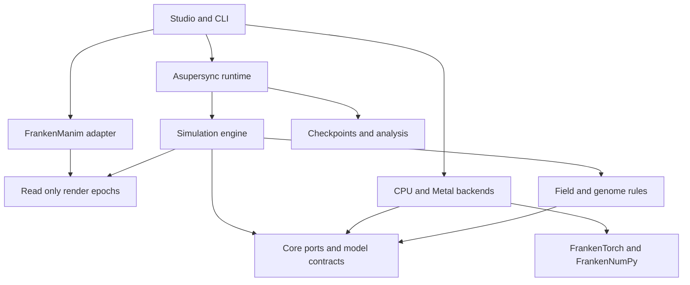

# FrankenLife

<div align="center">

[](#honest-status)
[](#the-stack)
[](#architecture)
[](#the-stack)
[](COMPREHENSIVE_PLAN_FOR_THE_DESIGN_OF_FRANKENLIFE.md)
[](LICENSE)

</div>

**FrankenLife is a real-time artificial-life laboratory in memory-safe Rust. Hundreds of thousands of organisms,
each carrying its own heritable neural network and chemistry, feed, signal, move, split and die through one shared
energy field. You can watch, pause, inspect, perturb, branch and record them while they evolve.**

The intended look is a dark microscope: luminous particles, filaments, hollow boundaries, dense colonies, vortices
and shifting ecological fronts. None of those shapes is painted. They have to come out of an ecology with finite
energy, genuine inheritance and an energy ledger that balances on every tick. The live world, its scientific
history and its animation are three views of the same committed state.

- **Every organism has its own weights.** Organisms with the same topology share a kernel and a memory layout,
  never a parameter.
- **Organisms interact only through the field.** There are no pairwise attraction tables, collision forces or
  global reward functions in the baseline.
- **Signals cannot counterfeit food.** A field cell holds spendable energy `e` and a 32-component signed chemical
  signature `m` with `‖m‖₂ ≤ e`. Opposite signals can cancel each other's chemistry without destroying or
  creating energy.
- **Nothing is trained by gradient.** Weights start random and change only through inherited mutation.
- **FrankenManim is the animation system.** It owns the camera, overlays, timeline and export. The world enters
  the scene as a few bulk primitives, not as 400,000 scene objects.

> **Inspiration, not a port.** The visual and mechanical target comes from screenshots of Fraser Price's
> Neural-Kimchi-4B and its description: about 400,000 particles, each with a distinct untrained, randomly mutated
> network of roughly 10,000 parameters, interacting only through a 1,000 × 1,000 × 32 field. The screenshots do
> not give the equations. FrankenLife is therefore an original, explicit rule set (**FieldEcologyV1**) built from
> the described primitives. It is not affiliated with that project and claims no numerical parity with it.

---

## Honest status

**The design is written down and has been through an independent mathematical, systems and integration audit
(plan v0.2). The code so far is foundations: the FL-001 stack probes, the FL-002 core contracts, the FL-003
field buffers, the FL-004 field transport and sources, the FL-005 uptake and energy ledger, the FL-006
organism-phase operators (chemistry, maintenance and motion), the FL-007 sensor/action ABI with its density
pyramid, the FL-008 scalar reference controller, the FL-009 immutable genomes and topology catalog, the
FL-010 semantic random addressing with founders and bounded mutation, the FL-011 paid emission and birth
transaction, the FL-012 death, recycling and live organism store, and the FL-013 ordered candidate tick with
epoch publication. A small headless ecology now runs, breeds, mutates, emits and dies with its energy ledger
closed every tick. FL-014 puts it behind an Asupersync session owner that admits commands with idempotent
identities and exact effective ticks. FL-015 adds the first real preset: a 4,096-organism, 128 × 128 reference
world, and a `flife run` smoke run through the session. Within 1,024 ticks it reads births, deaths, paid emission
and heritable variation from raw state. FL-017 adds immutable compact render epochs, which the session publishes
at every committed boundary. A viewer that retains them skips frames, never ticks or births. FL-018 draws the
live world on screen: `flife-studio` shows the 4,096-organism preset in a native Metal window as one FrankenManim
particle cloud. Its real pointer, key, scroll, focus and resize events run, pause and step the session, and a closed
Studio's world is bit-identical to the same world stepped directly. FL-030's first part evaluates every due
controller on the Mac's GPU in one fused Metal dispatch, bit for bit the CPU reference's, and `run`, `render` and the
Studio use it by default (`--controllers auto`). FL-028 puts every device buffer under one Metal owner: typed
buffers, read and write leases that exclude each other, commands that hold what they bind until the GPU reports
completion, and retirement that frees nothing still in use. FL-029 lets the owner submit several ordered kernels as
one command: one command buffer, checked and held as a unit, whose receipt gives the epochs written, the kernels run
and the GPU time. FL-031's first part runs phase 2 (transport, decay and the external sources) on Metal in software
binary64, bit for bit the CPU reference's, through a field backend port in the engine. Its second part does the
same for phase 3: the sensor pyramid and every organism's sample, value and gradients at its sensing scale, through
a sensor backend port. Its last part does it for phase 5: every organism's demand, and every cell's grants under
`cell-quantum-largest-remainder-v1`, contended cells included, through an uptake backend port. At the preset's scale
none is faster than the CPU yet (the sampler is 0.98× on one worker and 0.80× beside the Metal controllers on
sixteen; uptake 0.95× and 0.90×), so none is on by default: the measured frontier is in the Metal crate's contract. FL-027 groups uptake, deposit and per-organism packets with a bounded stable counting sort, not a
comparison sort: linear however organisms crowd, with scratch declared from the population maximum, in the same
cell-then-identity order, so the world is bit-identical. FL-019 adds six colour mappings (lineage, energy, generation,
motion, topology, chemical affinity), a raw look and density rendering, switched live in the Studio and chosen for `flife render`; the Studio's overlay
draws the shown mapping's colour key, each swatch in the colour its label maps to.
FL-016 encodes a whole session, world and command book, as one sealed, chunked checkpoint (Appendix B.2). A
world restored off phase, with newborns or after deaths publishes every later tick exactly as the uninterrupted
one, pending commands apply once, and damaged checkpoints are refused by name. FL-035's `flife-store` publishes
checkpoints atomically, storing each distinct chunk once by its SHA-256. A process killed after any step of a
publication, a cancellation, a refused write and damaged bytes all leave the last valid checkpoint recoverable,
and retention keeps the newest valid ones. FL-036 adds the run catalog and command journal, one FrankenSQLite
database. A `write-ahead-before-apply` session answers an acceptance or cancellation only once the journal holds
it, and holds a boundary until the records due there are durable while its control lane stays live. A process
killed at each point of an energy brush's life recovers from the journal and applies the brush exactly once.
FL-037 keeps a run in a directory: `flife run --run-dir DIR` writes its configuration, journals its commands
(`--inject TICK:X,Y:AMOUNT`), and checkpoints at the configured interval, without changing the run. `flife resume
DIR --until T` continues it from its newest checkpoint that restores. A run SIGKILLed part way, or whose newest
checkpoint is damaged, resumes to exactly the uninterrupted run's world and final checkpoint bytes, across
controller phases, cooldowns, newborns and commands still in the future.
FL-038 bounds a checkpoint's memory. `pause-and-stream` streams the committed world into the store a 1 MiB page at
a time: the preset's 160.7 MiB checkpoint peaks at about 1 MiB of heap, where encoding it whole peaked at 421.5 MiB.
`bounded-background` lets the run step on while a writer drains at most `checkpoint_retained_bytes` of pages. Both
store byte-identical checkpoints, and a run whose memory cannot hold a checkpoint is refused before it starts.
FL-043 (first slice) admits a run's peak memory before it starts. `flife run`, `resume` and `render` add up the
genome quota, the world's state, fields and tick scratch (reserved for the population's capacity, so they never
grow while it steps), a step's births, observers, checkpoints and a declared reserve against
`maximum_total_bytes`, and refuse the run before creating anything if those do not fit. The preset admits at
1,375.7 MiB of its 2,048. What is left is the controller backend's budget: a parameter shard that would not fit is
not made and its organisms are evaluated on the reference, so a small budget slows a run and never changes its
digest. The second slice admits observers: `flife render` charges its feed, its view's buffers, one frame's
FrankenManim job (compiled within a preparation limit) and the frames being encoded, and encodes fewer frames at
once before it refuses a render. The Studio is admitted before its controller backend is installed, with its feed,
view, frame upload and device surfaces, and its backend gets the bounded remainder instead of an unbounded budget.
FL-039 branches a run: `flife branch PARENT DIR --at T` starts a new session from the parent's checkpoint at
tick T, a control branch, or an intervention branch with `--inject` brushes or `--remove` removals of its own
(`--remove TICK:X,Y:RADIUS:DISPOSITION` takes out every organism in a disk, its energy removed, dissipated or
recycled; `flife run` takes it too). `--inject-material TICK:X,Y:AMOUNT:K=V,…` is the material brush: declared
energy into one cell carrying a signed chemical composition, a direction of norm at most one, so it can never
write composition the cell's energy cannot hold. `--introduce TICK:X,Y:COUNT:ENERGY` is seeded introduction: COUNT
new organisms, each endowed with ENERGY, enter one cell at the end of the tick, each drawn exactly as a founder
with its identity would be and founding its own lineage, all or none under the population cap. The branch links
the parent's verified chunk files instead of copying them and writes only its command closure. Its journal
starts with the history it inherited. A control branch resumes to exactly the parent's uninterrupted world,
while its intervention sibling matches it until its brush applies and differs after.
FL-040 adds metrics to `flife run` and `flife resume`: `--metrics-every M` folds every published tick's report
into a tracker that checks every identity as it goes, and prints a record every M ticks. The complete figures are
births, deaths, lifespans, mutation acceptance, energy flows, uptake contention, the architecture distribution and
lineage diversity. Motility, clustering and resource concentration are sampled from the render epoch, and the
start record declares which figures are which.
FL-041 runs experiments: `flife experiment SPEC --out DIR` runs a control and its conditions (six named ablations,
overrides, a parameter sweep) over discovery and held-out seeds. It catalogs every run in FrankenSQLite whether it
reached its tick, died out, paused or was refused, keeps each run's records and Appendix B.1 manifest, and reports
each condition against the control as an effect over k of n paired seeds with an exact sign-flip p-value. A
selection rule sees only the discovery runs. The report is the same bytes at any worker count, and after a kill and
a continuation.
FL-042 saves discoveries: `flife discover DIR BUNDLE --at T --region X,Y,R --description TEXT` (or `--lineage L`)
writes a bundle with the run/checkpoint reference, the selection measured in the committed world, a thumbnail framed
on the region, the presentation settings and the description. It also writes the full-world export `world/`, a
control branch of the checkpoint that `flife resume` continues to exactly the source run's state. The run's store
pins the checkpoint, so its retention keeps it while `preserve_pinned_discoveries` holds. A region discovery also
writes §14.5's second export, the local transplant package `package/`: the disk's organisms and field cells and
nothing else, its declared boundary (`exterior = "host"`) and its energy endowment, verified before use. It is not a
run. `flife transplant PACKAGE DIR --config HOST --at X,Y` grafts it into a host founded from another
configuration (moved by whole cells; the host's founders under it displaced; the package's organisms entering as
founders, kin kept as kin) and makes the grafted world a new run's founding checkpoint, which `flife resume`
continues. Its memory is admitted as a run's is, with the package's world and the graft's working copy charged
beside the host's. Grafting into a running world is not built.
FL-020 gives the Studio a camera (zoom about the pointer, pan across the seams, reset) and selection by stable
identity. FL-021 reads a selected organism back from the session as a bounded snapshot at its committed boundary,
printed as an `inspected` record and drawn under the overlay's lines (its energy, age, motion, controller and held
output), read again once a second while the world runs. Once the world has stepped while it is selected, the
snapshot also carries what the organism sensed, exactly as its controller read it, and the hidden activations
that produced the output it holds, recomputed on the reference and checked against it bit for bit. FL-022 gives it energy, removal, material
and introduction brushes: a click becomes a world-space command the session applies at its next open boundary, reported with
the tick it applied at and the energy it moved; the host's brush path has not been run in a window here.**

| Question | Answer |
|---|---|
| Is there a design? | **Yes.** [`COMPREHENSIVE_PLAN_FOR_THE_DESIGN_OF_FRANKENLIFE.md`](COMPREHENSIVE_PLAN_FOR_THE_DESIGN_OF_FRANKENLIFE.md) (about 2,400 lines, §1–§28 plus Appendices A–E) covers the equations, the tick, data layout, accelerator design, the runtime protocol, rendering, checkpoints, 15 invariants, 11 gates, a complete starter configuration and 17 hand-computable fixtures. Its statements are labelled **Observed**, **Derived**, **Target** or **Hypothesis**; anything unlabelled is a proposed design |
| Is there code? | **Foundations and a headless tick.** `crates/flife-probes` (FL-001) qualifies the pinned dependency closure. `crates/flife-core` (FL-002) defines identities, integer clocks, units, errors, the named-algorithm registry, the validated Appendix A configuration and its canonical hashes. `crates/flife-field` (FL-003, FL-004) holds the field as 33 typed F32 planes on a periodic grid, with a FrankenNumPy-checked layout descriptor, checked buffer limits, the configured initial field and the INV-01/INV-02 checks. It also runs phase 2 of the tick: positive five-point transport with CFL subcycling, exponential decay and normalized Gaussian source deposits, reporting the field's ledger terms. FL-005 adds local uptake: a two-pass demand/grant resolver that grants whole F32 quanta of each cell, so no cell is ever overdrawn and the field loses exactly what is granted. It also adds the energy ledger in `flife-core`, which closes every tick against a declared residual budget and refuses unrecorded changes between ticks. `crates/flife-engine` (FL-006) settles one organism's tick: bounded-affinity chemistry evaluated on each granted cell packet with toxicity clipped to what the organism holds, maintenance from canonical model work, and affordable motion with drag integrated through a stable `expm1`. Its elementary functions (`exp`, `expm1`, `tanh`, sigmoid, `log2`) are host-independent and within 1–2 ulp of correctly rounded. `crates/flife-neural` (FL-007) turns a sample of the field's density pyramid into the controller's 104 inputs (energy and composition, their saturated gradients, and five intrinsic inputs), and decodes 36 linear outputs into a reproduction probability, a child share and an emission proposal, applying sigmoid exactly once. A uniform field reads identically at every scale. Between the two, FL-008's scalar reference controller evaluates each organism's own dense `tanh` network with a linear output layer, accumulating in F32 in a declared order; hand-set networks pin its outputs bit for bit. `crates/flife-genome` (FL-009) holds each organism's own immutable genome: its catalog topology (the five §6.4 dense networks, under the parameter cap), its F32 parameters and its bounded traits. Every genome is charged its full logical size against a fixed quota, allocation is checked before anything is reserved and refused rather than aborted, and topology changes go through the declared width and depth maps, so a widened child computes exactly what its parent did. FL-010 names every random word by what it is for: a NumPy-exact Philox block keyed by the world seed and a stream, at a counter of stable entity, tick or ordinal, lane and draw, so no result depends on worker or evaluation order. Founders, mutation proposals and source chemistry, centers and paths all draw that way. Mutation tries at most eight candidates per birth, topology first, then parameters (perturbed in F64 and rounded once to F32), then traits. It rejects invalid and no-op candidates rather than reinterpreting them, and leaves nothing charged when every candidate fails. FL-011 adds paid emission and births. An organism pays its decoded fraction of what it holds after motion, and the field receives at most the efficiency times that on the next tick, never more than was paid. A birth costs a fixed amount and splits the rest exactly between parent and child. It reserves a population slot and the child's full genome size before allocating, takes identities in stable parent order, and rolls back completely on any shortfall, so a rejected birth costs nothing. FL-012 adds death and the live organism store. Exhaustion is rechecked after every budget stage, a reservoir below the tiny-energy threshold is dissipated and recorded, and a death is collected once, at its resulting position. The store keeps organisms as columns behind a stable-identity index, admits identities once and in order so a dead one never returns, and commits each tick's deaths and births together or not at all. Two slot layouts, compacting and free-list, hold the same world bit for bit. FL-013 strings these into the ordered tick: each tick is prepared as a candidate against the committed world, writing only the spare field buffer and its own copies, checked against INV-01–INV-07, and published whole (population, field, ledger, identities, quota, source paths, tick and epoch together) or not at all. A capacity shortfall pauses the tick and a numerical fault stops the run, both leaving the last published epoch untouched. A 48-founder, 32×32 headless ecology pins its world digest over 384 ticks, identical on macOS arm64 and Linux x86_64. `crates/flife-runtime` (FL-014) is the session owner: one Asupersync task holds the world and is its only commit authority. Its control lane (pause, resume, step, inspect, cancel, close) answers at a committed boundary while paused and is never blocked by a full command queue. Commands carry a client identity, so a retry returns the first outcome and reuse with other content is refused. Each command applies at exactly its effective tick, and a cancellation racing publication either discards the candidate or is reported too late, never both. The only command so far is a declared single-cell energy injection, and acceptance is in memory, or write-ahead through FL-036's journal. `presets/reference-small-world.toml` (FL-015) is Appendix A at the Reference profile's scale with five declared viability values and one motility value. Appendix A as written has no birth or death in its first 8 simulated seconds, and its motility gain leaves organisms at a mean 0.01 world units per second, visibly frozen; the preset's moves them at about 0.6. `crates/flife-cli` is the `flife` command line's first two commands, `validate` and `run`, printing versioned NDJSON. Its smoke run drives the preset through the session for 1,024 ticks and reads the committed world directly. Unfed founders starve and fed lineages breed, giving 507 births, 3,775 deaths and 1,009 energy paid as emission. Live children keep 99.8% of their parent's parameters bit for bit, while unrelated founders share 1.3%. Grandchildren carry 99.7% of their parent's mutations, and the digest is pinned on both hosts. `crates/flife-render` (FL-017) holds the render epochs.
- An epoch is exactly one committed world: compact views in stable identity order, a bounded block-mean field texture and a metric summary.
- Epochs live in preallocated slots. A leased or displayable slot cannot be written.
- When every slot is busy the boundary is skipped and the last displayable epoch stays.
- Viewers hold a bounded number of leases each and read the feed directly, never through the session's lanes.

Tests compare every committed world with one stepped directly. Under retained, slow and cross-thread readers, the trajectory and a near-capacity admission decision are unchanged. `crates/flife-manim` (FL-018) is the FrankenManim adapter: an exact viewport from world units to drawable pixels and logical window points, and one bounded particle cloud lowered from each epoch onto FrankenManim's 3D camera route (checked against FrankenManim's own CPU renderer to 0.05 px). `crates/flife-studio` (FL-018) is the native host. The window, typed input and Metal presentation stay on the main thread, and the session owner runs on its own Asupersync thread behind a bounded intent lane. A harness-free live test drives the real preset entirely with real AppKit events. The view draws the energy field under glowing lineage-coloured organisms, and `flife render` writes the same view to PNG frames and MP4. FL-020 adds camera control and selection, and FL-021 a bounded organism snapshot on selection (a record and an on-screen panel) |
| Does the stack compose? | **Yes (FL-001, FL-018).** One `Cargo.lock` resolves a single Asupersync v0.6.2 package, which took upstream repins in FrankenManim and others (§12.8). Every probe matches its independent oracle: NumPy-exact RNG and array layout, an exact FrankenTorch matmul, Asupersync lab replay, a byte-identical certified FrankenManim frame and an exact Metal kernel. The native presenter now delivers typed pointer, button, scroll, key, modifier, focus, capture-loss and resize events (FL-018 added the bridge upstream in FrankenTorch), and a real window probe qualifies it. Linux x86_64 also qualifies, with Metal reported unavailable, and its certified frame is byte-identical to the Mac's |
| Has the screenshot behaviour been reproduced? | **No.** The visual gate (G5) and the ecological gate (G9) are separate, and neither has run |
| Has anything been benchmarked? | **No.** Every population, rate and frame-time number below is a **Target** or a **Derived** arithmetic estimate |
| Is there a work plan? | **Yes.** 58 work items (FL-001 … FL-058) with dependencies and completion evidence, seven milestones (M0–M6) and 14 architecture decisions (§22–§26). They are instantiated as 58 beads with the plan's 141 dependency edges in `.beads/` for `br` |

---

## TL;DR

**The problem.** Artificial-life imagery is easy to make beautiful and hard to make honest. A shared-weight
network, an unaccounted energy source, a cull that keeps the screen attractive, or a renderer benchmarked with
inference switched off can each produce a gorgeous video of nothing evolving. Rigorous artificial-life systems,
meanwhile, tend to be small, offline and hard to look inside.

**What already exists.** Neural cellular automata learn one shared local rule. Lenia, Flow-Lenia and Particle
Lenia show what continuous local rules, mass conservation and interactive exploration can do. ScriptBots-style
simulators give agents direct interactions and pluggable brains. Neural-Kimchi-4B shows the target look at the
target scale.

**What FrankenLife composes.**
- an independent heritable neural controller for every organism;
- field-only interaction under an explicit energy ledger;
- a deterministic, checkpointable tick that survives cancellation and crashes;
- live, inspectable, recordable animation of that same committed state;

all at a scale (about four billion independent parameters) where memory bandwidth, not arithmetic, is the limit.

---

## The four claims

The plan keeps four claims apart and never lets one stand in for another (Executive design, §15, §21):

| Claim | Meaning | What establishes it |
|---|---|---|
| **Rules** | The simulation obeys its own rules | Invariants INV-01–INV-15 and the energy ledger, checked on every committed tick |
| **Implementation** | The code reproduces those rules | Independent hand-computed fixtures, a separate scalar oracle, CPU/Metal parity tests |
| **Visual** | The images have the intended character | Human review against the references, with raw diagnostic views beside the aesthetic ones (G5) |
| **Ecological** | Populations show measurable evolutionary phenomena | Ablations, seed ensembles and held-out seeds, with failed and extinct runs kept (G9) |

A beautiful image establishes only the third. A speed measured on named hardware is a separate kind of result
and is evidence for none of the four.

---

## How the world works

**FieldEcologyV1**, the first model (plan §4–§8):

- **World.** A two-dimensional periodic torus. Organisms have continuous positions; the field is a regular grid
  (1024 × 1024 at target scale).
- **Field.** Each cell holds energy `e ≥ 0` and a 32-component signed moment `m` with `‖m‖₂ ≤ e`; composition is
  `z = m / e`. Diffusion applies the same positive five-point stencil to `e` and to every component of `m`. That
  preserves the cone `‖m‖ ≤ e` and conserves energy before declared decay (Appendix D).
- **Sources.** Seeded Gaussian patches drift across the torus on smooth paths. Each injects a fixed total power
  with a fixed chemical direction, per simulation-second and never per display frame.
- **Sensing.** Each organism reads energy, 32 composition values and their x and y gradients at a heritable
  sensing scale through a density pyramid, plus its own energy, age, velocity and recent energy change: 104
  inputs.
- **Brain.** The default network is `104 → 64 → 32 → 36` (9,988 parameters), `tanh` hidden layers and a linear
  output layer. A topology catalog lets offspring move between networks of 1,164 and 29,316 parameters.
- **Decisions.** The 36 outputs are a reproduction hazard, a child energy share, an emission gate, a 32-dimensional
  emission direction and an emission spending rate. There is no motor output: motion comes from chemistry.
- **Uptake.** Organisms request energy from the cells under them, and a contended cell grants proportionally in a
  two-pass demand/grant step. No cell is overdrawn, and thread order cannot decide who eats.
- **Chemistry.** Each granted packet is evaluated separately. A heritable affinity direction `a` decides whether
  that packet feeds or poisons: `η = η_max · tanh(k · a·z − b)`. Toxicity is clipped to the energy the organism
  actually has.
- **Motion.** Heritable responses to energy and composition gradients produce an acceleration. Drag is integrated
  analytically. Movement costs energy in proportion to speed squared and is scaled down when unaffordable.
- **Emission.** An organism can spend energy to deposit chemical material at efficiency `ρ ≤ 1`. Deposits become
  visible on the next tick, so a closed self-feeding loop cannot amplify energy.
- **Reproduction.** A split creates a mutated child holding a share of the parent's energy minus a birth cost. The
  identity, genome, slot and energy transfer commit together, or nothing happens.
- **Death.** Zero energy after any stage is death, checked after every stage. Part of the residue returns to the
  field.

**The ledger.** With `𝓔 = Σ organism energy + Σ cell energy`, every committed tick satisfies
`𝓔ₙ₊₁ − 𝓔ₙ = injection − removal − dissipation + numerical residual`. Emission, absorption and child transfer are
internal moves. No correction may silently add energy to make the equation balance.

### One tick

| Phase | Action |
|---:|---|
| 1 | Admit commands at their recorded tick boundary |
| 2 | Transport the field and inject sources, producing one immutable observation field |
| 3 | Build the sensing pyramid and spatial bins |
| 4 | Sense and evaluate due controllers, all from the same epoch |
| 5 | Resolve uptake demand into cell grants |
| 6 | Settle useful gain, toxicity and maintenance |
| 7 | Propose affordable motion, then emission, then reproduction |
| 8 | Resolve capacity, construct births and collect deaths, transactionally and in stable-identity order |
| 9 | Reduce deposits and recycling into the next field, first sensed on the next tick |
| 10 | Validate the invariants and publish state, event cursor and accounting together |

Cancellation before phase 10 discards the candidate tick; the last committed world stays authoritative.

---

## Why the scale is hard

**Derived.** 400,000 organisms × 9,988 parameters ≈ 4.0 billion independent parameters: 7.45 GiB of F16 weights,
or 14.90 GiB in F32, before any other state. No two organisms share weights, so there is almost no weight reuse,
and every full neural sweep has to stream the whole bank from memory:

| Full-population sweeps/s | Multiply-accumulates/s | F16 weight stream | F32 weight stream |
|---:|---:|---:|---:|
| 15 | 60 billion | 120 GB/s | 240 GB/s |
| 30 | 120 billion | 240 GB/s | 480 GB/s |
| 60 | 240 billion | 480 GB/s | 960 GB/s |
| 128 | 512 billion | 1.024 TB/s | 2.048 TB/s |

These are arithmetic, not benchmarks. A headline GPU FLOP/s figure cannot justify a real-time claim for this
workload; only sustained bandwidth with the real independent-weight layout can.

Energy does not scale by copying numbers either. The starter profile's eight sources supply 640 energy units per
simulation-second, enough to sustain at most about 74,800 default organisms even with perfect uptake. 400,000 of
them need about 3,423 units per second for mandatory costs alone. Each operating profile therefore declares its
own environment (§19.5).

### Operating profiles

**Target.** These are workload definitions, not measured capabilities.

| Profile | Population | Field | Canonical weights | Neural schedule | Purpose |
|---|---:|---|---|---|---|
| Reference | 4,096 | 128² × 33 | F32 | Every tick | Independent correctness and a small live world |
| Interactive | 25,000 | 256² × 33 | F32, or a separately named F16 | Every tick | First polished live viewer |
| Desktop ecology | 100,000 | 512² × 33 | F16 | Every tick; an every-fourth-tick profile available | Everyday exploration |
| Target full | 400,000 | 1024² × 33 | F16, mean near 10k parameters | Every tick | The screenshot scale |
| Target multi-rate | 400,000 | 1024² × 33 | F16, mean near 10k parameters | Every fourth tick | A separately named, bandwidth-conscious ecology |

The full-scale gate (G7) asks for at least 30 achieved full-evaluation ticks per second and 30 fps at 1080p on a
named machine, for at least ten minutes, with at least 380,000 live organisms averaging 9,000–11,000 parameters.
The screenshots' 65–82 steps/s comes next; 128 steps/s is a stretch target.

**Honest clocks.** The HUD reports achieved scientific steps per second and the simulation-time/wall-time ratio
separately from display fps. At 30 steps/s with `Δt = 1/128`, the world advances 0.234 simulated seconds per wall
second. The engine never skips ticks, enlarges `Δt` or lowers neural cadence under load while keeping the same
model name.

---

## Three modes, one engine

| Mode | Purpose | What it does |
|---|---|---|
| **Studio** | Watch, inspect, intervene, discover | Responsive camera, honest clocks, an organism inspector, intervention brushes, presets and recordings |
| **Laboratory** | Reproduce and compare | Headless runs, seed ensembles, controlled branches, metrics and checkpoints |
| **Cinema** | Explanatory or artistic output | FrankenManim camera tracks, captions, diagrams and precisely timed export, with recorded provenance |

Cinema never invents simulation events, and Studio never runs its own physics in a frame callback.

The intended Studio flow: launch a validated preset and see the world at once. Zoom from the whole ecosystem to a
single organism without changing the simulation. Click an organism to see its energy, ancestry, chemistry, network
architecture, current inputs and decoded actions. Pause, erase part of a colony, resume, and compare the result
with a control branch from the exact pre-intervention checkpoint. Record the sequence with the same camera moves.

---

## The stack

| Component | Role in FrankenLife |
|---|---|
| [Asupersync](https://github.com/Dicklesworthstone/asupersync) | Owns the session, cancellation, bounded queues, control channels, checkpoint and export workers, and deterministic Lab tests. No detached tasks; 400,000 organisms never become 400,000 tasks |
| [FrankenTorch](https://github.com/Dicklesworthstone/frankentorch) | Typed tensor storage, CPU reference inference, independent-network population execution and the Metal compute gateway |
| [FrankenNumPy](https://github.com/Dicklesworthstone/franken_numpy) | Truly typed host arrays, layout, deterministic Philox RNG and reference numerics |
| [FrankenManim](https://github.com/Dicklesworthstone/franken_manim) | Scene composition, cameras, bulk particle and field primitives, overlays, timeline and export |
| [FrankenSQLite](https://github.com/Dicklesworthstone/frankensqlite) | Run catalog, command journal, checkpoint index, lineage summaries; never per-particle rows |
| [FrankenPandas](https://github.com/Dicklesworthstone/frankenpandas), [FrankenNetworkX](https://github.com/Dicklesworthstone/franken_networkx) | Optional offline analysis of sampled summaries and lineage graphs |
| [FrankenSim](https://github.com/Dicklesworthstone/frankensim), [FrankenThreeD](https://github.com/Dicklesworthstone/franken_threed) | Optional later physical extensions and volumetric presentation |

The first four are foundational. Some of the required work belongs upstream and is planned as deliverables there
(§22.4): population inference kernels, batched command submission and resource leases in FrankenTorch; bulk
`ParticleCloud` and `FieldTexture` primitives, a resident resource bridge and a native input bridge in
FrankenManim; borrowed typed-array kernels in FrankenNumPy.

---

## Architecture



The composition root injects a backend through the core ports. The engine never depends on a concrete backend,
and the renderer reads immutable epochs; it does not own the engine.

The proposed workspace (§18.1). A crate is created only when a milestone needs it:

| Crate | Responsibility |
|---|---|
| `flife-core` | IDs, units, schemas, errors, epochs, model descriptors, kernel-port contracts |
| `flife-field` | Field semantics, exchange and transport reference operators, layout contracts |
| `flife-genome` | Chemistry and controller genomes, mutation, topology catalog, ancestry |
| `flife-neural` | Sensor/action ABI, scalar oracle, FrankenTorch population adapter |
| `flife-engine` | The tick state machine, budgets and lifecycle transactions |
| `flife-backend-cpu`, `flife-backend-metal` | Qualified phase execution; device owner, kernels and resource leases |
| `flife-runtime` | Asupersync session ownership, commands, supervision, queue policies |
| `flife-render`, `flife-manim` | Compact render projections and colour semantics; the bulk FrankenManim adapter |
| `flife-store` | Chunk store and atomic checkpoint manifests (FL-035); run catalog, command journal and checkpoint index (FL-036); lineage later |
| `flife-analysis`, `flife-experiments` | Metrics and controlled comparisons; seed ensembles, sweeps, branches |
| `flife-cli`, `flife-studio` | The `flife` command line and the interactive application |

Every FrankenLife crate uses `#![forbid(unsafe_code)]`. The dependency graph is not unsafe-free (CPU SIMD and Metal
FFI sit in reviewed upstream boundary crates), and the project does not claim it is (§3.3).

---

## Milestones and gates

| Milestone | Deliverable | Gates |
|---|---|---|
| **M0** Compatible foundation | One native program runs an Asupersync session, a typed array operation, an independent-network batch and a FrankenManim frame | G0 |
| **M1** First living world | A 4,096-organism field ecology with independent genomes, the energy ledger, reproduction, mutation and death, viewed live in FrankenManim | G1, G2 |
| **M2** Usable laboratory | A polished 25k profile, inspector, interventions, checkpoint/resume, branches and basic recording | G3, G5, G6 |
| **M3** Qualified acceleration | CPU/Metal parity, persistent buffers, fused population inference, variable topology and births | G4 |
| **M4** Screenshot-scale world | 400k independent networks near 10k parameters on a 1024² field, rendered interactively with honest clocks | G7, G8 |
| **M5** Scientific and visual release | A seed gallery, ablations, experiment reports, reliable Cinema export, extension examples | G9, G10 |
| **M6** Additional model families | Recurrent controllers, multi-carrier chemistry or physical boundaries, each with a demonstrated need | Per extension |

The gates: **G0** stack compiles at one lockset and its probes pass · **G1** hand fixtures and arithmetic ·
**G2** a first world that lives, renders and pauses · **G3** checkpoint replay and crash/retry recovery ·
**G4** CPU/Metal parity · **G5** visual review · **G6** 30 fps with p95 input latency ≤ 100 ms ·
**G7** the 400k scale interval · **G8** eight-hour endurance · **G9** research claims · **G10** export alignment.

The first useful slice is a complete cycle. Source energy enters the field; organisms sense it; independent
networks decide; chemistry causes gain, loss and motion; paid emission changes the field; reproduction produces a
mutated child; death releases resources; and the result appears live through FrankenManim. A small authentic
ecology comes before any broad infrastructure.

---

## Planned command surface

**Mostly proposed** (§14.6). `flife validate`, `flife run` and `flife render` exist, and so does `flife-studio`
(FL-018, macOS); the rest are later work items. Try the real preset headlessly, as frames and video, then live:

```bash
cargo run --release -p flife-cli -- validate presets/reference-small-world.toml
cargo run --release -p flife-cli -- run presets/reference-small-world.toml --ticks 1024 --every 128 \
    --metrics-every 128
cargo run --release -p flife-cli -- render presets/reference-small-world.toml --ticks 2560 --every 4 \
    --width 1080 --height 1080 --out frames --video world.mp4
cargo run --release -p flife-cli -- render presets/reference-small-world.toml --ticks 1200 --every 1200 \
    --color energy --density --out frames-energy
cargo run --release -p flife-studio -- presets/reference-small-world.toml --width 960 --height 540
cargo run --release -p flife-studio -- presets/reference-small-world.toml --offscreen 20 --offscreen-zooms
cargo run --release -p flife-studio -- presets/reference-small-world.toml --timeline session.ndjson
cargo run --release -p flife-studio -- presets/reference-small-world.toml --export session.ndjson --out export
cargo run --release -p flife-studio -- presets/reference-small-world.toml --run studio-run
cargo run --release -p flife-cli -- resume studio-run --until 20000
```

`presets/interactive-world.toml` is the Interactive profile's world (§19.5): 25,000 founders on 256 × 256 × 33,
its source power chosen by FL-034's declared experiment E1 (`experiments/fl034/README.md`). Its populations
settle at about 22,000 to 25,000 after an early bottleneck. Open it the same way:
`cargo run --release -p flife-studio -- presets/interactive-world.toml`.

The Studio opens running (`--paused` to start paused). Space runs or pauses, → or `.` steps one tick while paused,
and Esc or ⌘W closes. It prints `frankenlife.studio.v1` NDJSON (status changes, a per-second frame summary, a `view`
record per style change and the closing world digest). With `[presentation] show_clock_telemetry` set, as in the
preset, a per-second `clock` record gives the honest clocks: the ticks committed per wall second, simulated seconds
per wall second and frames drawn per second (FL-024). The window draws the same in its top-left corner, as
text over a dark plate: running or paused at the shown tick, those clocks, plan §14.1's persistent telemetry (the
live population and its parameters, the controller cadence and full evaluations a second, genome memory and
headroom, births, deaths, capacity pauses and faults, the energy injected, taken up and dissipated with the
ledger's residual, the model, seed and checkpoint; a `telemetry` record a second carries the same), the colour
mapping's key (such as `energy ■ 0 ■ 1 ■ 2 ■ 4 ■ 8 ■ 16`, each square in its colour), the armed brush and the
selected organism. Drawn offscreen through the Metal
route, the key's squares are their colours exactly without the bloom; the preset's bloom moves them by up to 16
levels. The organisms glow over the energy field they feed on, in
the configuration's colour mapping (`[presentation] color_mapping`, lineage in the preset). The style keys work
while running or paused, and change only the picture:

| Key | View |
|---|---|
| 1 to 6 | colour by lineage, energy (dark to bright), generation (logarithmic), motion (hue for heading, strength for speed), topology (catalog member) or chemical affinity (grey for none; like chemistry, like colour) |
| R | the raw look: no halos, linear grey field |
| D | density per screen bin instead of dots |
| F | show or hide the field |
| C | the field's chemical composition instead of its energy (hue for chemistry, in the affinity mapping's colours, brightness for energy), then its chosen component, then its energy again |
| `[` or `]` | the field's chosen component: one moment channel per unit energy, blue (against) through pale to red (along), brightness for energy; again, the previous or next of its 32 channels |

E arms the energy brush, X the removal brush, M the material brush and I the introduction brush (the same key
again disarms). With one armed, a click adds 64 units of declared energy to the field cell under it; removes the
organisms within 12 points of it on screen, their energy recycled as a death's; adds 64 units of material whose
composition is the selected organism's affinity direction, the material it converts best; or introduces 8
founder-drawn organisms there. With the removal brush armed, a drag draws the disk instead of panning: press at
its centre, drag out its radius, release to remove the organisms in it. `-` and `=` halve and double the armed
brush's amount (1 to 4,096 energy) or count (1 to 64 organisms), and with the removal brush armed `/` sends the
removed energy elsewhere in turn: recycled as a death's, dissipated, or taken out of the modeled world. While one
is armed, the overlay says what a click at the pointer would do, or the release of the disk being drawn: the
energy it adds, in the model's units, and the cell it lands in, in world units; or for removal, the radius about
the pointer (or the press) and where the removed energy goes. The world shows where: the cell is outlined in
amber, or the removal's disc in red. Each click or drawn disk is a command: a `submitted` record names the
boundary it will apply at, with its amount, count or disposition, and a `finished` record the tick it applied at
and the energy it moved.

G arms the measuring tool instead (plan §14.3's temporary measurement region; G again, or a brush key, puts it
away). A click places the disk a removal click there would take, and a drag draws one, outlined in cyan. Nothing
changes: the session reports what the disk holds at its committed tick, exactly the organisms a removal of it
would take, their energy and their lineages, and the field's energy in the cells under it. The overlay says so
(`radius 4.56 world units at tick 5,120: 17 organisms of 41.2 energy, 3 lineages`, `field 812.5 energy in 1,064
cells`), a `measured` record carries it with the disk's centre, and both are read again once a second while the
world runs and after each step. Paused, measure a colony before erasing it with the same disk: the removal
applies at the tick measured, and its `finished` record moves exactly the energy measured.

T tracks the selected organism: the camera keeps it at the centre while the world runs. A click also follows its
line of descent (plan §2.2), and while tracking, when the organism dies, the selection and the camera move on to
its heir, the descendant then alive fewest generations below it and then the eldest. A `following` record names
the line when the click is answered and a `handed` record each hand-off. Following is observer state, outside
every digest and checkpoint, and so far it has run only offscreen.

`--offscreen SECONDS` runs the same Studio for that long with no window (FL-024). It renders each frame through
the same Metal route at `--scale` pixels a point (2 by default), reads it back and closes. Its `end` record gives
the frames' work times and, with `--offscreen-zooms`, a camera move's latency from its arrival at a random moment
of every third frame interval to the end of the frame that drew it. On the preset (1920×1080 points, its
controllers on the CPU reference with 16 workers) on a shared M5 Ultra it drew 30.00 frames a second at 1x
(latency p95 51.6 ms) and 29.79 at 2x (3840×2160, p95 59.9 ms). That is G6 offscreen. In a window, with AppKit's
delivery and the present, it is not yet measured. The Studio's frames start on a fixed schedule. Each frame used to
wait a period from its own start, so every timer oversleep delayed all later frames: in the same runs that drew
27.9 and 28.3 frames a second.

`--timeline FILE` records what the Studio presented (FL-023, live capture), one `frankenlife.timeline.v1` record a
line. That is every change a frame makes to the view (drawable, density, overlay, style, camera, selection, the
epochs shown and how far the display is between them) and every frame drawn with its tick and wall time, the
commands as the session accepts and applies them, and on a clean close the world it closed on. `--export FILE --out
DIR` opens no Studio and no window. It founds the world again, steps it with those commands at those ticks, and
redraws every frame through the same Metal route. Each frame lands in DIR as a PNG, byte for byte the frame the
Studio rendered. The frames on a constant clock (`--export-fps`, the preset's 30 by default) become
`capture.y4m` (BT.709 limited 4:2:0), its repeated and dropped frames declared. A `manifest.json` gives the
timeline's and configuration's hashes, the ticks shown, the closing digest and each file's SHA-256. An export that
reaches another world than the Studio's is refused, and neither command writes over a file. Simulation-time and
checkpoint-replay export (plan §13.8) and Cinema qualification (FL-050) are later work.

`--run DIR` keeps the Studio's session in a new run directory (FL-024), as `flife run --run-dir` keeps a run: the
configuration, the command journal (every brush applied is a journaled command under `write-ahead-before-apply`)
and checkpoints at the configured interval. The founding one comes first; while the world runs, the Studio holds
the session at each multiple of the interval, takes the checkpoint there and lets it run on, so its checkpoints land
on exactly the ticks `flife run`'s would. A brush stroke made while the world is paused first checkpoints the
boundary it will apply at, unless that boundary already has one, so `flife branch DIR CONTROL --at T` makes a
control from the exact pre-intervention world, holding every command before the stroke and none made at T.
Closing publishes the closing boundary and suspends the session, so a stroke still pending applies when the run is
resumed. The window's telemetry names the newest checkpoint's tick, and the NDJSON carries a `checkpoint` record
each. `flife resume`, `flife branch` and `flife inspect` (`--weights` included) take the directory: resuming it
reaches exactly the world an uninterrupted session would.

`render` and `flife-studio` take the same choices as `--color`, `--look glow|raw`, `--density`, `--no-field` and
`--field-mapping energy|composition|component-C` (C from 0 to 31).
Every style renders the same world: nine styles of one 1,200-tick render all end at the same digest.

`--controllers metal` evaluates the organisms' controllers on the Mac's GPU, `torch` on FrankenTorch's serial CPU
population kernel on the world's own workers (FL-025, any host), and `cpu` keeps them on the CPU reference; `metal`
refuses to run without a Metal device. `auto` (the default) takes Metal where the host has it and
the world uses at most 8 CPU workers, where it measured faster (2.2× on one worker, 1.7× on two, 1.3× on four, 1.1×
on eight). On a host without Metal it takes `torch` at up to 4 workers, where Linux measured it 1.41× on one worker
and 1.11× on four (0.91× on eight). Whatever the choice and the `--cpu-workers`
count, the world is the same bit for bit; the run's `start` record names the backend and `end` counts what it
evaluated. Measured over 512 ticks of the preset on an M5 Ultra under other load (median of three interleaved
runs, cv ≤ 2.5%), with all 4,096 founders alive:

| `--cpu-workers` | `--controllers cpu` | `--controllers metal` |
|---|---|---|
| 1 | 41 ms per tick | 18 ms per tick |
| 16 | 12.9 ms per tick | 13.7 ms per tick |

On one worker the controllers are about three quarters of a tick, and the GPU halves it. On 16 workers they are
already spread thin, and the tick is bound by its serial phases (chemistry, uptake, deposits, invariant checks).
There the GPU frees CPU cores but does not shorten the tick, so `auto` stays on the CPU there. The Studio, whose
presentation uses the same GPU, measured slower with Metal under FrankenManim `dfdc7d18` (72 against 119 ticks per
second). With `f401a947`'s lighter Metal frames it is level: 132 against 120 at 960×540 and 152 against 161 at
1,920×1,080, four interleaved runs each.

`torch` measured in one process next to the reference and Metal (`flife-backend-metal`'s `tick_throughput`
example: eight 20-tick blocks per world in rotating order after 40 warm-up ticks, the digests equal after every
block, nothing deferred; M5 Ultra under other load). Whole ticks against the reference:

| `--cpu-workers` | `torch` | `metal` |
|---|---|---|
| 1 | 1.62× | 2.22× |
| 4 | 1.26× | 1.32× |
| 8 | 1.10× | 1.04× |
| 16 | 1.01× | 0.94× |

At 8 and 16 workers the samples varied by more than 5%, so those rows show no admissible difference. On one
worker Metal is clearly faster than `torch`. On four it led by 5% while its own samples varied by 5.1%. So `auto`
keeps Metal where the host has it. On Linux x86-64 (one invocation per worker count, every row's cv at most 4.5%)
`torch` was 1.41× on one worker, 1.11× on four and 0.91× on eight. So without Metal `auto` takes `torch` at up to
four workers (`flife-backend-cpu`'s contract has the rows).

`flife render` encodes each frame's PNG on its own thread (up to four at once) while the world steps and the next
frame draws. The files are byte-identical to encoding them one by one, and 128 ticks at every second tick, 1,280²,
took 6.3 s instead of 12.8 s (median of four interleaved runs each; all eight runs wrote the same frames and world).
FrankenManim `dfdc7d18` then skips its polygon clipper for triangles wholly inside the view, most of the energy
field's mesh, with the clipper's exact bytes. That halves the CPU frame (45 to 21.5 ms at 1,280² with 4,096 alive)
and takes the same render to 3.95 s from 5.42 s, with the same PNG bytes. It also lifts the Studio from 14.8 to 19.6
presented frames per second at 960×540.
FrankenManim `f401a947` gives its Metal 3D kernel per-tile triangle lists, so a pixel no longer walks every triangle
of the field's full-screen mesh. The Metal frame went from 166 to 28 ms at 1,280² (median of four interleaved runs,
the same CPU and Metal frame bytes as before in every run). The Studio, which draws through that route, now presents
29.0 frames per second at 960×540 against its 30 fps pacing, up from 20.4, with about 10% fewer ticks per second
(141 against 160), since it lowers and presents 42% more frames.
For `flife render` the Metal route is measured and not adopted. It is now level with the CPU route (28 against 23 ms
at 1,280², 32–34 against 30–41 ms at 2,160²), and its frame differs from the CPU frame by one in about 0.02% of the
bytes, so it would change the written frames (`cargo run --release -p flife-cli --example frame_routes`). The full surface, as planned:

```bash
flife validate <config>     # range-check a config; report real memory and the worst admitted allocation
flife capabilities          # what this machine and build can actually run, with explicit refusals
flife run <config>          # a headless run
flife step                  # advance one tick
flife inspect               # a run directory's committed world at one checkpoint, every organism and cell (exists)
flife run --run-dir | resume  # durable, verified world state and exact resumption (exists)
flife branch                # control and intervention branches from one checkpoint (exists)
flife experiment            # seed ensembles, sweeps and ablations against a control, every run cataloged (exists)
flife discover              # a pinned discovery bundle: reference, selection, thumbnail, full-world export, local package (exists)
flife transplant            # a local package grafted into a founded host, as a run that resumes (exists)
flife analyze               # cross-experiment analysis of cataloged metrics
flife render | export       # simulation-time frames and video through FrankenManim (render exists)
flife-studio <preset>       # the interactive microscope
```

Machine output is versioned JSON or NDJSON with stable identifiers and typed errors. Missing accelerator capability,
budget exhaustion, schema mismatch, incompatible checkpoints, numerical invalidity and cancellation are distinct
error classes. A missing GPU yields a smaller CPU route when selected, or an explicit refusal; it never silently
substitutes a different neural model.

---

## Pins

| Item | Pin |
|---|---|
| Rust toolchain | `nightly-2026-08-31` (`rust-toolchain.toml`), shared with the FrankenSuite siblings; Rust 2024 edition |
| Asupersync | v0.6.2 (`a5d23e8d`), one package id across the closure; the root `[patch.crates-io]` maps FrankenTorch's crates.io edge onto the same commit |
| FrankenManim, FrankenTorch, FrankenNumPy | `d670e74e`, `0ae728fe`, `6492ff31`; the full qualified set and its probe results are in [`franken-stack.lock`](franken-stack.lock) |
| `rust-block` override | Reviewed revision `b39ae859…`, carried at this workspace root because Cargo ignores a dependency's own `[patch]` (§12.8) |

---

## What FrankenLife is not

- Not a reproduction or port of Neural-Kimchi-4B, and not a claim of numerical parity with it.
- Not a decorative particle animation: no shapes are painted in, there is no hidden culling to keep the display
  attractive, and extinct worlds are not silently reseeded.
- Not a shared-policy, distilled or low-rank shortcut presented as independent networks.
- Not trained by gradient in the baseline, and not scored by any aesthetic fitness function inside the world.
- Not a three-dimensional ecology, a distributed single world or a full-scale browser application in the initial
  release. A browser timeline player for recorded runs comes first.
- Not a claim about "life". "Species", "colony" and "cooperation" are analysis labels with explicit operational
  criteria.

---

## Repository layout

```text
COMPREHENSIVE_PLAN_FOR_THE_DESIGN_OF_FRANKENLIFE.md   the design specification and implementation plan
AGENTS.md                                             the operating contract for coding agents
README.md                                             this file
LICENSE                                               MIT with the OpenAI/Anthropic rider
rust-toolchain.toml, .rustfmt.toml, clippy.toml       toolchain pin and lint settings
Cargo.toml, Cargo.lock                                the workspace, its pins and its root patches
franken-stack.lock                                    the qualified dependency closure and its probe results
crates/flife-core/                                    FL-002 IDs, clocks, units, errors, registry, config validation and hashes
crates/flife-field/                                   FL-003–FL-005, FL-007, FL-011, FL-027 F32 field buffers and layout, transport, decay, sources, uptake, sensor pyramid, emission deposits, bounded cell bins
crates/flife-engine/                                  FL-006 per-packet chemistry, toxicity, maintenance, affordable motion; FL-011 emission and the birth transaction; FL-012 death, recycling, live organism store; FL-013 the ordered candidate tick and epoch publication
crates/flife-runtime/                                 FL-014 Asupersync session owner, command admission, sealed boundaries and cancellation
crates/flife-render/                                  FL-017 immutable compact render epochs, bounded slots, per-viewer leases, identity matching
crates/flife-cli/                                     FL-015 the flife binary (validate, run), run records, raw-state tally and survey
crates/flife-manim/                                   FL-018 FrankenManim adapter: exact viewport and camera, one bounded particle cloud per epoch
crates/flife-studio/                                  FL-018 native Studio: typed input controls, session thread, Metal presentation, live e2e test
crates/flife-backend-cpu/                             FL-025 FrankenTorch CPU controller route: the serial population kernel on the world's lanes, bit-identical to the reference; FL-026 per-topology packed shards
crates/flife-backend-metal/                           FL-030 fused Metal controller kernel, bit-identical to the reference; FL-026 per-topology parameter shards, each genome uploaded once, behind the engine's controller port; FL-031 field step, sensor pyramid and uptake behind the engine's field, sensor and uptake ports
presets/                                              FL-015 reference-small-world: Appendix A plus a declared viability tuning
crates/flife-genome/                                  FL-009 topology catalog, immutable genomes, genome quotas, width/depth transition maps; FL-010 founders and mutation; FL-026 arena slots
crates/flife-neural/                                  FL-007 104-input sensor encoding and 36-output action decoding; FL-008 reference controller; FL-030 controller backend port
crates/flife-probes/                                  FL-001 capability probes and the flife-probe binary
.beads/                                               the work graph: 58 beads mirroring FL-001 … FL-058 (JSONL is truth)
```

Code, small independent fixtures, presets, benchmark definitions and compact gallery manifests will live here.
Large recordings and run histories belong in artifact storage, not in git (§18.5).

---

## Reading paths

- **What and why:** this README, then plan §1–§3 and §26.
- **The model:** §4–§8, then Appendix D (why the field invariant holds) and Appendix C (the fixtures).
- **Performance:** §9–§11 and §19.
- **Runtime, rendering and Studio:** §12–§14.
- **Science:** §15, §21.6 and §24.
- **Implementing:** [`AGENTS.md`](AGENTS.md), §18, §21–§23, then Appendix A (the starter configuration).

---

## FAQ

**Why not share weights across organisms and batch them like a normal network?** Because then they would not be
independent organisms. A common weight matrix turns hundreds of thousands of evolving brains into one policy.
FrankenLife batches by topology so that each organism keeps its own weights, mutations and ancestry, and pays the
bandwidth cost that implies.

**Why a separate energy plane next to the 32 chemical channels?** With signed channels alone, two opposite signals
cancel. If those channels were also the food, mixing would destroy or create energy. A nonnegative energy amount
plus a bounded signed signature lets chemistry cancel while energy is conserved.

**Will a random start produce the screenshots?** Not necessarily. A random start may go extinct. Presets come in
three declared kinds: random research starts, viability-calibrated starts and saved evolved populations. A curated
seed bank is never presented as the unconditional result of arbitrary random initialization.

**Does a beautiful video show that something is evolving?** No. That is the visual claim only. Ecological claims
need ablations: frozen or shuffled controllers, emission switched off, fixed topology, altered sources, multiple
seeds, and the failed runs kept.

**Will it run in a browser?** Not at full scale. Four billion parameters exceed conventional 32-bit WebAssembly
memory even in F16. A browser player for recorded native runs is planned first.

**Why Rust and a custom runtime?** The tick has to be cancellable without half-applied energy transfers, resumable
from checkpoints with off-phase controller state intact, and testable under adversarial schedules. Structured
concurrency with region-owned tasks and a deterministic Lab runtime make those properties testable, and
`forbid(unsafe_code)` keeps FrankenLife's own crates memory-safe.

---

## License

MIT with the OpenAI/Anthropic rider. See [LICENSE](LICENSE).
